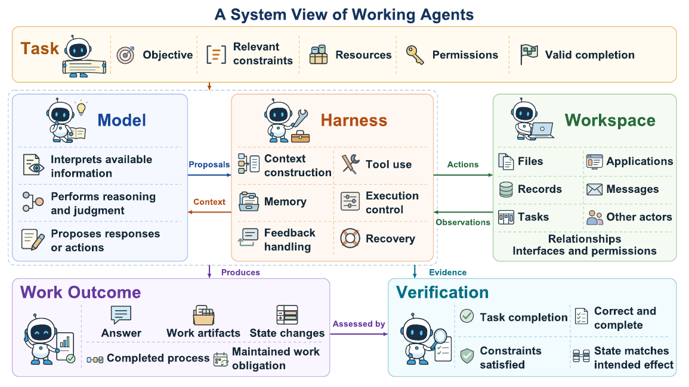

# Awesome Working Agents

> Research on agents that turn goals into accepted digital work: answers, artifacts, application changes, workflows, and responsibilities that continue over time.

A curated reading list accompanying **Working Agents: Systems, Capabilities, and Optimization**. The collection connects office productivity, enterprise operations, software engineering, scientific research, computer use, and the systems that make delegated work reliable.

**530 research papers and foundational studies** · **50 non-paper resources** · Updated **2026-10-18**

[Start Here](#start-here) · [Survey Perspective](#survey-perspective) · [Agents, Methods & Systems](#agents-methods--systems) · [Benchmarks & Evaluation](#benchmarks--evaluation) · [Surveys & Foundations](#surveys--foundations) · [Resources](#resources) · [Contributing](#contributing)

## Start Here

| Research question | Entry points |
| --- | --- |
| How do models become working systems? | [ReAct](https://arxiv.org/abs/2210.03629), [SWE-agent](https://arxiv.org/abs/2405.15793), [OpenHands](https://arxiv.org/abs/2407.16741) |
| How do agents create and edit native work products? | [SheetCopilot](https://arxiv.org/abs/2305.19308), [PPTAgent](https://arxiv.org/abs/2501.03936), [DeepPresenter](https://arxiv.org/abs/2602.22839) |
| How do agents work across tools and workspaces? | [AppWorld](https://arxiv.org/abs/2407.18901), [TheAgentCompany](https://arxiv.org/abs/2412.14161), [Workspace-Bench](https://arxiv.org/abs/2605.03596) |
| How are experience, models, and harnesses improved? | [Agent World Model](https://arxiv.org/abs/2602.10090), [SWE-Gym](https://arxiv.org/abs/2412.21139), [GEPA](https://arxiv.org/abs/2507.19457), [Co-Harness](https://arxiv.org/abs/2607.22688) |
| What evidence establishes successful work? | [OSWorld](https://arxiv.org/abs/2404.07972), [SpreadsheetBench](https://arxiv.org/abs/2406.14991), [GDPval](https://arxiv.org/abs/2510.04374) |
| How are state and experience maintained? | [SyncMind](https://arxiv.org/abs/2502.06994), [A-MEM](https://arxiv.org/abs/2502.12110), [Memory-R1](https://arxiv.org/abs/2508.19828) |

## Survey Perspective

A **working agent** uses a foundation model and a runtime **harness** to pursue an objective in a stateful workspace under task requirements, resources, permissions, and constraints. Its outcome may be an answer, an editable artifact, a business-state change, a completed process, or an obligation maintained over time. Verification connects that outcome to the requirements of the task.

<strong>Research map: work conditions, work forms, capabilities, optimization, and evaluation</strong>

**Two independent work conditions.** *Persistence* describes how long delegated responsibility remains open across feedback, stages, waiting periods, and events. *Openness* describes how much of the relevant work world must be discovered and updated during execution, including objects, dependencies, interfaces, permissions, and other actors. A short task can involve an unfamiliar workspace; a recurring duty can operate in a fixed environment.

**Five work forms.** These describe the scope and organization of delegated work. They are not a ranking of intelligence or autonomy, and a task can combine more than one form.

| Work form | What the agent is responsible for |
| --- | --- |
| Response-level | Produce an informational result grounded in the relevant evidence. |
| Atomic-action-level | Make and check a local change to a work object or application state. |
| Multi-step-level | Coordinate dependent actions and intermediate results toward an objective. |
| Workflow-level | Advance work through stages, procedural requirements, approvals, and handoffs. |
| Workspace-level | Discover related objects and maintain consistency across their dependencies, sources, and versions. |

**Capabilities.** Perception and understanding establish task-relevant objects and evidence; reasoning and decision making apply knowledge and constraints; planning and coordination organize dependencies and participants; execution and state management connect actions to committed effects; verification, recovery, and replanning check and repair the work. Workspace understanding is needed throughout this process.

**Optimization.** The survey follows experience through training environments, trajectory curation, and reward signals; model learning through supervised training, reinforcement learning, distillation, and self-improvement; harness improvements to tools, interfaces, prompts, workflows, memory, and skills; and coupled updates to models and harnesses. Updating a harness designer and updating the downstream executor are different interventions.

**Evaluation.** Read results through the chain **requested work → observable evidence → judgment procedure → reported metric**. Answers, native artifacts, application state, and workflow traces expose different properties. Reported success depends on the model, harness, environment, verifier, and budget used. Acceptance, repeated-run reliability, cost, human review effort, and downstream usefulness answer different questions.

**Frontiers.** The current manuscript examines realistic and evolving work environments; memory, initiative, and adaptation under persistent responsibilities; acceptance and return on delegation; and two interacting loops that deliver current work and improve future capability.

The manuscript organizes these topics as **§2 Foundation**, **§3 Work Forms**, **§4 Optimization**, **§5 Evaluation and Resources**, and **§6 Frontiers**. The public lists below use three broad paper groups; the *Focus* column helps readers find a work domain without reproducing every manuscript subsection.

**How to read the lists.** Each research work appears once in the three paper tables. *First year* records the first confirmed public release available to this collection, which can precede a conference or journal year. **Publication** links identify located formal versions; **Accepted** links identify acceptance evidence. A paper link alone makes no publication-status claim. Resources and product documentation are listed separately. The collection includes supporting studies on understanding, judging, safety, and work impact as well as end-to-end agents.

## Agents, Methods & Systems

Agents, learning methods, and runtime systems for producing work outcomes and improving reliability. **272 entries.**

| Paper | First year | Focus | Links |
| --- | --- | --- | --- |
| **ActiveSaddler**: Automated Curriculum Learning for Agent Harness Optimization | 2026 | Learning & agent harnesses | [Paper](https://arxiv.org/abs/2610.00906) |
| **Adaptive Auto-Harness**: Sustained Self-Improvement for Agentic System Deployment on Open-Ended Task Streams | 2026 | Learning & agent harnesses | [Paper](https://arxiv.org/abs/2606.01770) · [Code](https://github.com/A-EVO-Lab/a-evolve/tree/release/adaptive-auto-harness) |
| **ADMIRE**: Adaptive Milestone Reward for GUI Agents | 2026 | Web, desktop & mobile | [Paper](https://arxiv.org/abs/2602.11524) |
| **AeSlides**: Incentivizing Aesthetic Layout in LLM-Based Slide Generation via Verifiable Rewards | 2026 | Spreadsheets, slides & documents | [Paper](https://arxiv.org/abs/2604.22840) · [Code](https://github.com/ympan0508/aeslides) |
| **AEvo**: Harnessing Agentic Evolution | 2026 | Learning & agent harnesses | [Paper](https://arxiv.org/abs/2605.13821) |
| **Agent Lightning v1.0**: Towards Harnessed Agentic RL | 2026 | Learning & agent harnesses | [Paper](https://arxiv.org/abs/2608.17528) |
| **Agent World Model**: Infinity Synthetic Environments for Agentic Reinforcement Learning | 2026 | Tools & business workflows | [Paper](https://arxiv.org/abs/2602.10090) · [Code](https://github.com/Snowflake-Labs/agent-world-model) · [Publication](https://proceedings.mlr.press/v306/wang26jh.html) |
| **AgentMercury**: Your Agent Can Synthesize Verifiable Environments for Business Scenarios at scale | 2026 | Tools & business workflows | [Paper](https://arxiv.org/abs/2608.20634) · [Data](https://huggingface.co/datasets/Minbyul/AgentMercury-corpus-sample) |
| **Anchor**: Mitigating Artifact Drift in Agent Benchmark Generation | 2026 | Verification & recovery | [Paper](https://arxiv.org/abs/2605.26321) |
| **Atomix**: Timely, Transactional Tool Use for Reliable Agentic Workflows | 2026 | Verification & recovery | [Paper](https://arxiv.org/abs/2602.14849) · [Code](https://github.com/mpi-dsg/atomix) |
| **AutoDesign**: Meta-Harness Optimization for Long-Horizon Agentic Design | 2026 | Spreadsheets, slides & documents | [Paper](https://arxiv.org/abs/2608.13560) · [Code](https://github.com/Yaxin9Luo/AutoDesign) |
| **AutoRPA**: Efficient GUI Automation through LLM-Driven Code Synthesis from Interactions | 2026 | Learning & agent harnesses | [Paper](https://arxiv.org/abs/2605.21082) |
| **C-World**: A Computer Use Agent Environment Creator | 2026 | Learning & agent harnesses | [Paper](https://arxiv.org/abs/2601.06328v2) · [Code](https://github.com/Ziqiao-git/ToolGym) |
| **ChronoMem**: Version Control and Semantic Rollback for Large Language Model Agent Memory | 2026 | Memory & persistent work | [Paper](https://arxiv.org/abs/2607.27773) |
| **Co-Harness**: Co-Evolving Harnesses and Model Weights for LLM Agents | 2026 | Learning & agent harnesses | [Paper](https://arxiv.org/abs/2607.22688) |
| **CODESKILL**: Learning Self-Evolving Skills for Coding Agents | 2026 | Software, data & research | [Paper](https://arxiv.org/abs/2605.25430) |
| **CogEvol**: Towards Efficient and Reliable Learning Environment Generation | 2026 | Spreadsheets, slides & documents | [Paper](https://arxiv.org/abs/2608.30968) · [Code](https://github.com/CogEvol/CogEvol-4B) |
| **Component Routing**: Not All Experience Belongs in the Weights: Component Routing for Self-Improving GUI Agents | 2026 | Web, desktop & mobile | [Paper](https://arxiv.org/abs/2610.01787) |
| **CorpGen**: Simulating Corporate Environments with Autonomous Digital Employees in Multi-Horizon Task Environments | 2026 | Memory & persistent work | [Paper](https://arxiv.org/abs/2602.14229) |
| **CurateEvo**: Data-Curation Evolving for Agentic Post-Training | 2026 | Learning & agent harnesses | [Paper](https://arxiv.org/abs/2607.06140) |
| **daVinci-Dev**: Agent-native Mid-training for Software Engineering | 2026 | Software, data & research | [Paper](https://arxiv.org/abs/2601.18418) · [Code](https://github.com/GAIR-NLP/daVinci-Dev) |
| **daVinci-Env / OpenSWE**: daVinci-Env: Open SWE Environment Synthesis at Scale | 2026 | Software, data & research | [Paper](https://arxiv.org/abs/2603.13023) · [Code](https://github.com/GAIR-NLP/OpenSWE) |
| **DeepPresenter**: Environment-Grounded Reflection for Agentic Presentation Generation | 2026 | Spreadsheets, slides & documents | [Paper](https://arxiv.org/abs/2602.22839) · [Code](https://github.com/icip-cas/PPTAgent) · [Publication](https://aclanthology.org/2026.findings-acl.1578/) |
| **DMRL**: Document-Mediated Reinforcement Learning for Skill Optimization in Advertising Recommendation | 2026 | Tools & business workflows | [Paper](https://arxiv.org/abs/2609.02170) |
| **DSec**: DeepSeek Elastic Compute (DSec): A Sandbox Infrastructure for Effective Agentic Training at Scale | 2026 | Learning & agent harnesses | [Paper](https://arxiv.org/abs/2609.22978) |
| **EnterpriseLab**: A Full-Stack Platform for developing and deploying agents in Enterprises | 2026 | Tools & business workflows | [Paper](https://arxiv.org/abs/2603.21630) |
| **EnterpriseOps-Gym**: Environments and Evaluations for Stateful Agentic Planning and Tool Use in Enterprise Settings | 2026 | Tools & business workflows | [Paper](https://arxiv.org/abs/2603.13594) |
| **EnvCraft**: Synthesizing Executable Environments in Agentic RL for Claw-like Agent | 2026 | Workspaces & occupational work | [Paper](https://arxiv.org/abs/2609.05576) · [Code](https://github.com/zeng-yirong/EnvCraft) · [Data](https://huggingface.co/datasets/EnvCraft/EnvCraft-Data) |
| **EnvScaler**: Scaling Tool-Interactive Environments for LLM Agent via Programmatic Synthesis | 2026 | Tools & business workflows | [Paper](https://arxiv.org/abs/2601.05808) · [Code](https://github.com/RUC-NLPIR/EnvScaler) |
| **FST**: Learning, Fast and Slow: Towards LLMs That Adapt Continually | 2026 | Learning & agent harnesses | [Paper](https://arxiv.org/abs/2605.12484) |
| **Function-Aware FIM**: Function-Aware Fill-in-the-Middle as Mid-Training for Coding Agent Foundation Models | 2026 | Software, data & research | [Paper](https://arxiv.org/abs/2607.12463) · [Code](https://github.com/TIGER-AI-Lab/FIM-Midtraining) |
| **GHD / The Next Screenshot Knows**: The Next Screenshot Knows: Gated Hindsight Distillation for Mobile GUI Agents | 2026 | Web, desktop & mobile | [Paper](https://arxiv.org/abs/2608.06065) |
| **GraphForge**: Training Working Agents with Graph-Anchored Workspace Synthesis | 2026 | Workspaces & occupational work | [Paper](https://arxiv.org/abs/2609.38923) · [Data](https://huggingface.co/datasets/groundhogLLM/GraphForge-SFT-2169-clean) |
| **Guided-OPD**: On-Policy Distillation with Curriculum Turn-level Guidance for Multi-turn Agents | 2026 | Learning & agent harnesses | [Paper](https://arxiv.org/abs/2606.15912) · [Code](https://github.com/Zzzz-166/Guided-OPD) |
| **HiPER**: Hierarchical Reinforcement Learning with Explicit Credit Assignment for Large Language Model Agents | 2026 | Learning & agent harnesses | [Paper](https://arxiv.org/abs/2602.16165) · [Code](https://github.com/JonP07/HiPER-agent) · [Publication](https://proceedings.mlr.press/v306/peng26h.html) |
| **InfiAgent**: An Infinite-Horizon Framework for General-Purpose Autonomous Agents | 2026 | Memory & persistent work | [Paper](https://arxiv.org/abs/2601.03204) · [Code](https://github.com/ChenglinPoly/infiAgent) |
| **JIT-Agent**: Scaling Harness Intelligence via Just-in-Time Harness Evolution | 2026 | Learning & agent harnesses | [Paper](https://arxiv.org/abs/2608.25593) · [Code](https://github.com/bingreeky/JIT) |
| **JTPRO**: A Joint Tool-Prompt Reflective Optimization Framework for Language Agents | 2026 | Learning & agent harnesses | [Paper](https://arxiv.org/abs/2604.19821) · [Publication](https://aclanthology.org/2026.findings-acl.2017/) |
| **LiteGUI**: Lightweight GUI Agents via Multi-Solution Guided Distillation and Dual-Level Reinforcement Learning | 2026 | Web, desktop & mobile | [Paper](https://arxiv.org/abs/2605.07505) |
| **MESH-Harness**: Self-Improving Agent Harnesses via Bandit-Guided Compositional Evolution | 2026 | Learning & agent harnesses | [Paper](https://arxiv.org/abs/2610.05300) |
| **Meta-Harness**: End-to-End Optimization of Model Harnesses | 2026 | Learning & agent harnesses | [Paper](https://arxiv.org/abs/2603.28052) · [Code](https://github.com/stanford-iris-lab/meta-harness-tbench2-artifact) |
| **MiLDEdit / MiLDEAgent**: MiLDEdit: Reasoning-Based Multi-Layer Design Document Editing | 2026 | Spreadsheets, slides & documents | [Paper](https://arxiv.org/abs/2601.04589) |
| **NexForge**: Scaling Agent Capabilities through Requirement-Driven Task Synthesis for LLMs | 2026 | Workspaces & occupational work | [Paper](https://arxiv.org/abs/2607.14186) |
| **OmegaUse**: Building a General-Purpose GUI Agent for Autonomous Task Execution | 2026 | Web, desktop & mobile | [Paper](https://arxiv.org/abs/2601.20380) |
| **On-Policy Distillation**: Rethinking On-Policy Distillation of Large Language Models: Phenomenology, Mechanism, and Recipe | 2026 | Memory & persistent work | [Paper](https://arxiv.org/abs/2604.13016) · [Code](https://github.com/thunlp/OPD) |
| **OpenAgent**: Can Agents Generalize to the Open World? Unveiling the Fragility of Static Training in Tool Use | 2026 | Tools & business workflows | [Paper](https://arxiv.org/abs/2607.01084) · [Code](https://github.com/LAMDA-NeSy/OpenAgent) |
| **OpenThoughts-Agent**: Data Recipes for Agentic Models | 2026 | Learning & agent harnesses | [Paper](https://arxiv.org/abs/2606.24855) · [Code](https://github.com/open-thoughts/OpenThoughts-Agent) |
| **PAST-Bench / Hermes+**: PAST-Bench: Benchmarking the Foundations of Recursive Self-Improvement in Personal Agents | 2026 | Memory & persistent work | [Paper](https://arxiv.org/abs/2608.04003) · [Code](https://github.com/Gen-Verse/PAST-Bench) |
| **PRISM / Beyond Prompts**: Beyond Prompts: Measuring and Optimizing LLM Tool-Agent Harnesses | 2026 | Learning & agent harnesses | [Paper](https://arxiv.org/abs/2609.05736) · [Code](https://github.com/airbnb/agent-harness-optimizer) |
| **RADAR**: Automating Low-Risk Code Review at Meta: RADAR, Risk Calibration, and Review Efficiency | 2026 | Verification & recovery | [Paper](https://arxiv.org/abs/2605.30208) |
| **RePro**: Retrospective Progress-Aware Self-Refinement for LLM Agent Training | 2026 | Learning & agent harnesses | [Paper](https://arxiv.org/abs/2606.14302) |
| **Revisiting DAgger** in the Era of LLM-Agents | 2026 | Learning & agent harnesses | [Paper](https://arxiv.org/abs/2605.12913) |
| **RHO**: Evolving Agents in the Dark: Retrospective Harness Optimization via Self-Preference | 2026 | Learning & agent harnesses | [Paper](https://arxiv.org/abs/2606.05922) · [Code](https://github.com/wbopan/retro-harness) |
| **Rollback-Induced Reflection**: Rollback the World, Keep the Reflection: Rollback-Induced Reflection for Long-Horizon LLM Agents | 2026 | Verification & recovery | [Paper](https://arxiv.org/abs/2609.18304) |
| **SDPO**: Reinforcement Learning via Self-Distillation | 2026 | Learning & agent harnesses | [Paper](https://arxiv.org/abs/2601.20802) · [Code](https://github.com/lasgroup/SDPO) · [Publication](https://proceedings.mlr.press/v306/hubotter26a.html) |
| **SEE**: Structure-aware Exploring & Exploiting for Long-horizon GUI Agent Trajectory Synthesis | 2026 | Web, desktop & mobile | [Paper](https://arxiv.org/abs/2607.18046) · [Code](https://github.com/Zhh-Fan/SEE-Structure-aware-Exploring-Exploiting-for-Long-horizon-GUI-Agent-Trajectory-Synthesis) |
| **Self-Healing Orchestrators**: Self-Healing Agentic Orchestrators for Reliable Tool-Augmented Large Language Model Systems | 2026 | Verification & recovery | [Paper](https://arxiv.org/abs/2606.01416) |
| **SIA**: Self Improving AI with Harness & Weight Updates | 2026 | Learning & agent harnesses | [Paper](https://arxiv.org/abs/2605.27276) |
| **Skill-Alpha**: Progressive Agent Skill Generation via Reinforcement Learning | 2026 | Learning & agent harnesses | [Paper](https://arxiv.org/abs/2608.01678) · [Code](https://github.com/ejhshen/skill-alpha) |
| **Skill-SD**: Skill-Conditioned Self-Distillation for Multi-turn LLM Agents | 2026 | Learning & agent harnesses | [Paper](https://arxiv.org/abs/2604.10674) |
| **Skill2Env**: Capability-Oriented Environment Synthesis from Skills for General Agents | 2026 | Workspaces & occupational work | [Paper](https://arxiv.org/abs/2609.33772) · [Code](https://github.com/AllSpark-Research/AgentEnv) |
| **SkillOpt**: Executive Strategy for Self-Evolving Agent Skills | 2026 | Learning & agent harnesses | [Paper](https://arxiv.org/abs/2605.23904) |
| **SkillOS**: Learning Skill Curation for Self-Evolving Agents | 2026 | Learning & agent harnesses | [Paper](https://arxiv.org/abs/2605.06614) |
| **SkillRL**: Evolving Agents via Recursive Skill-Augmented Reinforcement Learning | 2026 | Learning & agent harnesses | [Paper](https://arxiv.org/abs/2602.08234) · [Code](https://github.com/aiming-lab/SkillRL) |
| **SkillSmith**: Co-Evolving Skills and Tools for Self-Improving Agent Systems | 2026 | Learning & agent harnesses | [Paper](https://arxiv.org/abs/2606.01314) |
| **SlideRL / Learning to Present**: Learning to Present: Inverse Specification Rewards for Agentic Slide Generation | 2026 | Spreadsheets, slides & documents | [Paper](https://arxiv.org/abs/2603.16839) · [Code](https://github.com/pushing-the-frontier/slide-forge-llm) · [Data](https://huggingface.co/datasets/KarthikRagunathAnandaKumar/sliderl-multi-turn-rollouts) |
| **SMITH**: Joint Optimization of Tool Creation and Use for Large Language Model Agents | 2026 | Learning & agent harnesses | [Paper](https://arxiv.org/abs/2608.24571) · [Code](https://github.com/appier-research/smith) |
| **Socratic-SWE**: Self-Evolving Coding Agents via Trace-Derived Agent Skills | 2026 | Software, data & research | [Paper](https://arxiv.org/abs/2606.07412) |
| **SOD**: Step-wise On-policy Distillation for Small Language Model Agents | 2026 | Learning & agent harnesses | [Paper](https://arxiv.org/abs/2605.07725) · [Code](https://github.com/YoungZ365/SOD) |
| **Spreadsheet-RL**: Advancing Large Language Model Agents on Realistic Spreadsheet Tasks via Reinforcement Learning | 2026 | Spreadsheets, slides & documents | [Paper](https://arxiv.org/abs/2605.22642) · [Code](https://github.com/Spreadsheet-RL/Spreadsheet-RL) · [Data](https://huggingface.co/datasets/Spreadsheet-RL/Spreadsheet-RL) |
| **SpreadsheetAgent**: Towards Robust Real-World Spreadsheet Understanding with Multi-Agent Multi-Format Reasoning | 2026 | Reasoning, evidence & work impact | [Paper](https://arxiv.org/abs/2604.12282) · [Code](https://github.com/renhouxing/SpreadsheetAgent) · [Publication](https://aclanthology.org/2026.acl-long.86/) |
| **SRD**: Self-Retrospection Distillation: Turning Post-hoc Experiences into Prior Foresight | 2026 | Learning & agent harnesses | [Paper](https://arxiv.org/abs/2610.08077) · [Code](https://github.com/SalesforceAIResearch/SRD) |
| **StagedWorkspace**: A Versioned Workspace for Knowledge-Work Agents | 2026 | Workspaces & occupational work | [Paper](https://arxiv.org/abs/2608.18050) |
| **StateGuard**: Analytical-State Management with Validity-Aware Intervention for Long-Horizon Data Agents | 2026 | Memory & persistent work | [Paper](https://arxiv.org/abs/2609.34134) |
| **TACO**: A Self-Evolving Framework for Efficient Terminal Agents via Observational Context Compression | 2026 | Learning & agent harnesses | [Paper](https://arxiv.org/abs/2604.19572) · [Code](https://github.com/multimodal-art-projection/TACO) |
| **TCOD**: Exploring Temporal Curriculum in On-Policy Distillation for Multi-turn Autonomous Agents | 2026 | Learning & agent harnesses | [Paper](https://arxiv.org/abs/2604.24005) · [Code](https://github.com/kokolerk/TCOD) |
| **TDScaling**: Beyond Quantity: Trajectory Diversity Scaling for Code Agents | 2026 | Tools & business workflows | [Paper](https://arxiv.org/abs/2602.03219) |
| **Tool Description Rewriter**: Learning to Rewrite Tool Descriptions for Reliable LLM-Agent Tool Use | 2026 | Learning & agent harnesses | [Paper](https://arxiv.org/abs/2602.20426) |
| **Trace2Skill (Office)**: Trace2Skill: Distill Trajectory-Local Lessons into Transferable Agent Skills | 2026 | Learning & agent harnesses | [Paper](https://arxiv.org/abs/2603.25158) · [Code](https://github.com/Qwen-Applications/Trace2Skill) |
| **TrajLong**: Co-Designing Agentic and Long-Context Supervision for Mid-Training | 2026 | Learning & agent harnesses | [Paper](https://arxiv.org/abs/2610.04973) |
| **UI-Copilot**: Advancing Long-Horizon GUI Automation via Tool-Integrated Policy Optimization | 2026 | Web, desktop & mobile | [Paper](https://arxiv.org/abs/2604.13822) |
| **UI-Mate**: Advancing Open-Weight Foundation GUI Agents with In-Context Demonstrations | 2026 | Web, desktop & mobile | [Paper](https://arxiv.org/abs/2608.15930) |
| **UI-Mem**: Self-Evolving Experience Memory for Online Reinforcement Learning in Mobile GUI Agents | 2026 | Web, desktop & mobile | [Paper](https://arxiv.org/abs/2602.05832) |
| **VERA**: Scaling Verifiable Environments for Agentic co-Evolution | 2026 | Verification & recovery | [Paper](https://arxiv.org/abs/2610.05923) · [Code](https://github.com/AutoMedBench/VERA) |
| **Verified Tool Calls** Improve LLM Agent Reliability Under Non-Atomic Failures | 2026 | Verification & recovery | [Paper](https://arxiv.org/abs/2608.02645) |
| **VERSE**: Verified Self-Evolving Optimizer for Agent Harnesses | 2026 | Learning & agent harnesses | [Paper](https://arxiv.org/abs/2610.02616) · [Code](https://github.com/wzekai/VERSE) |
| **Who Verifies the Verifier?** Co-Evolving Inspectable Graders with Self-Improving Agents | 2026 | Verification & recovery | [Paper](https://arxiv.org/abs/2610.11464) |
| **WorkGenesis**: Building the Worlds That Teach Agents to Work | 2026 | Workspaces & occupational work | [Paper](https://arxiv.org/abs/2609.39325) |
| **Workspace Optimization / DreamTeam**: Workspace Optimization: How to Train Your Agent | 2026 | Learning & agent harnesses | [Paper](https://arxiv.org/abs/2605.09650) |
| **A-MEM**: Agentic Memory for LLM Agents | 2025 | Memory & persistent work | [Paper](https://arxiv.org/abs/2502.12110) |
| **ACE**: Agentic Context Engineering: Evolving Contexts for Self-Improving Language Models | 2025 | Learning & agent harnesses | [Paper](https://arxiv.org/abs/2510.04618) · [Code](https://github.com/ace-agent/ace) · [Publication](https://openreview.net/pdf?id=eC4ygDs02R) |
| **Agent Lightning**: Train ANY AI Agents with Reinforcement Learning | 2025 | Learning & agent harnesses | [Paper](https://arxiv.org/abs/2508.03680) · [Code](https://github.com/microsoft/agent-lightning) |
| **Agent S2**: A Compositional Generalist-Specialist Framework for Computer Use Agents | 2025 | Web, desktop & mobile | [Paper](https://arxiv.org/abs/2504.00906) · [Code](https://github.com/simular-ai/Agent-S) |
| **Agent-R1**: A Unified and Modular Framework for Agentic Reinforcement Learning | 2025 | Learning & agent harnesses | [Paper](https://arxiv.org/abs/2511.14460) · [Code](https://github.com/AgentR1/Agent-R1) |
| **AgentDebug**: Where LLM Agents Fail and How They can Learn From Failures | 2025 | Verification & recovery | [Paper](https://arxiv.org/abs/2509.25370) · [Code](https://github.com/ulab-uiuc/AgentDebug) |
| **AgentGym-RL**: An Open-Source Framework to Train LLM Agents for Long-Horizon Decision Making via Multi-Turn RL | 2025 | Learning & agent harnesses | [Paper](https://arxiv.org/abs/2509.08755) · [Code](https://github.com/woooodyy/AgentGym-RL) · [Publication](https://openreview.net/pdf/d8e15fc2cabf98ead8ffbe0d8e6ad1b2764a3d28.pdf) |
| **Authenticated Delegation** and Authorized AI Agents | 2025 | Safety & authorization | [Paper](https://arxiv.org/abs/2501.09674) |
| **AutoPresent / SlidesBench**: AutoPresent: Designing Structured Visuals from Scratch | 2025 | Spreadsheets, slides & documents | [Paper](https://arxiv.org/abs/2501.00912) · [Code](https://github.com/para-lost/AutoPresent) · [Publication](https://openaccess.thecvf.com/content/CVPR2025/html/Ge_AutoPresent_Designing_Structured_Visuals_from_Scratch_CVPR_2025_paper.html) |
| **CoAct-1**: Computer-using Multi-Agent System with Coding Actions | 2025 | Learning & agent harnesses | [Paper](https://arxiv.org/abs/2508.03923) · [Code](https://github.com/SalesforceAIResearch/CoAct-1) |
| **ComputerRL**: Scaling End-to-End Online Reinforcement Learning for Computer Use Agents | 2025 | Web, desktop & mobile | [Paper](https://arxiv.org/abs/2508.14040) |
| **DART-GUI**: Efficient Multi-turn RL for GUI Agents via Decoupled Training and Adaptive Data Curation | 2025 | Learning & agent harnesses | [Paper](https://arxiv.org/abs/2509.23866) |
| **DGAP**: Discriminator-Guided Embodied Planning for LLM Agent | 2025 | Reasoning, evidence & work impact | [Paper](https://proceedings.iclr.cc/paper_files/paper/2025/hash/e6f2b968c4ee8ba260cd7077e39590dd-Abstract-Conference.html) |
| **Docling Toolkit**: Docling: An Efficient Open-Source Toolkit for AI-driven Document Conversion | 2025 | Tools & business workflows | [Paper](https://arxiv.org/abs/2501.17887) |
| **EnterpriseBench**: Can LLMs Help You at Work? A Sandbox for Evaluating LLM Agents in Enterprise Environments | 2025 | Tools & business workflows | [Paper](https://aclanthology.org/2025.emnlp-main.466/) |
| **GEPA**: Reflective Prompt Evolution Can Outperform Reinforcement Learning | 2025 | Learning & agent harnesses | [Paper](https://arxiv.org/abs/2507.19457) · [Code](https://github.com/gepa-ai/gepa) · [Publication](https://proceedings.iclr.cc/paper_files/paper/2026/hash/0e9e708b6f48e14fd0ac29e167413f76-Abstract-Conference.html) |
| **GoalAct**: Enhancing LLM-Based Agents via Global Planning and Hierarchical Execution | 2025 | Reasoning, evidence & work impact | [Paper](https://arxiv.org/abs/2504.16563) |
| **GUI-Actor**: Coordinate-Free Visual Grounding for GUI Agents | 2025 | Web, desktop & mobile | [Paper](https://arxiv.org/abs/2506.03143) · [Code](https://github.com/microsoft/GUI-Actor) · [Publication](https://proceedings.neurips.cc/paper_files/paper/2025/hash/16130af940e9dabb43c726119bd3b42e-Abstract-Conference.html) |
| **HiAgent**: Hierarchical Working Memory Management for Solving Long-Horizon Agent Tasks with Large Language Model | 2025 | Reasoning, evidence & work impact | [Paper](https://aclanthology.org/2025.acl-long.1575/) |
| **Human Digital Twin Architecture**: A Human Digital Twin Architecture for Knowledge-based Interactions and Context-Aware Conversations | 2025 | Memory & persistent work | [Paper](https://arxiv.org/abs/2504.03147) |
| **LocAgent**: Graph-Guided LLM Agents for Code Localization | 2025 | Software, data & research | [Paper](https://arxiv.org/abs/2503.09089) · [Publication](https://aclanthology.org/2025.acl-long.426/) |
| **MAP**: A brain-inspired agentic architecture to improve planning with LLMs | 2025 | Reasoning, evidence & work impact | [Paper](https://www.nature.com/articles/s41467-025-63804-5) |
| **Mem0**: Building Production-Ready AI Agents with Scalable Long-Term Memory | 2025 | Memory & persistent work | [Paper](https://arxiv.org/abs/2504.19413) · [Code](https://github.com/mem0ai/mem0) |
| **Memory-R1**: Enhancing Large Language Model Agents to Manage and Utilize Memories via Reinforcement Learning | 2025 | Memory & persistent work | [Paper](https://arxiv.org/abs/2508.19828) |
| **MLGym**: A New Framework and Benchmark for Advancing AI Research Agents | 2025 | Software, data & research | [Paper](https://arxiv.org/abs/2502.14499) · [Code](https://github.com/facebookresearch/MLGym) |
| **Optimas**: Optimizing Compound AI Systems with Globally Aligned Local Rewards | 2025 | Learning & agent harnesses | [Paper](https://arxiv.org/abs/2507.03041) · [Publication](https://proceedings.iclr.cc/paper_files/paper/2026/hash/f21a5fedfbcb55406ddaf51cf90d494a-Abstract-Conference.html) |
| **Plan-and-Act**: Improving Planning of Agents for Long-Horizon Tasks | 2025 | Reasoning, evidence & work impact | [Paper](https://arxiv.org/abs/2503.09572) |
| **PosterGen**: Aesthetic-Aware Multi-Modal Paper-to-Poster Generation via Multi-Agent LLMs | 2025 | Spreadsheets, slides & documents | [Paper](https://arxiv.org/abs/2508.17188) |
| **PPTAgent**: Generating and Evaluating Presentations Beyond Text-to-Slides | 2025 | Spreadsheets, slides & documents | [Paper](https://arxiv.org/abs/2501.03936) · [Code](https://github.com/icip-cas/PPTAgent) · [Publication](https://aclanthology.org/2025.emnlp-main.728/) |
| **PPTArena**: A Benchmark for PowerPoint Editing | 2025 | Spreadsheets, slides & documents | [Paper](https://arxiv.org/abs/2512.03042) · [Code](https://github.com/michaelofengend/PPTArena) |
| **PreGenie**: An Agentic Framework for High-quality Visual Presentation Generation | 2025 | Spreadsheets, slides & documents | [Paper](https://arxiv.org/abs/2505.21660) · [Publication](https://aclanthology.org/2025.findings-emnlp.165/) |
| **Process Reward Models That Think** | 2025 | Verification & recovery | [Paper](https://arxiv.org/abs/2504.16828) |
| **Provider Digital Twins**: Developing provider digital twins for personalized provider-patient communication via a RAG-based conversational framework | 2025 | Memory & persistent work | [Paper](https://pmc.ncbi.nlm.nih.gov/articles/PMC12809031/) |
| **R1-Searcher**: Incentivizing the Search Capability in LLMs via Reinforcement Learning | 2025 | Learning & agent harnesses | [Paper](https://arxiv.org/abs/2503.05592) · [Code](https://github.com/RUCAIBox/R1-Searcher) |
| **R2E-Gym**: Procedural Environments and Hybrid Verifiers for Scaling Open-Weights SWE Agents | 2025 | Software, data & research | [Paper](https://arxiv.org/abs/2504.07164) · [Publication](https://openreview.net/pdf?id=7evvwwdo3z) |
| **ReasoningBank**: Scaling Agent Self-Evolving with Reasoning Memory | 2025 | Learning & agent harnesses | [Paper](https://arxiv.org/abs/2509.25140) · [Code](https://github.com/google-research/reasoning-bank) · [Publication](https://openreview.net/pdf/25563ee680c408f3ad91eab8c7b4ec9ab05b7193.pdf) |
| **ReTool**: Reinforcement Learning for Strategic Tool Use in LLMs | 2025 | Tools & business workflows | [Paper](https://arxiv.org/abs/2504.11536) · [Publication](https://proceedings.iclr.cc/paper_files/paper/2026/hash/4038c9208dfc22644c60ad39c24e5c53-Abstract-Conference.html) |
| **Routine**: A Structural Planning Framework for LLM Agent System in Enterprise | 2025 | Tools & business workflows | [Paper](https://arxiv.org/abs/2507.14447) |
| **SagaLLM**: Context Management, Validation, and Transaction Guarantees for Multi-Agent LLM Planning | 2025 | Memory & persistent work | [Paper](https://arxiv.org/abs/2503.11951) |
| **Search-R1**: Training LLMs to Reason and Leverage Search Engines with Reinforcement Learning | 2025 | Learning & agent harnesses | [Paper](https://arxiv.org/abs/2503.09516) · [Code](https://github.com/PeterGriffinJin/Search-R1) · [Publication](https://openreview.net/pdf?id=Rwhi91ideu) |
| **SheetMind**: Actions Set Accuracy, Agents Set the Failure Mode | 2025 | Spreadsheets, slides & documents | [Paper](https://arxiv.org/abs/2506.12339) |
| **SlideTailor**: Personalized Presentation Slide Generation for Scientific Papers | 2025 | Spreadsheets, slides & documents | [Paper](https://arxiv.org/abs/2512.20292) |
| **SSR（Self-play SWE-RL）**: Toward Training Superintelligent Software Agents through Self-Play SWE-RL | 2025 | Learning & agent harnesses | [Paper](https://arxiv.org/abs/2512.18552) · [Publication](https://proceedings.mlr.press/v306/wei26x.html) |
| **SWE-RL**: Advancing LLM Reasoning via Reinforcement Learning on Open Software Evolution | 2025 | Learning & agent harnesses | [Paper](https://arxiv.org/abs/2502.18449) · [Code](https://github.com/facebookresearch/swe-rl) · [Publication](https://proceedings.nips.cc/paper_files/paper/2025/hash/7107d4d2e837bde2171c6b71b5bde954-Abstract-Conference.html) |
| **SWE-smith**: Scaling Data for Software Engineering Agents | 2025 | Learning & agent harnesses | [Paper](https://arxiv.org/abs/2504.21798) · [Publication](https://proceedings.neurips.cc/paper_files/paper/2025/hash/8b86cf5ace600c48fd188efbb8dedec8-Abstract-Datasets_and_Benchmarks_Track.html) |
| **SyncMind**: Measuring Agent Out-of-Sync Recovery in Collaborative Software Engineering | 2025 | Software, data & research | [Paper](https://arxiv.org/abs/2502.06994) · [Code](https://github.com/xhguo7/SyncMind) · [Data](https://huggingface.co/datasets/xuehang/SyncBench) |
| **Talk to Your Slides**: High-Efficiency Slide Editing via Language-Driven Structured Data Manipulation | 2025 | Spreadsheets, slides & documents | [Paper](https://arxiv.org/abs/2505.11604) |
| **Tool-to-Agent Retrieval**: Bridging Tools and Agents for Scalable LLM Multi-Agent Systems | 2025 | Tools & business workflows | [Paper](https://arxiv.org/abs/2511.01854) |
| **Toolathlon**: The Tool Decathlon: Benchmarking Language Agents for Diverse, Realistic, and Long-Horizon Task Execution | 2025 | Tools & business workflows | [Paper](https://arxiv.org/abs/2510.25726) · [Code](https://github.com/hkust-nlp/Toolathlon) |
| **ToolMaker**: LLM Agents Making Agent Tools | 2025 | Learning & agent harnesses | [Paper](https://aclanthology.org/2025.acl-long.1266/) |
| **ToRL**: Scaling Tool-Integrated RL | 2025 | Learning & agent harnesses | [Paper](https://arxiv.org/abs/2503.23383) · [Code](https://github.com/GAIR-NLP/ToRL) |
| **UFO2**: The Desktop AgentOS | 2025 | Web, desktop & mobile | [Paper](https://arxiv.org/abs/2504.14603) · [Code](https://github.com/microsoft/UFO/) |
| **UI-TARS**: Pioneering Automated GUI Interaction with Native Agents | 2025 | Web, desktop & mobile | [Paper](https://arxiv.org/abs/2501.12326) · [Code](https://github.com/bytedance/UI-TARS) |
| **UltraCUA**: A Foundation Model for Computer Use Agents with Hybrid Action | 2025 | Learning & agent harnesses | [Paper](https://arxiv.org/abs/2510.17790) |
| **WebAgent-R1**: Training Web Agents via End-to-End Multi-Turn Reinforcement Learning | 2025 | Learning & agent harnesses | [Paper](https://arxiv.org/abs/2505.16421) · [Code](https://github.com/weizhepei/WebAgent-R1) · [Publication](https://aclanthology.org/2025.emnlp-main.401/) |
| **WorkTeam**: Constructing Workflows from Natural Language with Multi-Agents | 2025 | Learning & agent harnesses | [Paper](https://arxiv.org/abs/2503.22473) · [Publication](https://aclanthology.org/2025.naacl-industry.3/) |
| **Zep**: A Temporal Knowledge Graph Architecture for Agent Memory | 2025 | Memory & persistent work | [Paper](https://arxiv.org/abs/2501.13956) · [Code](https://github.com/getzep/graphiti) |
| **ADAS**: Automated Design of Agentic Systems | 2024 | Learning & agent harnesses | [Paper](https://arxiv.org/abs/2408.08435) · [Code](https://github.com/ShengranHu/ADAS) · [Publication](https://proceedings.iclr.cc/paper_files/paper/2025/hash/36b7acf6f6010652b3f2a433774a66fe-Abstract-Conference.html) |
| **AFlow**: Automating Agentic Workflow Generation | 2024 | Learning & agent harnesses | [Paper](https://arxiv.org/abs/2410.10762) · [Code](https://github.com/FoundationAgents/AFlow) · [Publication](https://proceedings.iclr.cc/paper_files/paper/2025/hash/5492ecbce4439401798dcd2c90be94cd-Abstract-Conference.html) |
| **Agent Q**: Advanced Reasoning and Learning for Autonomous AI Agents | 2024 | Web, desktop & mobile | [Paper](https://arxiv.org/abs/2408.07199) |
| **Agent S**: An Open Agentic Framework that Uses Computers Like a Human | 2024 | Web, desktop & mobile | [Paper](https://arxiv.org/abs/2410.08164) · [Code](https://github.com/simular-ai/Agent-S) |
| **Agent-as-a-Judge**: Evaluate Agents with Agents | 2024 | Verification & recovery | [Paper](https://arxiv.org/abs/2410.10934) |
| **Agent-FLAN**: Designing Data and Methods of Effective Agent Tuning for Large Language Models | 2024 | Learning & agent harnesses | [Paper](https://arxiv.org/abs/2403.12881) · [Code](https://github.com/InternLM/Agent-FLAN) · [Publication](https://aclanthology.org/2024.findings-acl.557/) |
| **AgentBoard**: An Analytical Evaluation Board of Multi-turn LLM Agents | 2024 | Learning & agent harnesses | [Paper](https://arxiv.org/abs/2401.13178) |
| **AgentGen**: Enhancing Planning Abilities for Large Language Model based Agent via Environment and Task Generation | 2024 | Learning & agent harnesses | [Paper](https://arxiv.org/abs/2408.00764) · [Publication](https://doi.org/10.1145/3690624.3709321) |
| **AgentGym**: Evolving Large Language Model-based Agents across Diverse Environments | 2024 | Learning & agent harnesses | [Paper](https://arxiv.org/abs/2406.04151) · [Code](https://github.com/WooooDyy/AgentGym) |
| **AgentInstruct (Microsoft)**: AgentInstruct: Toward Generative Teaching with Agentic Flows | 2024 | Learning & agent harnesses | [Paper](https://arxiv.org/abs/2407.03502) |
| **Agentless**: Demystifying LLM-based Software Engineering Agents | 2024 | Software, data & research | [Paper](https://arxiv.org/abs/2407.01489) · [Code](https://github.com/OpenAutoCoder/Agentless) |
| **AgentOptimizer**: Offline Training of Language Model Agents with Functions as Learnable Weights | 2024 | Learning & agent harnesses | [Paper](https://arxiv.org/abs/2402.11359) · [Publication](https://proceedings.mlr.press/v235/zhang24cd.html) |
| **AgentSquare**: Automatic LLM Agent Search in Modular Design Space | 2024 | Learning & agent harnesses | [Paper](https://arxiv.org/abs/2410.06153) · [Code](https://github.com/tsinghua-fib-lab/AgentSquare) · [Publication](https://proceedings.iclr.cc/paper_files/paper/2025/hash/0ae94013da7cd459402fd77874e09ee3-Abstract-Conference.html) |
| **AgentTrek**: Agent Trajectory Synthesis via Guiding Replay with Web Tutorials | 2024 | Web, desktop & mobile | [Paper](https://arxiv.org/abs/2412.09605) |
| **AsyncLM**: Asynchronous LLM Function Calling | 2024 | Learning & agent harnesses | [Paper](https://arxiv.org/abs/2412.07017) |
| **AutoCodeRover**: Autonomous Program Improvement | 2024 | Software, data & research | [Paper](https://arxiv.org/abs/2404.05427) |
| **AWM**: Agent Workflow Memory | 2024 | Learning & agent harnesses | [Paper](https://arxiv.org/abs/2409.07429) · [Code](https://github.com/zorazrw/agent-workflow-memory) · [Publication](https://proceedings.mlr.press/v267/wang25bx.html) |
| **BetterTogether**: Fine-Tuning and Prompt Optimization: Two Great Steps that Work Better Together | 2024 | Learning & agent harnesses | [Paper](https://arxiv.org/abs/2407.10930) · [Publication](https://aclanthology.org/2024.emnlp-main.597/) |
| **BrowserGym**: The BrowserGym Ecosystem for Web Agent Research | 2024 | Learning & agent harnesses | [Paper](https://arxiv.org/abs/2412.05467) · [Code](https://github.com/ServiceNow/BrowserGym) |
| **Chain-of-Table**: Evolving Tables in the Reasoning Chain for Table Understanding | 2024 | Tools & business workflows | [Paper](https://arxiv.org/abs/2401.04398) |
| **CodeAct**: Executable Code Actions Elicit Better LLM Agents | 2024 | Tools & business workflows | [Paper](https://arxiv.org/abs/2402.01030) · [Code](https://github.com/xingyaoww/code-act) |
| **Collaborative Gym**: A Framework for Enabling and Evaluating Human-Agent Collaboration | 2024 | Workspaces & occupational work | [Paper](https://arxiv.org/abs/2412.15701) · [Code](https://github.com/SALT-NLP/collaborative-gym) |
| **ColPali / ViDoRe**: ColPali: Efficient Document Retrieval with Vision Language Models | 2024 | Reasoning, evidence & work impact | [Paper](https://arxiv.org/abs/2407.01449) · [Code](https://github.com/illuin-tech/colpali) |
| **Data Interpreter**: An LLM Agent For Data Science | 2024 | Software, data & research | [Paper](https://arxiv.org/abs/2402.18679) · [Code](https://github.com/geekan/MetaGPT) |
| **DesiGen**: A Pipeline for Controllable Design Template Generation | 2024 | Spreadsheets, slides & documents | [Paper](https://arxiv.org/abs/2403.09093) |
| **DigiRL**: Training In-The-Wild Device-Control Agents with Autonomous Reinforcement Learning | 2024 | Web, desktop & mobile | [Paper](https://arxiv.org/abs/2406.11896) · [Code](https://github.com/DigiRL-agent/digirl) · [Publication](https://papers.nips.cc/paper_files/paper/2024/file/1704ddd0bb89f159dfe609b32c889995-Paper-Conference.pdf) |
| **Docling** Technical Report | 2024 | Reasoning, evidence & work impact | [Paper](https://arxiv.org/abs/2408.09869) · [Code](https://github.com/DS4SD/docling) |
| **DocLLM**: A Layout-Aware Generative Language Model for Multimodal Document Understanding | 2024 | Reasoning, evidence & work impact | [Paper](https://aclanthology.org/2024.acl-long.463/) |
| **DynaSaur**: Large Language Agents Beyond Predefined Actions | 2024 | Learning & agent harnesses | [Paper](https://arxiv.org/abs/2411.01747) · [Code](https://github.com/adobe-research/dynasaur) · [Publication](https://openreview.net/pdf?id=lv0cJ2pWVd) |
| **Graph-enhanced Asynchronous Planning**: Graph-enhanced Large Language Models in Asynchronous Plan Reasoning | 2024 | Tools & business workflows | [Paper](https://arxiv.org/abs/2402.02805) |
| **M-LongDoc**: A Benchmark For Multimodal Super-Long Document Understanding And A Retrieval-Aware Tuning Framework | 2024 | Reasoning, evidence & work impact | [Paper](https://arxiv.org/abs/2411.06176) |
| **Magentic-One**: A Generalist Multi-Agent System for Solving Complex Tasks | 2024 | Learning & agent harnesses | [Paper](https://arxiv.org/abs/2411.04468) · [Code](https://github.com/microsoft/autogen) |
| **mEdIT**: Multilingual Text Editing via Instruction Tuning | 2024 | Learning & agent harnesses | [Paper](https://arxiv.org/abs/2402.16472) |
| **MinerU**: An Open-Source Solution for Precise Document Content Extraction | 2024 | Reasoning, evidence & work impact | [Paper](https://arxiv.org/abs/2409.18839) · [Code](https://github.com/opendatalab/MinerU) |
| **MIPRO**: Optimizing Instructions and Demonstrations for Multi-Stage Language Model Programs | 2024 | Learning & agent harnesses | [Paper](https://arxiv.org/abs/2406.11695) · [Publication](https://aclanthology.org/2024.emnlp-main.525/) |
| **mPLUG-DocOwl 1.5**: Unified Structure Learning for OCR-free Document Understanding | 2024 | Reasoning, evidence & work impact | [Paper](https://arxiv.org/abs/2403.12895) |
| **mPLUG-DocOwl2**: High-resolution Compressing for OCR-free Multi-page Document Understanding | 2024 | Reasoning, evidence & work impact | [Paper](https://arxiv.org/abs/2409.03420) · [Code](https://github.com/X-PLUG/mPLUG-DocOwl) |
| **NL2Formula**: Generating Spreadsheet Formulas from Natural Language Queries | 2024 | Spreadsheets, slides & documents | [Paper](https://aclanthology.org/2024.findings-eacl.158/) |
| **OmniParser** for Pure Vision Based GUI Agent | 2024 | Web, desktop & mobile | [Paper](https://arxiv.org/abs/2408.00203) |
| **OpenHands**: An Open Platform for AI Software Developers as Generalist Agents | 2024 | Learning & agent harnesses | [Paper](https://arxiv.org/abs/2407.16741) · [Code](https://github.com/OpenHands/OpenHands) |
| **OS-Copilot**: Towards Generalist Computer Agents with Self-Improvement | 2024 | Web, desktop & mobile | [Paper](https://arxiv.org/abs/2402.07456) |
| **Proactive Agent**: Shifting LLM Agents from Reactive Responses to Active Assistance | 2024 | Memory & persistent work | [Paper](https://arxiv.org/abs/2410.12361) · [Code](https://github.com/thunlp/ProactiveAgent) |
| **RepoGraph**: Enhancing AI Software Engineering with Repository-level Code Graph | 2024 | Software, data & research | [Paper](https://arxiv.org/abs/2410.14684) · [Publication](https://proceedings.iclr.cc/paper_files/paper/2025/file/4a4a3c197deac042461c677219efd36c-Paper-Conference.pdf) |
| **SeeClick**: Harnessing GUI Grounding for Advanced Visual GUI Agents | 2024 | Web, desktop & mobile | [Paper](https://aclanthology.org/2024.acl-long.505/) · [Code](https://github.com/njucckevin/SeeClick) |
| **SheetAgent**: Towards A Generalist Agent for Spreadsheet Reasoning and Manipulation via Large Language Models | 2024 | Spreadsheets, slides & documents | [Paper](https://arxiv.org/abs/2403.03636) · [Publication](https://doi.org/10.1145/3696410.3714962) |
| **ShowUI**: One Vision-Language-Action Model for GUI Visual Agent | 2024 | Web, desktop & mobile | [Paper](https://arxiv.org/abs/2411.17465) |
| **SpreadsheetLLM**: Encoding Spreadsheets for Large Language Models | 2024 | Reasoning, evidence & work impact | [Paper](https://arxiv.org/abs/2407.09025) |
| **SpreadsheetLLM**: Encoding Spreadsheets for Large Language Models | 2024 | Tools & business workflows | [Paper](https://aclanthology.org/2024.emnlp-main.1154/) |
| **STORM**: Assisting in Writing Wikipedia-like Articles From Scratch with Large Language Models | 2024 | Spreadsheets, slides & documents | [Paper](https://arxiv.org/abs/2402.14207) |
| **SWE-agent**: Agent-Computer Interfaces Enable Automated Software Engineering | 2024 | Software, data & research | [Paper](https://arxiv.org/abs/2405.15793) · [Publication](https://proceedings.neurips.cc/paper_files/paper/2024/hash/5a7c947568c1b1328ccc5230172e1e7c-Abstract-Conference.html) |
| **SWE-Gym**: Training Software Engineering Agents and Verifiers with SWE-Gym | 2024 | Software, data & research | [Paper](https://arxiv.org/abs/2412.21139) · [Code](https://github.com/SWE-Gym/SWE-Gym) · [Publication](https://proceedings.mlr.press/v267/pan25g.html) |
| **TableGPT2**: A Large Multimodal Model with Tabular Data Integration | 2024 | Learning & agent harnesses | [Paper](https://arxiv.org/abs/2411.02059) |
| **TableLlama**: Towards Open Large Generalist Models for Tables | 2024 | Learning & agent harnesses | [Paper](https://aclanthology.org/2024.naacl-long.335/) |
| **Text2Chart31**: Instruction Tuning for Chart Generation with Automatic Feedback | 2024 | Spreadsheets, slides & documents | [Paper](https://aclanthology.org/2024.emnlp-main.640/) |
| **TextGrad**: Optimizing generative AI by backpropagating language model feedback | 2024 | Learning & agent harnesses | [Paper](https://arxiv.org/abs/2406.07496) · [Code](https://github.com/zou-group/textgrad) · [Publication](https://www.nature.com/articles/s41586-025-08661-4) |
| **Trace** is the Next AutoDiff: Generative Optimization with Rich Feedback, Execution Traces, and LLMs | 2024 | Learning & agent harnesses | [Paper](https://arxiv.org/abs/2406.16218) · [Publication](https://papers.nips.cc/paper_files/paper/2024/hash/83ba7056bce2c3c3c27e17397cf3e1f0-Abstract-Conference.html) |
| **UFO**: A UI-Focused Agent for Windows OS Interaction | 2024 | Web, desktop & mobile | [Paper](https://arxiv.org/abs/2402.07939) · [Code](https://github.com/microsoft/UFO) |
| **UGround**: Navigating the Digital World as Humans Do: Universal Visual Grounding for GUI Agents | 2024 | Web, desktop & mobile | [Paper](https://arxiv.org/abs/2410.05243) · [Publication](https://proceedings.iclr.cc/paper_files/paper/2025/hash/4ca0e369689dadb25a5345ba9755ad6f-Abstract-Conference.html) |
| **WebRL**: Training LLM Web Agents via Self-Evolving Online Curriculum Reinforcement Learning | 2024 | Web, desktop & mobile | [Paper](https://arxiv.org/abs/2411.02337) · [Code](https://github.com/THUDM/WebRL) · [Publication](https://proceedings.iclr.cc/paper_files/paper/2025/hash/c66e1fcc9691aae706250638f36f681b-Abstract-Conference.html) |
| **WebVoyager**: Building an End-to-End Web Agent with Large Multimodal Models | 2024 | Web, desktop & mobile | [Paper](https://arxiv.org/abs/2401.13919) |
| **Windows Agent Arena**: Evaluating Multi-Modal OS Agents at Scale | 2024 | Web, desktop & mobile | [Paper](https://arxiv.org/abs/2409.08264) · [Code](https://github.com/microsoft/WindowsAgentArena) |
| **AgentTuning**: Enabling Generalized Agent Abilities for LLMs | 2023 | Learning & agent harnesses | [Paper](https://arxiv.org/abs/2310.12823) · [Code](https://github.com/THUDM/AgentTuning) · [Publication](https://aclanthology.org/2024.findings-acl.181/) |
| **Auto-Tables**: Synthesizing Multi-Step Transformations to Relationalize Tables without Using Examples | 2023 | Spreadsheets, slides & documents | [Paper](https://arxiv.org/abs/2307.14565) |
| **AutoGen**: Enabling Next-Gen LLM Applications via Multi-Agent Conversation | 2023 | Learning & agent harnesses | [Paper](https://arxiv.org/abs/2308.08155) · [Code](https://github.com/microsoft/autogen) |
| **BPO**: Black-Box Prompt Optimization: Aligning Large Language Models without Model Training | 2023 | Learning & agent harnesses | [Paper](https://arxiv.org/abs/2311.04155) · [Code](https://github.com/thu-coai/BPO) · [Publication](https://aclanthology.org/2024.acl-long.176/) |
| **CAMEL**: Communicative Agents for "Mind" Exploration of Large Language Model Society | 2023 | Learning & agent harnesses | [Paper](https://arxiv.org/abs/2303.17760) |
| **ChatDev**: Communicative Agents for Software Development | 2023 | Software, data & research | [Paper](https://arxiv.org/abs/2307.07924) |
| **CoEdIT**: Text Editing by Task-Specific Instruction Tuning | 2023 | Spreadsheets, slides & documents | [Paper](https://arxiv.org/abs/2305.09857) |
| **CogAgent**: A Visual Language Model for GUI Agents | 2023 | Web, desktop & mobile | [Paper](https://arxiv.org/abs/2312.08914) |
| **CRITIC**: Large Language Models Can Self-Correct with Tool-Interactive Critiquing | 2023 | Verification & recovery | [Paper](https://arxiv.org/abs/2305.11738) · [Code](https://github.com/microsoft/ProphetNet/tree/master/CRITIC) |
| **Data-Copilot**: Bridging Billions of Data and Humans with Autonomous Workflow | 2023 | Tools & business workflows | [Paper](https://arxiv.org/abs/2306.07209) |
| **Dater**: Large Language Models are Versatile Decomposers: Decompose Evidence and Questions for Table-based Reasoning | 2023 | Reasoning, evidence & work impact | [Paper](https://arxiv.org/abs/2301.13808) |
| **DSPy**: Compiling Declarative Language Model Calls into State-of-the-Art Pipelines | 2023 | Learning & agent harnesses | [Paper](https://arxiv.org/abs/2310.03714) · [Code](https://github.com/stanfordnlp/dspy) · [Publication](https://proceedings.iclr.cc/paper_files/paper/2024/hash/f1cf02ce09757f57c3b93c0db83181e0-Abstract-Conference.html) |
| **EvoPrompt**: Connecting Large Language Models with Evolutionary Algorithms Yields Powerful Prompt Optimizers | 2023 | Learning & agent harnesses | [Paper](https://arxiv.org/abs/2309.08532) · [Code](https://github.com/beeevita/EvoPrompt) · [Publication](https://proceedings.iclr.cc/paper_files/paper/2024/hash/9156b0f6dfa9bbd18c79cc459ef5d61c-Abstract-Conference.html) |
| **ExpeL**: LLM Agents Are Experiential Learners | 2023 | Memory & persistent work | [Paper](https://arxiv.org/abs/2308.10144) · [Code](https://github.com/LeapLabTHU/ExpeL) · [Publication](https://ojs.aaai.org/index.php/AAAI/article/download/29936/31635) |
| **FireAct**: Toward Language Agent Fine-tuning | 2023 | Tools & business workflows | [Paper](https://arxiv.org/abs/2310.05915) |
| **FormaT5**: Abstention and Examples for Conditional Table Formatting with Natural Language | 2023 | Spreadsheets, slides & documents | [Paper](https://arxiv.org/abs/2310.17306) |
| **G-Eval**: NLG Evaluation using GPT-4 with Better Human Alignment | 2023 | Verification & recovery | [Paper](https://arxiv.org/abs/2303.16634) |
| **Generative Agents**: Interactive Simulacra of Human Behavior | 2023 | Memory & persistent work | [Paper](https://arxiv.org/abs/2304.03442) |
| **GKD**: On-Policy Distillation of Language Models: Learning from Self-Generated Mistakes | 2023 | Learning & agent harnesses | [Paper](https://arxiv.org/abs/2306.13649) · [Publication](https://proceedings.iclr.cc/paper_files/paper/2024/hash/5be69a584901a26c521c2b51e40a4c20-Abstract-Conference.html) |
| **Gorilla**: Large Language Model Connected with Massive APIs | 2023 | Learning & agent harnesses | [Paper](https://arxiv.org/abs/2305.15334) |
| **Hi-VT5 / MP-DocVQA**: Hierarchical Multimodal Transformers for Multipage DocVQA | 2023 | Reasoning, evidence & work impact | [Paper](https://doi.org/10.1016/j.patcog.2023.109834) |
| **HuggingGPT**: Solving AI Tasks with ChatGPT and its Friends in Hugging Face | 2023 | Tools & business workflows | [Paper](https://arxiv.org/abs/2303.17580) · [Code](https://github.com/microsoft/JARVIS) |
| **LATS**: Language Agent Tree Search Unifies Reasoning Acting and Planning in Language Models | 2023 | Verification & recovery | [Paper](https://arxiv.org/abs/2310.04406) · [Code](https://github.com/andyz245/LanguageAgentTreeSearch) · [Publication](https://proceedings.mlr.press/v235/zhou24r.html) |
| **LayoutGPT**: Compositional Visual Planning and Generation with Large Language Models | 2023 | Reasoning, evidence & work impact | [Paper](https://arxiv.org/abs/2305.15393) · [Code](https://github.com/weixi-feng/LayoutGPT) |
| **LayoutPrompter**: TextDiffuser-2: Unleashing the Power of Language Models for Text Rendering | 2023 | Spreadsheets, slides & documents | [Paper](https://arxiv.org/abs/2311.16465) |
| **LLM+P**: Empowering Large Language Models with Optimal Planning Proficiency | 2023 | Tools & business workflows | [Paper](https://arxiv.org/abs/2304.11477) |
| **Medprompt**: Can Generalist Foundation Models Outcompete Special-Purpose Tuning? Case Study in Medicine | 2023 | Learning & agent harnesses | [Paper](https://arxiv.org/abs/2311.16452) |
| **MemGPT**: Towards LLMs as Operating Systems | 2023 | Memory & persistent work | [Paper](https://arxiv.org/abs/2310.08560) · [Code](https://github.com/letta-ai/letta) |
| **MetaGPT**: Meta Programming for A Multi-Agent Collaborative Framework | 2023 | Software, data & research | [Paper](https://arxiv.org/abs/2308.00352) · [Code](https://github.com/geekan/MetaGPT) |
| **mPLUG-DocOwl**: Modularized Multimodal Large Language Model for Document Understanding | 2023 | Reasoning, evidence & work impact | [Paper](https://arxiv.org/abs/2307.02499) |
| **MT-Bench / Chatbot Arena**: Judging LLM-as-a-Judge with MT-Bench and Chatbot Arena | 2023 | Verification & recovery | [Paper](https://arxiv.org/abs/2306.05685) · [Code](https://github.com/lm-sys/FastChat/tree/main/llm-judge) |
| **OPRO**: Large Language Models as Optimizers | 2023 | Learning & agent harnesses | [Paper](https://arxiv.org/abs/2309.03409) · [Code](https://github.com/google-deepmind/opro) · [Publication](https://proceedings.iclr.cc/paper_files/paper/2024/hash/3339f19c5fcee3ad74502947a32be9e6-Abstract-Conference.html) |
| **PAL**: Program-aided Language Models | 2023 | Tools & business workflows | [Paper](https://proceedings.mlr.press/v202/gao23f.html) |
| **PDFTriage**: Question Answering over Long, Structured Documents | 2023 | Reasoning, evidence & work impact | [Paper](https://arxiv.org/abs/2309.08872) |
| **Prometheus**: Inducing Fine-grained Evaluation Capability in Language Models | 2023 | Verification & recovery | [Paper](https://arxiv.org/abs/2310.08491) |
| **PromptAgent**: Strategic Planning with Language Models Enables Expert-level Prompt Optimization | 2023 | Learning & agent harnesses | [Paper](https://arxiv.org/abs/2310.16427) · [Code](https://github.com/XinyuanWangCS/PromptAgent) · [Publication](https://proceedings.iclr.cc/paper_files/paper/2024/hash/686a3f32067838c8dbb68da6e9e3cf69-Abstract-Conference.html) |
| **Promptbreeder**: Self-Referential Self-Improvement via Prompt Evolution | 2023 | Learning & agent harnesses | [Paper](https://arxiv.org/abs/2309.16797) · [Publication](https://proceedings.mlr.press/v235/fernando24a.html) |
| **ProTeGi**: Automatic Prompt Optimization with “Gradient Descent” and Beam Search | 2023 | Learning & agent harnesses | [Paper](https://arxiv.org/abs/2305.03495) · [Code](https://github.com/microsoft/LMOps/tree/main/prompt_optimization) · [Publication](https://aclanthology.org/2023.emnlp-main.494/) |
| **Reflexion**: Language Agents with Verbal Reinforcement Learning | 2023 | Verification & recovery | [Paper](https://arxiv.org/abs/2303.11366) · [Code](https://github.com/noahshinn/reflexion) · [Publication](https://proceedings.neurips.cc/paper_files/paper/2023/hash/1b44b878bb782e6954cd888628510e90-Abstract-Conference.html) |
| **RewriteLM**: An Instruction-Tuned Large Language Model for Text Rewriting | 2023 | Learning & agent harnesses | [Paper](https://arxiv.org/abs/2305.15685) |
| **RLAIF vs. RLHF**: Scaling Reinforcement Learning from Human Feedback with AI Feedback | 2023 | Learning & agent harnesses | [Paper](https://arxiv.org/abs/2309.00267) |
| **Self-Refine**: Iterative Refinement with Self-Feedback | 2023 | Verification & recovery | [Paper](https://arxiv.org/abs/2303.17651) · [Code](https://github.com/madaan/self-refine) · [Publication](https://proceedings.neurips.cc/paper_files/paper/2023/hash/91edff07232fb1b55a505a9e9f6c0ff3-Abstract-Conference.html) |
| **SheetCopilot**: Bringing Software Productivity to the Next Level through Large Language Models | 2023 | Spreadsheets, slides & documents | [Paper](https://arxiv.org/abs/2305.19308) · [Code](https://github.com/BraveGroup/SheetCopilot) · [Publication](https://proceedings.neurips.cc/paper_files/paper/2023/hash/0ff30c4bf31db0119a6219e0d250e037-Abstract.html) |
| **StructGPT**: A General Framework for Large Language Model to Reason over Structured Data | 2023 | Tools & business workflows | [Paper](https://arxiv.org/abs/2305.09645) |
| **Table-GPT**: Table-tuned GPT for Diverse Table Tasks | 2023 | Learning & agent harnesses | [Paper](https://arxiv.org/abs/2310.09263) |
| **ToolEmu**: Identifying the Risks of LM Agents with an LM-Emulated Sandbox | 2023 | Safety & authorization | [Paper](https://arxiv.org/abs/2309.15817) |
| **Toolformer**: Language Models Can Teach Themselves to Use Tools | 2023 | Tools & business workflows | [Paper](https://arxiv.org/abs/2302.04761) · [Publication](https://proceedings.neurips.cc/paper_files/paper/2023/file/d842425e4bf79ba039352da0f658a906-Paper-Conference.pdf) |
| **ToolLLM / ToolBench**: ToolLLM: Facilitating Large Language Models to Master 16000+ Real-world APIs | 2023 | Tools & business workflows | [Paper](https://arxiv.org/abs/2307.16789) · [Code](https://github.com/OpenBMB/ToolBench) · [Publication](https://proceedings.iclr.cc/paper_files/paper/2024/hash/28e50ee5b72e90b50e7196fde8ea260e-Abstract-Conference.html) |
| **Voyager**: An Open-Ended Embodied Agent with Large Language Models | 2023 | Memory & persistent work | [Paper](https://arxiv.org/abs/2305.16291) · [Publication](https://openreview.net/pdf?id=ehfRiF0R3a) |
| **BINDER**: Binding Language Models in Symbolic Languages | 2022 | Tools & business workflows | [Paper](https://arxiv.org/abs/2210.02875) |
| **LayoutLMv3**: Pre-training for Document AI with Unified Text and Image Masking | 2022 | Reasoning, evidence & work impact | [Paper](https://arxiv.org/abs/2204.08387) · [Code](https://aka.ms/layoutlmv3) |
| **PEER**: A Collaborative Language Model | 2022 | Spreadsheets, slides & documents | [Paper](https://arxiv.org/abs/2208.11663) |
| **Program of Thoughts** Prompting: Disentangling Computation from Reasoning for Numerical Reasoning Tasks | 2022 | Tools & business workflows | [Paper](https://arxiv.org/abs/2211.12588) |
| **ReAct**: Synergizing Reasoning and Acting in Language Models | 2022 | Tools & business workflows | [Paper](https://arxiv.org/abs/2210.03629) · [Code](https://github.com/ysymyth/ReAct) · [Publication](https://openreview.net/pdf?id=WE_vluYUL-X) |
| **RLPrompt**: Optimizing Discrete Text Prompts with Reinforcement Learning | 2022 | Learning & agent harnesses | [Paper](https://arxiv.org/abs/2205.12548) · [Code](https://github.com/mingkaid/rl-prompt) · [Publication](https://aclanthology.org/2022.emnlp-main.222/) |
| **Codex / HumanEval**: Evaluating Large Language Models Trained on Code | 2021 | Learning & agent harnesses | [Paper](https://arxiv.org/abs/2107.03374) |
| **D2S**: Document-to-Slide Generation Via Query-Based Text Summarization | 2021 | Spreadsheets, slides & documents | [Paper](https://aclanthology.org/2021.naacl-main.111/) |
| **DOC2PPT**: Automatic Presentation Slides Generation from Scientific Documents | 2021 | Spreadsheets, slides & documents | [Paper](https://arxiv.org/abs/2101.11796) |
| **LayoutLMv2**: Multi-modal Pre-training for Visually-rich Document Understanding | 2021 | Reasoning, evidence & work impact | [Paper](https://aclanthology.org/2021.acl-long.201/) |
| **SpreadsheetCoder**: Formula Prediction from Semi-structured Context | 2021 | Spreadsheets, slides & documents | [Paper](https://proceedings.mlr.press/v139/chen21m.html) |
| **TAPEX**: Table Pre-training via Learning a Neural SQL Executor | 2021 | Learning & agent harnesses | [Paper](https://arxiv.org/abs/2107.07653) |
| **TAPAS**: Weakly Supervised Table Parsing via Pre-training | 2020 | Reasoning, evidence & work impact | [Paper](https://aclanthology.org/2020.acl-main.398/) |
| **Gradient Episodic Memory** for Continual Learning | 2017 | Reasoning, evidence & work impact | [Paper](https://arxiv.org/abs/1706.08840) |
| **NLyze**: Interactive Programming by Natural Language for SpreadSheet Data Analysis and Manipulation | 2014 | Spreadsheets, slides & documents | [Paper](https://www.microsoft.com/en-us/research/publication/nlyze-interactive-programming-natural-language-spreadsheet-data-analysis-manipulation/) |
| **Flash Fill**: Automating String Processing in Spreadsheets using Input-Output Examples | 2011 | Spreadsheets, slides & documents | [Paper](https://www.microsoft.com/en-us/research/publication/automating-string-processing-spreadsheets-using-input-output-examples/) |

## Benchmarks & Evaluation

Benchmarks, datasets, task environments, and evaluation protocols. Their tasks and checks establish different scopes of evidence; compare the original protocols when interpreting results. **171 entries.**

| Paper | First year | Focus | Links |
| --- | --- | --- | --- |
| **\$OneMillion-Bench**: How Far are Language Agents from Human Experts? | 2026 | Workspaces & occupational work | [Paper](https://arxiv.org/abs/2603.07980) |
| **AgentIF-OneDay**: A Task-level Instruction-Following Benchmark for General AI Agents in Daily Scenarios | 2026 | Workspaces & occupational work | [Paper](https://arxiv.org/abs/2601.20613) |
| **Agents’ Last Exam**: Agents' Last Exam | 2026 | Workspaces & occupational work | [Paper](https://arxiv.org/abs/2606.05405) |
| **AgentWorld**: Benchmarking Long-Horizon Collaboration of Multi-agent LLMs | 2026 | Learning & agent harnesses | [Paper](https://arxiv.org/abs/2609.31590) · [Code](https://github.com/openagents-org/agentworld) |
| **AGORA**: An Archive-Grounded Benchmark for Agentic Workplace Document Reasoning | 2026 | Workspaces & occupational work | [Paper](https://arxiv.org/abs/2606.24526) |
| **AIDABench**: AI Data Analytics Benchmark | 2026 | Workspaces & occupational work | [Paper](https://arxiv.org/abs/2603.15636) · [Code](https://github.com/MichaelYang-lyx/AIDABench) |
| **APEX-Agents** | 2026 | Workspaces & occupational work | [Paper](https://arxiv.org/abs/2601.14242) · [Data](https://huggingface.co/datasets/mercor/apex-agents) |
| **Auditing Financial Agent Self-Evolution**: Auditing Self-Evolution in Financial Agents: Capability Gains, Security Drift, and Execution-Interface Mismatch | 2026 | Safety & authorization | [Paper](https://arxiv.org/abs/2608.17684) |
| **AutomationBench (Zapier)**: AutomationBench | 2026 | Tools & business workflows | [Paper](https://arxiv.org/abs/2604.18934) · [Code](https://github.com/zapier/AutomationBench) |
| **BankerToolBench**: Evaluating AI Agents in End-to-End Investment Banking Workflows | 2026 | Workspaces & occupational work | [Paper](https://arxiv.org/abs/2604.11304) · [Code](https://github.com/Handshake-AI-Research/bankertoolbench) |
| **BlueFin**: Benchmarking LLM Agents on Financial Spreadsheets | 2026 | Spreadsheets, slides & documents | [Paper](https://arxiv.org/abs/2605.30907) |
| **CentaurBench**: Benchmarking LLM Capabilities on Augmenting vs. Automating Real-World Work Tasks | 2026 | Workspaces & occupational work | [Paper](https://arxiv.org/abs/2608.18554) · [Code](https://github.com/kennywong524/best-player-not-best-coach) |
| **CHI-Bench**: Can AI Agents Automate End-to-End, Long-Horizon, Policy-Rich Healthcare Workflows? | 2026 | Tools & business workflows | [Paper](https://arxiv.org/abs/2605.16679) |
| **CI-Work**: Benchmarking Contextual Integrity in Enterprise LLM Agents | 2026 | Safety & authorization | [Paper](https://aclanthology.org/2026.acl-industry.103/) · [Code](https://aka.ms/ci-work) |
| **CL-bench**: A Benchmark for Context Learning | 2026 | Reasoning, evidence & work impact | [Paper](https://arxiv.org/abs/2602.03587) |
| **ComplexMCP**: Evaluation of LLM Agents in Dynamic, Interdependent, and Large-Scale Tool Sandbox | 2026 | Tools & business workflows | [Paper](https://arxiv.org/abs/2605.10787) |
| **DELEGATE-52**: LLMs Corrupt Your Documents When You Delegate | 2026 | Spreadsheets, slides & documents | [Paper](https://arxiv.org/abs/2604.15597) · [Code](https://github.com/microsoft/DELEGATE52) |
| **Dr. DocBench**: A Comprehensive Benchmark for Expert-Level and Difficult Document Parsing | 2026 | Reasoning, evidence & work impact | [Paper](https://arxiv.org/abs/2606.01393) · [Code](https://github.com/2077AI/DrDocBench) |
| **DRFLOW**: A Deep Research Benchmark for Personalized Workflow Prediction | 2026 | Tools & business workflows | [Paper](https://arxiv.org/abs/2606.18191) |
| **DrugDiscoveryBench**: Can Coding Agents Assist Early-Stage Drug Discovery? | 2026 | Software, data & research | [Paper](https://labs.scale.com/leaderboard/drugdiscoverybench) · [Code](https://github.com/scaleapi/DrugDiscoveryBench) · [Data](https://huggingface.co/datasets/ScaleAI/DrugDiscoveryBench-Preview) |
| **E-Bench**: Benchmarking Multi-Step Tool-Use Agents in Real-World Product Scenarios | 2026 | Tools & business workflows | [Paper](https://arxiv.org/abs/2607.23722) |
| **E-Commerce Bench**: Evaluating LLM Agents on Long-Horizon Autonomous Business Operation | 2026 | Tools & business workflows | [Paper](https://arxiv.org/abs/2608.30730) |
| **EntCollabBench**: Beyond the All-in-One Agent: Benchmarking Role-Specialized Multi-Agent Collaboration in Enterprise Workflows | 2026 | Tools & business workflows | [Paper](https://arxiv.org/abs/2605.08761) |
| **EnterpriseClawBench**: Benchmarking Agents from Real Workplace Sessions | 2026 | Tools & business workflows | [Paper](https://arxiv.org/abs/2606.23654) |
| **Facts Without Rules**: Boundary Metadata Collapse in Multi-Agent LLM Handoffs | 2026 | Safety & authorization | [Paper](https://arxiv.org/abs/2608.29028) · [Code](https://github.com/CrowdDynamicsLab/facts_without_rules_emnlp_2026) |
| **GDP.pdf**: Benchmarking Grounded Multimodal Reasoning over Professional PDF Documents | 2026 | Reasoning, evidence & work impact | [Paper](https://arxiv.org/abs/2607.11192) · [Data](https://huggingface.co/datasets/surgeai/GDP.pdf) |
| **HealthAgentBench**: A Unified Benchmark Suite of Realistic Agentic Healthcare Environments for Challenging Frontier AI Agents | 2026 | Tools & business workflows | [Paper](https://arxiv.org/abs/2606.31179) · [Code](https://github.com/microsoft/HealthAgentBench) |
| **HiL-Bench** (Human-in-Loop Benchmark): Do Agents Know When to Ask for Help? | 2026 | Software, data & research | [Paper](https://arxiv.org/abs/2604.09408) · [Code](https://github.com/hilbenchauthors/hil-bench) · [Data](https://huggingface.co/datasets/ScaleAI/hil-bench) |
| **JobBench**: Aligning Agent Work With Human Will | 2026 | Workspaces & occupational work | [Paper](https://arxiv.org/abs/2605.26329) · [Code](https://github.com/Job-Bench/job-bench-eval) · [Data](https://huggingface.co/datasets/JobBench/job-bench) |
| **Legal Research Bench**: Measuring End-to-End Reliability in Long-Horizon Legal Research Agents | 2026 | Reasoning, evidence & work impact | [Paper](https://arxiv.org/abs/2610.00609) · [Code](https://github.com/vals-ai/legal-research-bench) · [Benchmark](https://www.vals.ai/benchmarks/legal_research) |
| **LongDS-Bench**: On the Failure of Long-Horizon Agentic Data Analysis | 2026 | Memory & persistent work | [Paper](https://arxiv.org/abs/2605.30434) · [Code](https://github.com/zjunlp/DataMind) |
| **MASBench**: Benchmarking LLM-based Multi-Agent Collaboration under Partial Observability | 2026 | Learning & agent harnesses | [Paper](https://arxiv.org/abs/2610.04672) · [Code](https://github.com/BUPT-GAMMA/MASBench) |
| **MBABench**: Evaluating LLM Agents on End-to-End Spreadsheet Tasks in Finance | 2026 | Spreadsheets, slides & documents | [Paper](https://arxiv.org/abs/2605.22664) |
| **MCP-Atlas**: A Large-Scale Benchmark for Tool-Use Competency with Real MCP Servers | 2026 | Tools & business workflows | [Paper](https://arxiv.org/abs/2602.00933) |
| **Odysseys**: Benchmarking Web Agents on Realistic Long Horizon Tasks | 2026 | Web, desktop & mobile | [Paper](https://arxiv.org/abs/2604.24964) |
| **Office Comprehension Benchmark** | 2026 | Reasoning, evidence & work impact | [Paper](https://arxiv.org/abs/2607.01245) · [Code](https://github.com/microsoft/OfficeComprehensionBench) · [Data](https://huggingface.co/datasets/microsoft/OfficeComprehensionBenchmark) |
| **OfficeEval**: Mind the Gap: Can Frontier LLMs Pass a Standardized Office Proficiency Exam? | 2026 | Workspaces & occupational work | [Paper](https://arxiv.org/abs/2606.10956) |
| **OfficeQA Pro**: An Enterprise Benchmark for End-to-End Grounded Reasoning | 2026 | Reasoning, evidence & work impact | [Paper](https://arxiv.org/abs/2603.08655) · [Code](https://github.com/databricks/officeqa) · [Data](https://huggingface.co/datasets/databricks/officeqa) |
| **OmegaUse-OfficeVal**: Benchmarking LLM Agents on Long-Horizon Office-Suite Tasks with Economic Grounding | 2026 | Workspaces & occupational work | [Paper](https://arxiv.org/abs/2607.27155) · [Code](https://github.com/baidu-frontier-research/OmegaUse-OfficeVal) · [Data](https://huggingface.co/datasets/baidu-frontier-research/OmegaUse-OfficeVal) |
| **OmniaBench**: Benchmarking General AI Agents Across Diverse Scenarios | 2026 | Tools & business workflows | [Paper](https://arxiv.org/abs/2607.14989) |
| **PPT-Eval**: A Benchmark for Computer-Use Agents on PowerPoint Tasks | 2026 | Spreadsheets, slides & documents | [Paper](https://arxiv.org/abs/2606.31154) · [Code](https://github.com/microsoft/PPTEval) |
| **PresentBench**: A Fine-Grained Rubric-Based Benchmark for Slide Generation | 2026 | Spreadsheets, slides & documents | [Paper](https://arxiv.org/abs/2603.07244) · [Code](https://github.com/PresentBench/PresentBench) · [Data](https://huggingface.co/datasets/PresentBench/PresentBench) |
| **PSEBench**: A Controllable and Verifiable Benchmark for Evaluating LLMs in Patient Safety Event Triage | 2026 | Reasoning, evidence & work impact | [Paper](https://arxiv.org/abs/2606.05463) |
| **SkillsBench**: Benchmarking How Well Agent Skills Work Across Diverse Tasks | 2026 | Workspaces & occupational work | [Paper](https://arxiv.org/abs/2602.12670) |
| **SpreadsheetBench 2**: Evaluating Agents on End-to-End Business Spreadsheet Workflows | 2026 | Spreadsheets, slides & documents | [Paper](https://arxiv.org/abs/2606.29955) · [Code](https://github.com/RUCKBReasoning/SpreadsheetBench-2) · [Data](https://huggingface.co/datasets/KAKA22/SpreadsheetBench-v2) · [Accepted](https://neurips.cc/Downloads/2026) |
| **StartupBench**: Benchmarking General-Purpose Agents on Market-Validated End-to-End Workflows | 2026 | Workspaces & occupational work | [Paper](https://arxiv.org/abs/2608.17800) |
| **StreamMemBench**: Streaming Evaluation of Agent Memory for Future-Oriented Assistance | 2026 | Memory & persistent work | [Paper](https://arxiv.org/abs/2606.14571) · [Code](https://github.com/landian60/StreamMemBench) |
| **SWE Atlas**: Benchmarking Coding Agents Beyond Issue Resolution | 2026 | Software, data & research | [Paper](https://arxiv.org/abs/2605.08366) · [Code](https://github.com/scaleapi/SWE-Atlas) |
| **SWE-INTERACT**: Reimagining SWE Benchmarks as User-Driven Long-Horizon Coding Sessions | 2026 | Software, data & research | [Paper](https://arxiv.org/abs/2606.30573) · [Code](https://github.com/scaleapi/SWE-Interact) |
| **Terminal-Bench**: Benchmarking Agents on Hard, Realistic Tasks in Command Line Interfaces | 2026 | Web, desktop & mobile | [Paper](https://arxiv.org/abs/2601.11868) · [Code](https://github.com/harbor-framework/terminal-bench) · [Publication](https://proceedings.iclr.cc/paper_files/paper/2026/hash/444a3737adaee10d86ad2ef5f74468e6-Abstract-Conference.html) |
| **ToolBench-X**: Beyond Function Calling: Benchmarking Tool-Using Agents under Tool-Environment Unreliability | 2026 | Verification & recovery | [Paper](https://arxiv.org/abs/2606.25819) · [Code](https://github.com/Foreverskyou/ToolBench-X) |
| **TwinVoice**: A Multi-dimensional Benchmark Towards Digital Twins via LLM Persona Simulation | 2026 | Memory & persistent work | [Paper](https://aclanthology.org/2026.findings-acl.981/) |
| **VibeLifeBench**: Can Your Life Agent Be Proactive and Persistent in a Living World? | 2026 | Memory & persistent work | [Paper](https://arxiv.org/abs/2608.10875) |
| **VibeSearchBench**: Benchmarking Long-horizon Proactive Search in the Wild | 2026 | Reasoning, evidence & work impact | [Paper](https://arxiv.org/abs/2605.27882) |
| **WeaveBench**: A Long-Horizon, Real-World Benchmark for Computer-Use Agents with Hybrid Interfaces | 2026 | Web, desktop & mobile | [Paper](https://arxiv.org/abs/2606.09426) · [Code](https://github.com/weavebench/WeaveBench) · [Data](https://huggingface.co/datasets/wanlilll/WeaveBench) |
| **WildClawBench**: A Benchmark for Real-World, Long-Horizon Agent Evaluation | 2026 | Web, desktop & mobile | [Paper](https://arxiv.org/abs/2605.10912) |
| **WorkBuddy Bench**: Tencent WorkBuddy Bench: A Multi-Domain Coding-Agent Benchmark with Contamination-Resistant Task Construction | 2026 | Workspaces & occupational work | [Paper](https://arxiv.org/abs/2607.20911) |
| **Workspace-Bench** 1.0: Benchmarking AI Agents on Workspace Tasks with Large-Scale File Dependencies | 2026 | Workspaces & occupational work | [Paper](https://arxiv.org/abs/2605.03596) · [Code](https://github.com/OpenDataBox/Workspace-Bench) |
| **WTM-Bench**: Back to the Future: A workbook time machine for spread sheet creation benchmarks | 2026 | Spreadsheets, slides & documents | [Paper](https://arxiv.org/abs/2608.07873) · [Code](https://github.com/microsoft/WTM-Bench) · [Data](https://huggingface.co/datasets/prose-ms/wtm-bench) · [Publication](https://openreview.net/forum?id=7COs0aR7ra) |
| **XL-DocBench**: Benchmarking Evidence-Grounded Extra-Long Document Understanding | 2026 | Reasoning, evidence & work impact | [Paper](https://arxiv.org/abs/2608.00036) |
| **YC-Bench**: Benchmarking AI Agents for Long-Term Planning and Consistent Execution | 2026 | Memory & persistent work | [Paper](https://arxiv.org/abs/2604.01212) · [Code](https://github.com/collinear-ai/yc-bench) |
| **AgentRewardBench**: Evaluating Automatic Evaluations of Web Agent Trajectories | 2025 | Verification & recovery | [Paper](https://arxiv.org/abs/2504.08942) |
| **AIOpsLab**: A Holistic Framework to Evaluate AI Agents for Enabling Autonomous Clouds | 2025 | Software, data & research | [Paper](https://arxiv.org/abs/2501.06706) |
| **BFCL**: The Berkeley Function Calling Leaderboard (BFCL): From Tool Use to Agentic Evaluation of Large Language Models | 2025 | Tools & business workflows | [Paper](https://proceedings.mlr.press/v267/patil25a.html) · [Code](https://github.com/ShishirPatil/gorilla/tree/main/berkeley-function-call-leaderboard) |
| **BrowseComp**: A Simple Yet Challenging Benchmark for Browsing Agents | 2025 | Reasoning, evidence & work impact | [Paper](https://arxiv.org/abs/2504.12516) |
| **ChartQAPro**: A More Diverse and Challenging Benchmark for Chart Question Answering | 2025 | Reasoning, evidence & work impact | [Paper](https://arxiv.org/abs/2504.05506) · [Publication](https://aclanthology.org/2025.findings-acl.978/) |
| **CRMArena-Pro**: Holistic Assessment of LLM Agents Across Diverse Business Scenarios and Interactions | 2025 | Tools & business workflows | [Paper](https://arxiv.org/abs/2505.18878) · [Code](https://github.com/SalesforceAIResearch/CRMArena) · [Data](https://huggingface.co/datasets/Salesforce/CRMArenaPro) · [Publication](https://openreview.net/forum?id=EPlpe3Fx1x) |
| **DABstep**: Data Agent Benchmark for Multi-step Reasoning | 2025 | Software, data & research | [Paper](https://arxiv.org/abs/2506.23719) |
| **DAComp**: Benchmarking Data Agents across the Full Data Intelligence Lifecycle | 2025 | Software, data & research | [Paper](https://arxiv.org/abs/2512.04324) · [Publication](https://da-comp.github.io/) |
| **DataSciBench**: An LLM Agent Benchmark for Data Science | 2025 | Software, data & research | [Paper](https://arxiv.org/abs/2502.13897) · [Code](https://github.com/THUDM/DataSciBench) · [Publication](https://aclanthology.org/2026.findings-acl.181/) |
| **Document Haystack**: A Long Context Multimodal Image/Document Understanding Vision LLM Benchmark | 2025 | Reasoning, evidence & work impact | [Paper](https://arxiv.org/abs/2507.15882) · [Code](https://github.com/amazon-science/document-haystack) · [Data](https://huggingface.co/datasets/AmazonScience/document-haystack) |
| **DRBench**: A Realistic Benchmark for Enterprise Deep Research | 2025 | Workspaces & occupational work | [Paper](https://arxiv.org/abs/2510.00172) · [Publication](https://proceedings.iclr.cc/paper_files/paper/2026/hash/0ba520d93c3df592c83a611961314c98-Abstract-Conference.html) |
| **EXP-Bench**: Can AI Conduct AI Research Experiments? | 2025 | Software, data & research | [Paper](https://arxiv.org/abs/2505.24785) · [Publication](https://proceedings.iclr.cc/paper_files/paper/2026/hash/c411f5b2d9c55f1685e72db224ad8b0e-Abstract-Conference.html) |
| **FieldWorkArena**: Agentic AI Benchmark for Real Field Work Tasks | 2025 | Web, desktop & mobile | [Paper](https://arxiv.org/abs/2505.19662) |
| **Finance Agent Benchmark**: Benchmarking LLMs on Real-world Financial Research Tasks | 2025 | Reasoning, evidence & work impact | [Paper](https://arxiv.org/abs/2508.00828) · [Benchmark v2](https://www.vals.ai/benchmarks/fabv2) |
| **FINCH / FinWorkBench**: Finch: Benchmarking Finance & Accounting across Spreadsheet-Centric Enterprise Workflows | 2025 | Workspaces & occupational work | [Paper](https://arxiv.org/abs/2512.13168) · [Code](https://github.com/FinWorkBench/Finch) · [Data](https://huggingface.co/datasets/FinWorkBench/Finch) |
| **FinLFQA**: Evaluating Attributed Text Generation of LLMs in Financial Long-Form Question Answering | 2025 | Reasoning, evidence & work impact | [Paper](https://arxiv.org/abs/2510.06426) · [Publication](https://aclanthology.org/2025.findings-emnlp.908/) |
| **Flex-TravelPlanner**: A Benchmark for Flexible Planning with Language Agents | 2025 | Tools & business workflows | [Paper](https://arxiv.org/abs/2506.04649) |
| **GDPval**: Evaluating AI Model Performance on Real-World Economically Valuable Tasks | 2025 | Workspaces & occupational work | [Paper](https://arxiv.org/abs/2510.04374) |
| **Hell or High Water**: Evaluating Agentic Recovery from External Failures | 2025 | Verification & recovery | [Paper](https://arxiv.org/abs/2508.11027) · [Code](https://github.com/JHU-CLSP/hell-or-high-water) |
| **HERB**: Benchmarking Deep Search over Heterogeneous Enterprise Data | 2025 | Workspaces & occupational work | [Paper](https://arxiv.org/abs/2506.23139) · [Publication](https://aclanthology.org/2025.emnlp-industry.34/) |
| **MAST**: Why Do Multi-Agent LLM Systems Fail? | 2025 | Verification & recovery | [Paper](https://arxiv.org/abs/2503.13657) · [Code](https://github.com/multi-agent-systems-failure-taxonomy/MAST) · [Data](https://huggingface.co/datasets/mcemri/MAST-Data) |
| **MCP-Bench**: Benchmarking Tool-Using LLM Agents with Complex Real-World Tasks via MCP Servers | 2025 | Tools & business workflows | [Paper](https://arxiv.org/abs/2508.20453) · [Code](https://github.com/Accenture/mcp-bench) · [Publication](https://proceedings.iclr.cc/paper_files/paper/2026/hash/9e4b14eb6f16fe7b5818a8d633a0606a-Abstract-Conference.html) |
| **MCP-Universe**: Benchmarking Large Language Models with Real-World Model Context Protocol Servers | 2025 | Tools & business workflows | [Paper](https://arxiv.org/abs/2508.14704) |
| **MedAgentBench**: A Realistic Virtual EHR Environment to Benchmark Medical LLM Agents | 2025 | Tools & business workflows | [Paper](https://arxiv.org/abs/2501.14654) · [Code](https://github.com/stanfordmlgroup/MedAgentBench) |
| **METR time horizon**: Measuring AI Ability to Complete Long Software Tasks | 2025 | Memory & persistent work | [Paper](https://arxiv.org/abs/2503.14499) |
| **MMDocIR**: Benchmarking Multimodal Retrieval for Long Documents | 2025 | Reasoning, evidence & work impact | [Paper](https://aclanthology.org/2025.emnlp-main.1576/) · [Code](https://github.com/MMDocRAG/MMDocIR) |
| **MMLongBench**: Benchmarking Long-Context Vision-Language Models Effectively and Thoroughly | 2025 | Reasoning, evidence & work impact | [Paper](https://arxiv.org/abs/2505.10610) · [Publication](https://proceedings.neurips.cc/paper_files/paper/2025/file/9c8712a9e6d34d60edb8c4c980d4a0f2-Paper-Datasets_and_Benchmarks_Track.pdf) |
| **MMTU**: A Massive Multi-Task Table Understanding and Reasoning Benchmark | 2025 | Reasoning, evidence & work impact | [Paper](https://arxiv.org/abs/2506.05587) · [Publication](https://papers.neurips.cc/paper_files/paper/2025/hash/63b3985ad1dade84a34d581590e5f608-Abstract-Datasets_and_Benchmarks_Track.html) |
| **Multi-Mission Tool Bench**: Assessing the Robustness of LLM based Agents through Related and Dynamic Missions | 2025 | Tools & business workflows | [Paper](https://arxiv.org/abs/2504.02623) |
| **MultiAgentBench**: Evaluating the Collaboration and Competition of LLM agents | 2025 | Learning & agent harnesses | [Paper](https://arxiv.org/abs/2503.01935) · [Code](https://github.com/MultiagentBench/MARBLE) |
| **OdysseyBench**: Evaluating LLM Agents on Long-Horizon Complex Office Application Workflows | 2025 | Workspaces & occupational work | [Paper](https://arxiv.org/abs/2508.09124) |
| **PaperBench**: Evaluating AI's Ability to Replicate AI Research | 2025 | Software, data & research | [Paper](https://arxiv.org/abs/2504.01848) · [Code](https://github.com/openai/preparedness) · [Publication](https://proceedings.mlr.press/v267/starace25a.html) |
| **PRBench**: Large-Scale Expert Rubrics for Evaluating High-Stakes Professional Reasoning | 2025 | Reasoning, evidence & work impact | [Paper](https://arxiv.org/abs/2511.11562) |
| **Ready Jurist One**: Benchmarking Language Agents for Legal Intelligence in Dynamic Environments | 2025 | Tools & business workflows | [Paper](https://arxiv.org/abs/2507.04037) |
| **Remote Labor Index**: Measuring AI Automation of Remote Work | 2025 | Workspaces & occupational work | [Paper](https://arxiv.org/abs/2510.26787) |
| **ResearchRubrics**: A Benchmark of Prompts and Rubrics For Evaluating Deep Research Agents | 2025 | Reasoning, evidence & work impact | [Paper](https://arxiv.org/abs/2511.07685) |
| **ScreenSpot-Pro**: GUI Grounding for Professional High-Resolution Computer Use | 2025 | Web, desktop & mobile | [Paper](https://arxiv.org/abs/2504.07981) · [Code](https://github.com/likaixin2000/ScreenSpot-Pro-GUI-Grounding) · [Data](https://huggingface.co/datasets/likaixin/ScreenSpot-Pro) · [Publication](https://doi.org/10.1145/3746027.3755688) |
| **SCUBA**: Salesforce Computer Use Benchmark | 2025 | Tools & business workflows | [Paper](https://arxiv.org/abs/2509.26506) · [Publication](https://proceedings.iclr.cc/paper_files/paper/2026/hash/29c8c615b3187ee995029284702d3f43-Abstract-Conference.html) |
| **SWE-bench Goes Live!** | 2025 | Software, data & research | [Paper](https://arxiv.org/abs/2505.23419) · [Publication](https://proceedings.neurips.cc/paper_files/paper/2025/hash/d83c4a745789690f82e86d0ef752ae7c-Abstract-Datasets_and_Benchmarks_Track.html) |
| **SWE-Bench Pro**: Can AI Agents Solve Long-Horizon Software Engineering Tasks? | 2025 | Software, data & research | [Paper](https://arxiv.org/abs/2509.16941) · [Publication](https://proceedings.mlr.press/v306/deng26f.html) |
| **SWE-Lancer**: Can Frontier LLMs Earn \$1 Million from Real-World Freelance Software Engineering? | 2025 | Software, data & research | [Paper](https://arxiv.org/abs/2502.12115) |
| **τ²-Bench**: Evaluating Conversational Agents in a Dual-Control Environment | 2025 | Tools & business workflows | [Paper](https://arxiv.org/abs/2506.07982) · [Code](https://github.com/sierra-research/tau2-bench) · [Publication](https://proceedings.mlr.press/v306/barres26a.html) |
| **AAAR-1.0**: Assessing AI’s Potential to Assist Research | 2024 | Software, data & research | [Paper](https://arxiv.org/abs/2410.22394) · [Publication](https://proceedings.mlr.press/v267/lou25c.html) |
| **AgentDojo**: A Dynamic Environment to Evaluate Prompt Injection Attacks and Defenses for LLM Agents | 2024 | Safety & authorization | [Paper](https://arxiv.org/abs/2406.13352) · [Code](https://github.com/ethz-spylab/agentdojo) |
| **AgentHarm**: A Benchmark for Measuring Harmfulness of LLM Agents | 2024 | Safety & authorization | [Paper](https://arxiv.org/abs/2410.09024) |
| **AndroidWorld**: A Dynamic Benchmarking Environment for Autonomous Agents | 2024 | Web, desktop & mobile | [Paper](https://arxiv.org/abs/2405.14573) · [Code](https://github.com/google-research/android_world) |
| **AppWorld**: A Controllable World of Apps and People for Benchmarking Interactive Coding Agents | 2024 | Tools & business workflows | [Paper](https://arxiv.org/abs/2407.18901) · [Code](https://github.com/stonybrooknlp/appworld) · [Publication](https://aclanthology.org/2024.acl-long.850/) |
| **AssistantBench**: Can Web Agents Solve Realistic and Time-Consuming Tasks? | 2024 | Reasoning, evidence & work impact | [Paper](https://arxiv.org/abs/2407.15711) |
| **CRMArena**: Understanding the Capacity of LLM Agents to Perform Professional CRM Tasks in Realistic Environments | 2024 | Tools & business workflows | [Paper](https://arxiv.org/abs/2411.02305) · [Code](https://github.com/SalesforceAIResearch/CRMArena) · [Publication](https://aclanthology.org/2025.naacl-long.194/) |
| **DA-Code**: Agent Data Science Code Generation Benchmark for Large Language Models | 2024 | Workspaces & occupational work | [Paper](https://aclanthology.org/2024.emnlp-main.748/) |
| **DiscoveryBench**: Towards Data-Driven Discovery with Large Language Models | 2024 | Software, data & research | [Paper](https://arxiv.org/abs/2407.01725) · [Code](https://github.com/allenai/discoverybench) · [Data](https://huggingface.co/datasets/allenai/discoverybench) |
| **DocBench**: A Benchmark for Evaluating LLM-based Document Reading Systems | 2024 | Reasoning, evidence & work impact | [Paper](https://arxiv.org/abs/2407.10701) · [Code](https://github.com/Anni-Zou/DocBench) |
| **DSBench**: How Far Are Data Science Agents from Becoming Data Science Experts? | 2024 | Software, data & research | [Paper](https://arxiv.org/abs/2409.07703) · [Code](https://github.com/LiqiangJing/DSBench) · [Publication](https://proceedings.iclr.cc/paper_files/paper/2025/hash/50e9ad960ae78b741a6b4fea533f2eaf-Abstract-Conference.html) |
| **InjecAgent**: Benchmarking Indirect Prompt Injections in Tool-Integrated Large Language Model Agents | 2024 | Safety & authorization | [Paper](https://arxiv.org/abs/2403.02691) |
| **LoCoMo**: Evaluating Very Long-Term Conversational Memory of LLM Agents | 2024 | Memory & persistent work | [Paper](https://arxiv.org/abs/2402.17753) · [Code](https://github.com/snap-research/LoCoMo) · [Data](https://github.com/snap-research/locomo/tree/main/data) |
| **LongBench v2**: Towards Deeper Understanding and Reasoning on Realistic Long-context Multitasks | 2024 | Reasoning, evidence & work impact | [Paper](https://arxiv.org/abs/2412.15204) · [Publication](https://aclanthology.org/2025.acl-long.183/) |
| **LongDocURL**: a Comprehensive Multimodal Long Document Benchmark Integrating Understanding, Reasoning, and Locating | 2024 | Reasoning, evidence & work impact | [Paper](https://arxiv.org/abs/2412.18424) · [Code](https://github.com/dengc2023/LongDocURL) |
| **LongMemEval**: Benchmarking Chat Assistants on Long-Term Interactive Memory | 2024 | Memory & persistent work | [Paper](https://arxiv.org/abs/2410.10813) · [Code](https://github.com/xiaowu0162/LongMemEval) |
| **MLE-bench**: Evaluating Machine Learning Agents on Machine Learning Engineering | 2024 | Software, data & research | [Paper](https://arxiv.org/abs/2410.07095) · [Publication](https://proceedings.iclr.cc/paper_files/paper/2025/hash/7e3767db483c942b883eb4f8cfb74e31-Abstract-Conference.html) |
| **MLLM-as-a-Judge**: Assessing Multimodal LLM-as-a-Judge with Vision-Language Benchmark | 2024 | Verification & recovery | [Paper](https://arxiv.org/abs/2402.04788) |
| **MMLongBench-Doc**: Benchmarking Long-context Document Understanding with Visualizations | 2024 | Reasoning, evidence & work impact | [Paper](https://arxiv.org/abs/2407.01523) · [Code](https://github.com/mayubo2333/MMLongBench-Doc) · [Data](https://huggingface.co/datasets/yubo2333/MMLongBench-Doc) |
| **OfficeBench**: Benchmarking Language Agents across Multiple Applications for Office Automation | 2024 | Workspaces & occupational work | [Paper](https://arxiv.org/abs/2407.19056) · [Code](https://github.com/zlwang-cs/OfficeBench) |
| **OmniDocBench**: Benchmarking Diverse PDF Document Parsing with Comprehensive Annotations | 2024 | Reasoning, evidence & work impact | [Paper](https://arxiv.org/abs/2412.07626) · [Code](https://github.com/opendatalab/OmniDocBench) |
| **OSWorld**: Benchmarking Multimodal Agents for Open-Ended Tasks in Real Computer Environments | 2024 | Web, desktop & mobile | [Paper](https://arxiv.org/abs/2404.07972) · [Code](https://github.com/xlang-ai/OSWorld) · [Data](https://github.com/xlang-ai/OSWorld/tree/main/evaluation_examples) |
| **RE-Bench**: Evaluating frontier AI R&D capabilities of language model agents against human experts | 2024 | Software, data & research | [Paper](https://arxiv.org/abs/2411.15114) · [Code](https://github.com/METR/ai-rd-tasks) |
| **ScienceAgentBench**: Toward Rigorous Assessment of Language Agents for Data-Driven Scientific Discovery | 2024 | Software, data & research | [Paper](https://arxiv.org/abs/2410.05080) · [Code](https://github.com/OSU-NLP-Group/ScienceAgentBench) · [Data](https://huggingface.co/datasets/osunlp/ScienceAgentBench) · [Publication](https://proceedings.iclr.cc/paper_files/paper/2025/hash/f12b4df26344f3be803c06b555252efe-Abstract-Conference.html) |
| **Spider 2.0**: Evaluating Language Models on Real-World Enterprise Text-to-SQL Workflows | 2024 | Tools & business workflows | [Paper](https://arxiv.org/abs/2411.07763) · [Code](https://github.com/xlang-ai/Spider2) |
| **SpreadsheetBench**: Towards Challenging Real World Spreadsheet Manipulation | 2024 | Spreadsheets, slides & documents | [Paper](https://arxiv.org/abs/2406.14991) · [Code](https://github.com/RUCKBReasoning/SpreadsheetBench) · [Data](https://huggingface.co/datasets/KAKA22/SpreadsheetBench) |
| **SWT-Bench**: Testing and Validating Real-World Bug-Fixes with Code Agents | 2024 | Software, data & research | [Paper](https://arxiv.org/abs/2406.12952) |
| **TableBench**: A Comprehensive and Complex Benchmark for Table Question Answering | 2024 | Workspaces & occupational work | [Paper](https://arxiv.org/abs/2408.09174) |
| **TheAgentCompany**: Benchmarking LLM Agents on Consequential Real World Tasks | 2024 | Tools & business workflows | [Paper](https://arxiv.org/abs/2412.14161) · [Code](https://github.com/TheAgentCompany/TheAgentCompany) · [Publication](https://papers.nips.cc/paper_files/paper/2025/hash/0d744742f6fac4d1134c019b7cef3c8a-Abstract-Datasets_and_Benchmarks_Track.html) |
| **TimeArena**: Shaping Efficient Multitasking Language Agents in a Time-Aware Simulation | 2024 | Memory & persistent work | [Paper](https://arxiv.org/abs/2402.05733) |
| **ToolSandbox**: A Stateful, Conversational, Interactive Evaluation Benchmark for LLM Tool Use Capabilities | 2024 | Tools & business workflows | [Paper](https://arxiv.org/abs/2408.04682) · [Code](https://github.com/apple/ToolSandbox) |
| **TravelPlanner**: A Benchmark for Real-World Planning with Language Agents | 2024 | Tools & business workflows | [Paper](https://arxiv.org/abs/2402.01622) · [Code](https://github.com/OSU-NLP-Group/TravelPlanner) · [Data](https://huggingface.co/datasets/osunlp/TravelPlanner) |
| **VideoWebArena**: Evaluating Long Context Multimodal Agents with Video Understanding Web Tasks | 2024 | Web, desktop & mobile | [Paper](https://arxiv.org/abs/2410.19100) |
| **VisualWebArena**: Evaluating Multimodal Agents on Realistic Visual Web Tasks | 2024 | Web, desktop & mobile | [Paper](https://arxiv.org/abs/2401.13649) |
| **WebLINX**: Real-World Website Navigation with Multi-Turn Dialogue | 2024 | Web, desktop & mobile | [Paper](https://arxiv.org/abs/2402.05930) |
| **WorFBench**: Benchmarking Agentic Workflow Generation | 2024 | Learning & agent harnesses | [Paper](https://arxiv.org/abs/2410.07869) · [Publication](https://proceedings.iclr.cc/paper_files/paper/2025/hash/adbe936993aa7cf41e45054d8b72f183-Abstract-Conference.html) |
| **WorkArena**: How Capable Are Web Agents at Solving Common Knowledge Work Tasks? | 2024 | Web, desktop & mobile | [Paper](https://arxiv.org/abs/2403.07718) |
| **WorkArena++**: Towards Compositional Planning and Reasoning-based Common Knowledge Work Tasks | 2024 | Web, desktop & mobile | [Paper](https://arxiv.org/abs/2407.05291) · [Code](https://github.com/ServiceNow/WorkArena) · [Publication](https://proceedings.neurips.cc/paper_files/paper/2024/hash/0b82662b6c32e887bb252a74d8cb2d5e-Abstract-Datasets_and_Benchmarks_Track.html) |
| **WorkBench**: a Benchmark Dataset for Agents in a Realistic Workplace Setting | 2024 | Tools & business workflows | [Paper](https://arxiv.org/abs/2405.00823) · [Code](https://github.com/olly-styles/WorkBench) |
| **τ-bench**: A Benchmark for Tool-Agent-User Interaction in Real-World Domains | 2024 | Tools & business workflows | [Paper](https://arxiv.org/abs/2406.12045) · [Code](https://github.com/sierra-research/tau-bench) · [Publication](https://proceedings.iclr.cc/paper_files/paper/2025/hash/1b126cc38b8638e07bef37e7b2bb72bf-Abstract-Conference.html) |
| **AgentBench**: Evaluating LLMs as Agents | 2023 | Tools & business workflows | [Paper](https://arxiv.org/abs/2308.03688) |
| **API-Bank**: A Comprehensive Benchmark for Tool-Augmented LLMs | 2023 | Tools & business workflows | [Paper](https://arxiv.org/abs/2304.08244) · [Code](https://github.com/AlibabaResearch/DAMO-ConvAI/tree/main/api-bank) · [Publication](https://aclanthology.org/2023.emnlp-main.187/) |
| **BIRD**: Can LLM Already Serve as A Database Interface? A BIg Bench for Large-Scale Database Grounded Text-to-SQLs | 2023 | Workspaces & occupational work | [Paper](https://arxiv.org/abs/2305.03111) |
| **FinanceBench**: A New Benchmark for Financial Question Answering | 2023 | Reasoning, evidence & work impact | [Paper](https://arxiv.org/abs/2311.11944) · [Code](https://github.com/patronus-ai/financebench) |
| **GAIA**: a benchmark for General AI Assistants | 2023 | Workspaces & occupational work | [Paper](https://arxiv.org/abs/2311.12983) |
| **InstructExcel**: A Benchmark for Natural Language Instruction in Excel | 2023 | Spreadsheets, slides & documents | [Paper](https://aclanthology.org/2023.findings-emnlp.265/) · [Code](https://github.com/microsoft/InstructExcel) |
| **LawBench**: Benchmarking Legal Knowledge of Large Language Models | 2023 | Reasoning, evidence & work impact | [Paper](https://arxiv.org/abs/2309.16289) · [Code](https://github.com/open-compass/LawBench) |
| **LegalBench**: A Collaboratively Built Benchmark for Measuring Legal Reasoning in Large Language Models | 2023 | Reasoning, evidence & work impact | [Paper](https://arxiv.org/abs/2308.11462) · [Publication](https://proceedings.nips.cc/paper_files/paper/2023/hash/89e44582fd28ddfea1ea4dcb0ebbf4b0-Abstract-Datasets_and_Benchmarks.html) |
| **LongBench**: A Bilingual, Multitask Benchmark for Long Context Understanding | 2023 | Workspaces & occupational work | [Paper](https://arxiv.org/abs/2308.14508) |
| **Mind2Web**: Towards a Generalist Agent for the Web | 2023 | Web, desktop & mobile | [Paper](https://arxiv.org/abs/2306.06070) |
| **MINT**: Evaluating LLMs in Multi-turn Interaction with Tools and Language Feedback | 2023 | Tools & business workflows | [Paper](https://arxiv.org/abs/2309.10691) · [Code](https://github.com/xingyaoww/mint-bench) · [Data](https://github.com/xingyaoww/mint-bench/blob/main/docs/DATA.md) |
| **PPTC** Benchmark: Evaluating Large Language Models for PowerPoint Task Completion | 2023 | Spreadsheets, slides & documents | [Paper](https://arxiv.org/abs/2311.01767) · [Code](https://github.com/gydpku/PPTC) · [Publication](https://aclanthology.org/2024.findings-acl.514/) |
| **RepoBench**: Benchmarking Repository-Level Code Auto-Completion Systems | 2023 | Software, data & research | [Paper](https://arxiv.org/abs/2306.03091) · [Code](https://github.com/Leolty/repobench) |
| **SWE-bench**: Can Language Models Resolve Real-World GitHub Issues? | 2023 | Software, data & research | [Paper](https://arxiv.org/abs/2310.06770) · [Publication](https://proceedings.iclr.cc/paper_files/paper/2024/hash/edac78c3e300629acfe6cbe9ca88fb84-Abstract-Conference.html) |
| **WebArena**: A Realistic Web Environment for Building Autonomous Agents | 2023 | Web, desktop & mobile | [Paper](https://arxiv.org/abs/2307.13854) |
| **ChartQA**: A Benchmark for Question Answering about Charts with Visual and Logical Reasoning | 2022 | Reasoning, evidence & work impact | [Paper](https://arxiv.org/abs/2203.10244) · [Code](https://github.com/vis-nlp/ChartQA) · [Publication](https://aclanthology.org/2022.findings-acl.177/) |
| **ConvFinQA**: Exploring the Chain of Numerical Reasoning in Conversational Finance Question Answering | 2022 | Reasoning, evidence & work impact | [Paper](https://arxiv.org/abs/2210.03849) · [Code](https://github.com/czyssrs/ConvFinQA) |
| **DS-1000**: A Natural and Reliable Benchmark for Data Science Code Generation | 2022 | Software, data & research | [Paper](https://arxiv.org/abs/2211.11501) |
| **PlanBench**: An Extensible Benchmark for Evaluating Large Language Models on Planning and Reasoning about Change | 2022 | Reasoning, evidence & work impact | [Paper](https://arxiv.org/abs/2206.10498) · [Code](https://github.com/karthikv792/LLMs-Planning) |
| **ScienceQA**: Learn to Explain: Multimodal Reasoning via Thought Chains for Science Question Answering | 2022 | Reasoning, evidence & work impact | [Paper](https://arxiv.org/abs/2209.09513) · [Code](https://github.com/lupantech/ScienceQA) · [Data](https://huggingface.co/datasets/derek-thomas/ScienceQA) · [Publication](https://proceedings.neurips.cc/paper_files/paper/2022/hash/11332b6b6cf4485b84afadb1352d3a9a-Abstract-Conference.html) |
| **WebShop**: Towards Scalable Real-World Web Interaction with Grounded Language Agents | 2022 | Web, desktop & mobile | [Paper](https://arxiv.org/abs/2207.01206) |
| **FinQA**: A Dataset of Numerical Reasoning over Financial Data | 2021 | Reasoning, evidence & work impact | [Paper](https://arxiv.org/abs/2109.00122) · [Code](https://github.com/czyssrs/FinQA) · [Publication](https://aclanthology.org/2021.emnlp-main.300/) |
| **TAT-QA**: A Question Answering Benchmark on a Hybrid of Tabular and Textual Content in Finance | 2021 | Reasoning, evidence & work impact | [Paper](https://arxiv.org/abs/2105.07624) · [Code](https://github.com/NExTplusplus/tat-qa) · [Publication](https://aclanthology.org/2021.acl-long.254/) |
| **DocVQA**: A Dataset for VQA on Document Images | 2020 | Reasoning, evidence & work impact | [Paper](https://arxiv.org/abs/2007.00398) · [Publication](https://openaccess.thecvf.com/content/WACV2021/html/Mathew_DocVQA_A_Dataset_for_VQA_on_Document_Images_WACV_2021_paper.html) |
| **PubMedQA**: A Dataset for Biomedical Research Question Answering | 2019 | Reasoning, evidence & work impact | [Paper](https://arxiv.org/abs/1909.06146) · [Code](https://github.com/pubmedqa/pubmedqa) · [Publication](https://aclanthology.org/D19-1259/) |
| **HotpotQA**: A Dataset for Diverse, Explainable Multi-hop Question Answering | 2018 | Reasoning, evidence & work impact | [Paper](https://arxiv.org/abs/1809.09600) · [Code](https://github.com/hotpotqa/hotpot) · [Publication](https://aclanthology.org/D18-1259/) |
| **Spider**: A Large-Scale Human-Labeled Dataset for Complex and Cross-Domain Semantic Parsing and Text-to-SQL Task | 2018 | Workspaces & occupational work | [Paper](https://aclanthology.org/D18-1425/) |
| **SQuAD**: 100,000+ Questions for Machine Comprehension of Text | 2016 | Reasoning, evidence & work impact | [Paper](https://arxiv.org/abs/1606.05250) · [Publication](https://aclanthology.org/D16-1264/) |

## Surveys & Foundations

Surveys, conceptual foundations, model and reasoning studies, verification research, and empirical work on productivity and human-agent collaboration. **87 entries.**

| Paper | First year | Focus | Links |
| --- | --- | --- | --- |
| **Agent Skills Survey**: Agent Skills for Large Language Models: Architecture, Acquisition, Security, and the Path Forward | 2026 | Reasoning, evidence & work impact | [Paper](https://arxiv.org/abs/2602.12430) |
| **AI Agent Systems Survey**: AI Agent Systems: Architectures, Applications, and Evaluation | 2026 | Learning & agent harnesses | [Paper](https://arxiv.org/abs/2601.01743) |
| **AI Petition Platform Study**: Introducing AI to an online petition platform changed outputs but not outcomes | 2026 | Reasoning, evidence & work impact | [Paper](https://www.nature.com/articles/s41562-026-02580-8) |
| **Co-Evolution in Agentic Systems**: Toward Self-Directed Evolution Beyond Human Design | 2026 | Memory & persistent work | [Paper](https://arxiv.org/abs/2608.10299) |
| **Code as Agent Harness** | 2026 | Learning & agent harnesses | [Paper](https://arxiv.org/abs/2605.18747) |
| **Coding Assistants Longitudinal Study**: The Impact of AI Coding Assistants on Software Engineering: A Longitudinal Study | 2026 | Reasoning, evidence & work impact | [Paper](https://arxiv.org/abs/2605.23135) |
| **Externalization in LLM Agents**: A Unified Review of Memory, Skills, Protocols and Harness Engineering | 2026 | Learning & agent harnesses | [Paper](https://arxiv.org/abs/2604.08224) |
| **From Question Answering to Task Completion: A Survey on Agent System and Harness Design** | 2026 | Learning & agent harnesses | [Paper](https://arxiv.org/abs/2606.20683) · [Code](https://github.com/ggjy/Awesome-Agent-Engineering) |
| **GLM-5**: from Vibe Coding to Agentic Engineering | 2026 | Reasoning, evidence & work impact | [Paper](https://arxiv.org/abs/2602.15763) |
| **Harness Engineering**: Anatomy, Architecture, and Evolution of Coding Agents -- A Source-Code Study of Eleven Systems | 2026 | Learning & agent harnesses | [Paper](https://arxiv.org/abs/2609.00006) |
| **How Well Does Agent Development Reflect Real-World Work?** | 2026 | Reasoning, evidence & work impact | [Paper](https://arxiv.org/abs/2603.01203) · [Code](https://github.com/zorazrw/ai4work-resources) |
| **Intelligent AI Delegation** | 2026 | Safety & authorization | [Paper](https://arxiv.org/abs/2602.11865) |
| **Kimi K2.5**: Visual Agentic Intelligence | 2026 | Reasoning, evidence & work impact | [Paper](https://arxiv.org/abs/2602.02276) |
| **On-Policy Distillation Survey**: A Survey of On-Policy Distillation for Large Language Models | 2026 | Reasoning, evidence & work impact | [Paper](https://arxiv.org/abs/2604.00626) |
| **Open-World Evaluations for Measuring Frontier AI Capabilities** | 2026 | Reasoning, evidence & work impact | [Paper](https://arxiv.org/abs/2605.20520) |
| **Proactivity-Gym**: Foundations of Proactive Agents: Principles, Technical Layers, and Proactivity-Gym | 2026 | Memory & persistent work | [Paper](https://arxiv.org/abs/2609.37267) |
| **Reliable Self-Evolving Agents**: Diving into Reliable Self-Evolving Agents: A Survey | 2026 | Memory & persistent work | [Paper](https://wkqdzkd.github.io/Awesome-Reliable-Self-Evolving-Agents/Diving_into_Reliable_Self-Evolving_Agents_A_Survey.pdf) · [Code](https://github.com/wkqdzkd/Awesome-Reliable-Self-Evolving-Agents) |
| **Self-Improvements in Modern Agentic Systems**: A Survey | 2026 | Memory & persistent work | [Paper](https://arxiv.org/abs/2607.13104) |
| **Shift to Agentic AI**: The Shift to Agentic AI: Evidence from Codex | 2026 | Reasoning, evidence & work impact | [Paper](https://arxiv.org/abs/2606.26959) |
| **Sim2Real User Simulation**: Mind the Sim2Real Gap in User Simulation for Agentic Tasks | 2026 | Verification & recovery | [Paper](https://arxiv.org/abs/2603.11245) |
| **The Evolution of AI Office**: From Passive Assistants to Goal-Driven Agents | 2026 | Spreadsheets, slides & documents | [Paper](https://www.alphaxiv.org/abs/2609.evolution-ai-office-agents) |
| **Towards Long-Horizon Agents**: A Survey | 2026 | Memory & persistent work | [Paper](https://doi.org/10.20944/preprints202607.1328.v1) · [Code](https://github.com/RUC-NLPIR/Awesome-Long-Horizon-Agents) |
| **A Comprehensive Survey of Agents for Computer Use: Foundations, Challenges, and Future Directions** | 2025 | Web, desktop & mobile | [Paper](https://arxiv.org/abs/2501.16150) |
| **A Survey of Self-Evolving Agents**: What, When, How, and Where to Evolve on the Path to Artificial Super Intelligence | 2025 | Memory & persistent work | [Paper](https://arxiv.org/abs/2507.21046) |
| **A Survey on Latent Reasoning** | 2025 | Reasoning, evidence & work impact | [Paper](https://arxiv.org/abs/2507.06203) |
| **Advances and Challenges in Foundation Agents**: From Brain-Inspired Intelligence to Evolutionary, Collaborative, and Safe Systems | 2025 | Learning & agent harnesses | [Paper](https://arxiv.org/abs/2504.01990) · [Code](https://github.com/FoundationAgents/awesome-foundation-agents) |
| **Agent Evaluation and Benchmarking Survey**: Evaluation and Benchmarking of LLM Agents: A Survey | 2025 | Verification & recovery | [Paper](https://arxiv.org/abs/2507.21504) |
| **Agentic ROI**: Position: The Real Barrier to LLM Agent Usability is Agentic ROI | 2025 | Reasoning, evidence & work impact | [Paper](https://arxiv.org/abs/2505.17767) |
| **Anthropic Economic Index**: Which Economic Tasks are Performed with AI? Evidence from Millions of Claude Conversations | 2025 | Reasoning, evidence & work impact | [Paper](https://arxiv.org/abs/2503.04761) |
| **DeepSeek-R1**: Incentivizing Reasoning Capability in LLMs via Reinforcement Learning | 2025 | Reasoning, evidence & work impact | [Paper](https://arxiv.org/abs/2501.12948) · [Publication](https://www.nature.com/articles/s41586-025-09422-z) |
| **Future of Work with AI Agents**: Auditing Automation and Augmentation Potential across the U.S. Workforce | 2025 | Reasoning, evidence & work impact | [Paper](https://arxiv.org/abs/2506.06576) |
| **Great Models Think Alike** and this Undermines AI Oversight | 2025 | Verification & recovery | [Paper](https://arxiv.org/abs/2502.04313) · [Code](https://github.com/model-similarity/lm-similarity) |
| **Levels of Autonomy** for AI Agents | 2025 | Reasoning, evidence & work impact | [Paper](https://arxiv.org/abs/2506.12469) |
| **Lifelong Learning of LLM Agents**: Lifelong Learning of Large Language Model based Agents: A Roadmap | 2025 | Memory & persistent work | [Paper](https://arxiv.org/abs/2501.07278) |
| **LLM-KG4QA**: Large Language Models Meet Knowledge Graphs for Question Answering: Synthesis and Opportunities | 2025 | Reasoning, evidence & work impact | [Paper](https://arxiv.org/abs/2505.20099) |
| **Memory in the Age of AI Agents** | 2025 | Memory & persistent work | [Paper](https://arxiv.org/abs/2512.13564) |
| **METR Developer Productivity RCT**: Measuring the Impact of Early-2025 AI on Experienced Open-Source Developer Productivity | 2025 | Software, data & research | [Paper](https://arxiv.org/abs/2507.09089) |
| **Multimodal Document RAG Survey**: Scaling Beyond Context: A Survey of Multimodal Retrieval-Augmented Generation for Document Understanding | 2025 | Reasoning, evidence & work impact | [Paper](https://arxiv.org/abs/2510.15253) |
| **OS Agents Survey**: OS Agents: A Survey on MLLM-based Agents for Computer, Phone and Browser Use | 2025 | Reasoning, evidence & work impact | [Paper](https://aclanthology.org/2025.acl-long.369/) |
| **Production-Grade Agentic Workflows**: A Practical Guide for Designing, Developing, and Deploying Production-Grade Agentic AI Workflows | 2025 | Reasoning, evidence & work impact | [Paper](https://arxiv.org/abs/2512.08769) |
| **Qwen2.5-VL** Technical Report | 2025 | Reasoning, evidence & work impact | [Paper](https://arxiv.org/abs/2502.13923) · [Code](https://github.com/QwenLM/Qwen2.5-VL) |
| **Rethinking Agent Memory**: Rethinking Memory in LLM based Agents: Representations, Operations, and Emerging Topics | 2025 | Memory & persistent work | [Paper](https://arxiv.org/abs/2505.00675) · [Code](https://github.com/Elvin-Yiming-Du/Survey_Memory_in_AI) |
| **Scaling Agent Systems**: Towards a Science of Scaling Agent Systems | 2025 | Learning & agent harnesses | [Paper](https://arxiv.org/abs/2512.08296) |
| **Survey on Agent Evaluation**: Survey on Evaluation of LLM-based Agents | 2025 | Verification & recovery | [Paper](https://arxiv.org/abs/2503.16416) |
| **Table Processing Survey**: Large language model for table processing: a survey | 2025 | Reasoning, evidence & work impact | [Paper](https://doi.org/10.1007/s11704-024-40763-6) |
| **The Cybernetic Teammate**: A Field Experiment on Generative AI Reshaping Teamwork and Expertise | 2025 | Reasoning, evidence & work impact | [Paper](https://www.nber.org/papers/w33641) |
| **Tool Learning Survey**: LLM-Based Agents for Tool Learning: A Survey | 2025 | Reasoning, evidence & work impact | [Paper](https://link.springer.com/article/10.1007/s41019-025-00296-9) |
| **Visually Rich Document Understanding Survey**: A Survey on MLLM-based Visually Rich Document Understanding: Methods, Challenges, and Emerging Trends | 2025 | Reasoning, evidence & work impact | [Paper](https://arxiv.org/abs/2507.09861) |
| **Agent Memory Mechanism Survey**: A Survey on the Memory Mechanism of Large Language Model based Agents | 2024 | Memory & persistent work | [Paper](https://arxiv.org/abs/2404.13501) · [Code](https://github.com/nuster1128/LLM_Agent_Memory_Survey) |
| **DeepSeekMath**: Pushing the Limits of Mathematical Reasoning in Open Language Models | 2024 | Reasoning, evidence & work impact | [Paper](https://arxiv.org/abs/2402.03300) |
| **Generative Agent Simulations**: LLM Agents Grounded in Self-Reports Enable General-Purpose Simulation of Individuals | 2024 | Reasoning, evidence & work impact | [Paper](https://arxiv.org/abs/2411.10109) |
| **GUI Agents Survey**: GUI Agents: A Survey | 2024 | Reasoning, evidence & work impact | [Paper](https://arxiv.org/abs/2412.13501) |
| **LLM Agent Planning Survey**: Understanding the planning of LLM agents: A survey | 2024 | Reasoning, evidence & work impact | [Paper](https://arxiv.org/abs/2402.02716) |
| **Self-Preference in LLM Evaluators**: LLM Evaluators Recognize and Favor Their Own Generations | 2024 | Verification & recovery | [Paper](https://arxiv.org/abs/2404.13076) |
| **Self-Rewarding LM**: Self-Rewarding Language Models | 2024 | Learning & agent harnesses | [Paper](https://arxiv.org/abs/2401.10020) · [Publication](https://proceedings.mlr.press/v235/yuan24d.html) |
| **Tool Learning Survey**: Tool Learning with Large Language Models: A Survey | 2024 | Tools & business workflows | [Paper](https://arxiv.org/abs/2405.17935) · [Code](https://github.com/quchangle1/LLM-Tool-Survey) |
| **CoALA**: Cognitive Architectures for Language Agents | 2023 | Learning & agent harnesses | [Paper](https://arxiv.org/abs/2309.02427) · [Code](https://github.com/ysymyth/awesome-language-agents) |
| **Eureka**: Human-Level Reward Design via Coding Large Language Models | 2023 | Learning & agent harnesses | [Paper](https://arxiv.org/abs/2310.12931) · [Publication](https://proceedings.iclr.cc/paper_files/paper/2024/file/70c26937fbf3d4600b69a129031b66ec-Paper-Conference.pdf) |
| **Gemini**: A Family of Highly Capable Multimodal Models | 2023 | Reasoning, evidence & work impact | [Paper](https://arxiv.org/abs/2312.11805) |
| **GPT-4** Technical Report | 2023 | Reasoning, evidence & work impact | [Paper](https://arxiv.org/abs/2303.08774) |
| **GPTs are GPTs**: An Early Look at the Labor Market Impact Potential of Large Language Models | 2023 | Reasoning, evidence & work impact | [Paper](https://arxiv.org/abs/2303.10130) |
| **Let's Verify Step by Step** | 2023 | Learning & agent harnesses | [Paper](https://arxiv.org/abs/2305.20050) · [Publication](https://proceedings.iclr.cc/paper_files/paper/2024/file/aca97732e30bcf1303bc22ac3924fd16-Paper-Conference.pdf) |
| **LLM Autonomous Agents Survey**: A Survey on Large Language Model based Autonomous Agents | 2023 | Learning & agent harnesses | [Paper](https://arxiv.org/abs/2308.11432) |
| **Productivity Effects of Generative AI**: Experimental evidence on the productivity effects of generative artificial intelligence | 2023 | Reasoning, evidence & work impact | [Paper](https://doi.org/10.1126/science.adh2586) |
| **Sparks of AGI**: Sparks of Artificial General Intelligence: Early experiments with GPT-4 | 2023 | Reasoning, evidence & work impact | [Paper](https://arxiv.org/abs/2303.12712) |
| **The Rise and Potential of LLM Agents**: The Rise and Potential of Large Language Model Based Agents: A Survey | 2023 | Learning & agent harnesses | [Paper](https://arxiv.org/abs/2309.07864) |
| **APE**: Large Language Models Are Human-Level Prompt Engineers | 2022 | Learning & agent harnesses | [Paper](https://arxiv.org/abs/2211.01910) · [Code](https://github.com/keirp/automatic_prompt_engineer) · [Publication](https://openreview.net/pdf?id=92gvk82DE-) |
| **Emergent Abilities** of Large Language Models | 2022 | Reasoning, evidence & work impact | [Paper](https://arxiv.org/abs/2206.07682) |
| **Reward Model Overoptimization**: Scaling Laws for Reward Model Overoptimization | 2022 | Verification & recovery | [Paper](https://arxiv.org/abs/2210.10760) |
| **Self-Instruct**: Aligning Language Models with Self-Generated Instructions | 2022 | Learning & agent harnesses | [Paper](https://arxiv.org/abs/2212.10560) · [Code](https://github.com/yizhongw/self-instruct) · [Publication](https://aclanthology.org/2023.acl-long.754/) |
| **STaR**: Bootstrapping Reasoning With Reasoning | 2022 | Learning & agent harnesses | [Paper](https://arxiv.org/abs/2203.14465) · [Publication](https://proceedings.neurips.cc/paper_files/paper/2022/hash/639a9a172c044fbb64175b5fad42e9a5-Abstract-Conference.html) |
| **Foundation Models**: On the Opportunities and Risks of Foundation Models | 2021 | Reasoning, evidence & work impact | [Paper](https://arxiv.org/abs/2108.07258) |
| **GPT-3**: Language Models are Few-Shot Learners | 2020 | Reasoning, evidence & work impact | [Paper](https://arxiv.org/abs/2005.14165) |
| **Scaling Laws** for Neural Language Models | 2020 | Reasoning, evidence & work impact | [Paper](https://arxiv.org/abs/2001.08361) |
| **Productivity J-Curve**: The Productivity J-Curve: How Intangibles Complement General Purpose Technologies | 2018 | Reasoning, evidence & work impact | [Paper](https://doi.org/10.1257/mac.20180386) |
| **PPO**: Proximal Policy Optimization Algorithms | 2017 | Reasoning, evidence & work impact | [Paper](https://arxiv.org/abs/1707.06347) |
| **RL from Human Preferences**: Deep reinforcement learning from human preferences | 2017 | Reasoning, evidence & work impact | [Paper](https://arxiv.org/abs/1706.03741) |
| **DAgger**: A Reduction of Imitation Learning and Structured Prediction to No-Regret Online Learning | 2010 | Learning & agent harnesses | [Paper](https://arxiv.org/abs/1011.0686) · [Publication](https://proceedings.mlr.press/v15/ross11a.html) |
| **Provenance in Databases**: Why, How, and Where | 2009 | Reasoning, evidence & work impact | [Paper](https://doi.org/10.1561/1900000006) |
| **Life Beyond Distributed Transactions** | 2007 | Reasoning, evidence & work impact | [Paper](https://doi.org/10.1145/3012426.3025012) |
| **Case Handling**: a new paradigm for business process support | 2005 | Reasoning, evidence & work impact | [Paper](https://doi.org/10.1016/j.datak.2004.07.003) |
| **Ten Challenges for Automation Team Players**: Ten Challenges for Making Automation a “Team Player” in Joint Human-Agent Activity | 2004 | Reasoning, evidence & work impact | [Paper](https://doi.org/10.1109/MIS.2004.74) |
| **Humans and Automation**: Use, Misuse, Disuse, Abuse | 1997 | Reasoning, evidence & work impact | [Paper](https://doi.org/10.1518/001872097778543886) |
| **Interdisciplinary Study of Coordination**: The interdisciplinary study of coordination | 1993 | Reasoning, evidence & work impact | [Paper](https://doi.org/10.1145/174666.174668) |
| **IT Productivity Paradox**: The Productivity Paradox of Information Technology | 1993 | Reasoning, evidence & work impact | [Paper](https://doi.org/10.1145/163298.163309) |
| **Sagas** | 1987 | Reasoning, evidence & work impact | [Paper](https://doi.org/10.1145/38713.38742) |
| **Ironies of Automation** | 1983 | Reasoning, evidence & work impact | [Paper](https://doi.org/10.1016/0005-1098(83)90046-8) |

## Resources

Official tools, product documentation, benchmark portals, and standalone projects without a separately identified research paper in this collection. **50 resources**, excluded from the paper count.

| Resource | Focus | Links |
| --- | --- | --- |
| **AA-AnalystAgent** | Reasoning, evidence & work impact | [Source](https://artificialanalysis.ai/evaluations/aa-analyst-agent) |
| **AA-Briefcase v1.1: Agentic Knowledge Work Benchmark** | Workspaces & occupational work | [Source](https://artificialanalysis.ai/evaluations/aa-briefcase) · [Code](https://github.com/ArtificialAnalysis/Stirrup) · [Data](https://huggingface.co/datasets/ArtificialAnalysis/AA-Briefcase-Lite) |
| **Adobe Acrobat AI Assistant** | Workspaces & occupational work | [Source](https://www.adobe.com/acrobat/generative-ai-pdf.html) |
| **Agentic Capabilities in Word, Excel, and PowerPoint** | Workspaces & occupational work | [Source](https://www.microsoft.com/en-us/microsoft-365/blog/2026/04/22/copilots-agentic-capabilities-in-word-excel-and-powerpoint-are-generally-available/) |
| **Airtable Omni: AI-Native App Builder and Assistant** | Workspaces & occupational work | [Source](https://www.airtable.com/newsroom/introducing-the-ai-native-airtable) |
| **Announcing the Agent2Agent Protocol (A2A)** | Learning & agent harnesses | [Source](https://developers.googleblog.com/en/a2a-a-new-era-of-agent-interoperability/) |
| **BigLaw Bench** | Reasoning, evidence & work impact | [Source](https://github.com/harveyai/biglaw-bench) |
| **Claude Code Overview** | Learning & agent harnesses | [Source](https://code.claude.com/docs/en/overview) |
| **Claude Cowork: Agentic AI for Knowledge Work** | Workspaces & occupational work | [Source](https://www.anthropic.com/product/claude-cowork) |
| **Codex Manual** | Learning & agent harnesses | [Source](https://developers.openai.com/codex/codex-manual.md) |
| **Computer-Using Agent** | Workspaces & occupational work | [Source](https://openai.com/index/computer-using-agent/) |
| **Copilot for Power BI Overview** | Workspaces & occupational work | [Source](https://learn.microsoft.com/en-us/power-bi/create-reports/copilot-introduction) |
| **Copilot in Excel** | Workspaces & occupational work | [Source](https://support.microsoft.com/en-us/copilot-excel) |
| **Dynamic Workflows: Orchestrate Subagents at Scale** | Learning & agent harnesses | [Source](https://code.claude.com/docs/en/workflows) |
| **Equipping Agents for the Real World with Agent Skills** | Learning & agent harnesses | [Source](https://www.anthropic.com/engineering/equipping-agents-for-the-real-world-with-agent-skills) · [Code](https://github.com/anthropics/skills) |
| **Excel Modeling Benchmark** | Spreadsheets, slides & documents | [Source](https://www.vals.ai/benchmarks/emb) |
| **Function Calling** | Learning & agent harnesses | [Source](https://developers.openai.com/api/docs/guides/function-calling) |
| **GLM Slide and Poster Agent Documentation** | Workspaces & occupational work | [Source](https://docs.z.ai/guides/agents/slide) |
| **Google Workspace Studio: Agents for Everyday Work** | Workspaces & occupational work | [Source](https://workspace.google.com/blog/product-announcements/introducing-google-workspace-studio-agents-for-everyday-work) |
| **Harvey Legal Agent Benchmark** | Workspaces & occupational work | [Source](https://www.harvey.ai/blog/introducing-harveys-legal-agent-benchmark) · [Code](https://github.com/harveyai/harvey-labs/tree/v1.0) |
| **How the Microsoft 365 Copilot Orchestrator Chooses Actions** | Learning & agent harnesses | [Source](https://learn.microsoft.com/en-us/microsoft-365-copilot/extensibility/orchestrator) |
| **Introducing ChatGPT Agent: Bridging Research and Action** | Workspaces & occupational work | [Source](https://openai.com/index/introducing-chatgpt-agent/) |
| **Introducing Claude Design by Anthropic Labs** | Workspaces & occupational work | [Source](https://www.anthropic.com/news/claude-design-anthropic-labs) |
| **Introducing Computer Use** | Workspaces & occupational work | [Source](https://www.anthropic.com/news/3-5-models-and-computer-use/) |
| **Introducing the Model Context Protocol** | Learning & agent harnesses | [Source](https://www.anthropic.com/news/model-context-protocol) |
| **Loop Engineering: Designing Agentic Loops** | Learning & agent harnesses | [Source](https://addyosmani.com/blog/loop-engineering/) |
| **MedCode** | Reasoning, evidence & work impact | [Source](https://www.vals.ai/benchmarks/medcode) |
| **Medical Long Context Reasoning (MLCR-AA)** | Reasoning, evidence & work impact | [Source](https://artificialanalysis.ai/evaluations/mlcr-aa) · [Code](https://github.com/Wisedocs-AI/medical-long-context-reasoning) · [Data](https://huggingface.co/datasets/Wisedocs/mlcr-dataset) |
| **MedScribe** | Spreadsheets, slides & documents | [Source](https://www.vals.ai/benchmarks/medscribe) |
| **Microsoft 365 Copilot Tuning and Multi-Agent Orchestration** | Learning & agent harnesses | [Source](https://www.microsoft.com/en-us/microsoft-365/blog/2025/05/19/introducing-microsoft-365-copilot-tuning-multi-agent-orchestration-and-more-from-microsoft-build-2025/) |
| **Microsoft 365 Copilot Tuning Overview** | Learning & agent harnesses | [Source](https://learn.microsoft.com/en-us/microsoft-365/copilot/copilot-tuning-overview) |
| **Microsoft Copilot architecture and how it works** | Learning & agent harnesses | [Source](https://learn.microsoft.com/en-us/microsoft-365/copilot/microsoft-365-copilot-architecture) · [Architecture](https://learn.microsoft.com/en-us/copilot/microsoft-365/microsoft-365-copilot-architecture) |
| **MiniMax Skills: Office Artifact Skills for Coding Agents** | Learning & agent harnesses | [Source](https://github.com/MiniMax-AI/skills) |
| **New Tools for Building Agents** | Learning & agent harnesses | [Source](https://openai.com/index/new-tools-for-building-agents/) |
| **NotebookLM: AI-Powered Research and Note-Taking** | Workspaces & occupational work | [Source](https://notebooklm.google.com/) |
| **OpenCode: The Open-Source Coding Agent** | Workspaces & occupational work | [Source](https://opencode.ai/) |
| **PinchBench** | Workspaces & occupational work | [Source](https://github.com/pinchbench/skill) |
| **PptxGenJS Documentation** | Learning & agent harnesses | [Source](https://gitbrent.github.io/PptxGenJS/) |
| **Quadratic: The AI Spreadsheet** | Workspaces & occupational work | [Source](https://www.quadratichq.com/) |
| **Rows AI: Spreadsheet and Data Analyst** | Workspaces & occupational work | [Source](https://rows.com/ai) |
| **SpreadsheetBench v2: Business Spreadsheet Workflows** | Workspaces & occupational work | [Source](https://huggingface.co/datasets/KAKA22/SpreadsheetBench-v2) |
| **Tax Agent Bench** | Reasoning, evidence & work impact | [Source](https://www.vals.ai/benchmarks/tax_agent_bench) · [Code](https://github.com/vals-ai/tax-agent-bench) |
| **The Next Era of Knowledge Work** | Workspaces & occupational work | [Source](https://cdn.openai.com/pdf/the-next-era-of-knowledge-work.pdf) |
| **The O*NET Content Model** | Reasoning, evidence & work impact | [Source](https://www.onetcenter.org/content.html) |
| **The Ralph Wiggum Technique** | Learning & agent harnesses | [Source](https://github.com/ghuntley/how-to-ralph-wiggum) |
| **We are Changing our Developer Productivity Experiment Design** | Reasoning, evidence & work impact | [Source](https://metr.org/blog/2026-02-24-uplift-update/) |
| **What 81,000 People Want from AI** | Workspaces & occupational work | [Source](https://www.anthropic.com/features/81k-interviews) |
| **WorkBuddy: A Desktop Agent for Office Work** | Workspaces & occupational work | [Source](https://www.workbuddy.ai/) |
| **Wukong: An AI-Native Agentic Platform for Enterprises** | Workspaces & occupational work | [Source](https://www.alibabagroup.com/en-US/document-1971078136456019968) |
| **Zapier Agents: Autonomous AI Teammates** | Workspaces & occupational work | [Source](https://zapier.com/agents) |

## Contributing

Suggestions and corrections are welcome through [GitHub issues](https://github.com/EnjunDu/awesome-working-agent/issues) or [pull requests](https://github.com/EnjunDu/awesome-working-agent/pulls). Edit the relevant table directly and include the full title, first public year, a short focus label, and a primary paper or official project link. Add author-maintained code, data, and formal publication links when available. Check existing titles, aliases, and versions before adding another entry.

Keep entries in descending first-year order and alphabetize names within a year. Use the current work or benchmark version explicitly when its task setting differs. Product pages, documentation, and project-only references belong under Resources.

**Curation.** This is a maintained narrative-review collection, not an exhaustive systematic census or a leaderboard. The reading list covers the current manuscript's 282 numbered references, merging repeated works and project/paper aliases, and retains additional relevant literature from earlier curation. Interpret each method and evaluation in its stated setting. The overview illustration is reproduced from the companion manuscript; all linked papers, projects, and datasets remain with their respective authors and maintainers.
