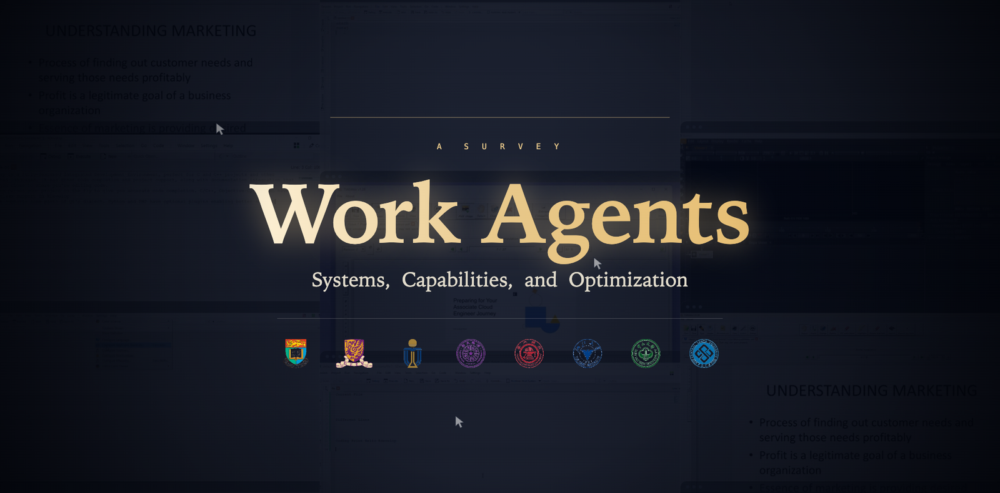

<h1 align="center">Work Agents: Systems, Capabilities, and Optimization</h1>

<p align="center">
  Zishan Xu<sup>1*</sup>, <a href="https://enjundu.com/">Enjun Du</a><sup>2,3*</sup>, Mingqi Gao<sup>4*</sup>, Cheng Yang<sup>3</sup>, <a href="https://github.com/ejhshen">Junhao Shen</a><sup>5</sup>, Zirong Chen<sup>4</sup>, Zhiyuan Yao<sup>6</sup>, Yifu Guo<sup>7</sup>, Yuquan Lu<sup>7</sup>, <a href="https://hjytsuki.github.io/">Jinyang Huang</a><sup>8</sup>, Zhengxi Lu<sup>6</sup>, Siyi Liu<sup>3</sup>, Ziyu Zheng<sup>2</sup>, <a href="https://yzhangee.github.io/">Yongqi Zhang</a><sup>3†</sup>, <a href="https://difanzou.github.io/">Difan Zou</a><sup>2†</sup>, <a href="https://wwliu555.github.io/">Weiwen Liu</a><sup>1†</sup>
</p>

<p align="center">
  <sup>1</sup>Shanghai Jiao Tong University &nbsp; <sup>2</sup>The University of Hong Kong &nbsp; <sup>3</sup>The Hong Kong University of Science and Technology (Guangzhou) &nbsp; <sup>4</sup>Tsinghua University<br>
  <sup>5</sup>The Chinese University of Hong Kong &nbsp; <sup>6</sup>Zhejiang University &nbsp; <sup>7</sup>Sun Yat-sen University &nbsp; <sup>8</sup>Central South University
</p>

<p align="center">
  <sup>*</sup>Equal contribution &nbsp; <sup>†</sup>Corresponding authors
</p>

<p align="center">
  <a href="https://arxiv.org/abs/2610.35845">
    
  </a>
  <a href="https://enjundu.com/blog/working_agents">
    
  </a>
  <a href="https://github.com/EnjunDu/awesome-working-agent">
    
  </a>
  <a href="https://github.com/EnjunDu/awesome-working-agent/pulls">
    
  </a>
</p>

`Work Agents` are AI systems that combine **foundation models** with **runtime harnesses** to carry out delegated digital work in stateful workspaces. They use tools, interact with applications, and coordinate workflows to produce answers, editable artifacts, and changes to workspace state.

This repository is the companion reading list for **Work Agents: Systems, Capabilities, and Optimization**. It brings together research across office productivity, enterprise operations, software engineering, scientific research, and computer use:

- **Agents, methods, and systems** — architectures, training methods, environments, memory, and agent harnesses.
- **Benchmarks and evaluation** — task suites and evaluation methods for digital work.
- **Surveys and resources** — foundational studies, open-source tools, and official documentation.

Read the survey on [arXiv](https://arxiv.org/abs/2610.35845), and visit the [project homepage](https://enjundu.com/blog/working_agents) for the project overview.

<p align="center">
  
</p>

## Contents

- [Agents, Methods & Systems](#agents-methods--systems)
- [Benchmarks & Evaluation](#benchmarks--evaluation)
- [Surveys & Foundations](#surveys--foundations)
- [Resources](#resources)
- [Citation](#citation)
- [Contributing](#contributing)

## Agents, Methods & Systems

Agents, learning methods, training environments, and runtime systems for producing work outcomes and improving capability. **279 entries.**

| Paper | Year | Focus | Links |
| --- | --- | --- | --- |
| **ACE**: Agentic Context Engineering: Evolving Contexts for Self-Improving Language Models <sup>[236]</sup> | 2026 | Learning & agent harnesses | [Paper](https://arxiv.org/abs/2510.04618) · [Code](https://github.com/ace-agent/ace) · [Publication](https://openreview.net/pdf?id=eC4ygDs02R) |
| **ActiveSaddler**: Automated Curriculum Learning for Agent Harness Optimization <sup>[257]</sup> | 2026 | Learning & agent harnesses | [Paper](https://arxiv.org/abs/2610.00906) |
| **Adaptive Auto-Harness**: Sustained Self-Improvement for Agentic System Deployment on Open-Ended Task Streams <sup>[258]</sup> | 2026 | Learning & agent harnesses | [Paper](https://arxiv.org/abs/2606.01770) · [Code](https://github.com/A-EVO-Lab/a-evolve/tree/release/adaptive-auto-harness) |
| **ADMIRE**: Adaptive Milestone Reward for GUI Agents <sup>[205]</sup> | 2026 | Web, desktop & mobile | [Paper](https://arxiv.org/abs/2602.11524) |
| **AeSlides**: Incentivizing Aesthetic Layout in LLM-Based Slide Generation via Verifiable Rewards <sup>[384]</sup> | 2026 | Spreadsheets, slides & documents | [Paper](https://arxiv.org/abs/2604.22840) · [Code](https://github.com/ympan0508/aeslides) · [Data](https://huggingface.co/datasets/ympan/aeslides-reward-bench) |
| **AEvo**: Harnessing Agentic Evolution <sup>[249]</sup> | 2026 | Learning & agent harnesses | [Paper](https://arxiv.org/abs/2605.13821) · [Publication](https://neurips.cc/virtual/2026/poster/156126) |
| **Agent Lightning v1.0**: Towards Harnessed Agentic RL <sup>[260]</sup> | 2026 | Learning & agent harnesses | [Paper](https://arxiv.org/abs/2608.17528) |
| **AgentMercury**: Your Agent Can Synthesize Verifiable Environments for Business Scenarios at scale <sup>[163]</sup> | 2026 | Tools & business workflows | [Paper](https://arxiv.org/abs/2608.20634) · [Data](https://huggingface.co/datasets/Minbyul/AgentMercury-corpus-sample) · [Website](https://minstar.github.io/AgentMercury/) |
| **Agent World Model**: Infinity Synthetic Environments for Agentic Reinforcement Learning <sup>[162]</sup> | 2026 | Tools & business workflows | [Paper](https://arxiv.org/abs/2602.10090) · [Code](https://github.com/Snowflake-Labs/agent-world-model) · [Publication](https://proceedings.mlr.press/v306/wang26jh.html) · [Data](https://huggingface.co/datasets/Snowflake/AgentWorldModel-1K) |
| **Anchor**: Mitigating Artifact Drift in Agent Benchmark Generation <sup>[174]</sup> | 2026 | Verification & recovery | [Paper](https://arxiv.org/abs/2605.26321) · [Code](https://github.com/agentic-labs/erp-bench) · [Website](https://erpbench.ai/) |
| **Atomix**: Timely, Transactional Tool Use for Reliable Agentic Workflows <sup>[382]</sup> | 2026 | Verification & recovery | [Paper](https://arxiv.org/abs/2602.14849) · [Code](https://github.com/mpi-dsg/atomix) · [Publication](https://openreview.net/forum?id=gele0qdZXT) |
| **AutoDesign**: Meta-Harness Optimization for Long-Horizon Agentic Design <sup>[232]</sup> | 2026 | Spreadsheets, slides & documents | [Paper](https://arxiv.org/abs/2608.13560) · [Code](https://github.com/Yaxin9Luo/AutoDesign) · [Data](https://huggingface.co/datasets/YaxinLuo/PosterBench) · [Website](https://autodesign.designanything.ai/) |
| **AutoRPA**: Efficient GUI Automation through LLM-Driven Code Synthesis from Interactions | 2026 | Learning & agent harnesses | [Paper](https://arxiv.org/abs/2605.21082) |
| **Better Harnesses, Smaller Models**: Building 90% Cheaper Agents via Automated Harness Adaptation <sup>[327]</sup> | 2026 | Learning & agent harnesses | [Paper](https://arxiv.org/abs/2607.08938) |
| **ChronoMem**: Version Control and Semantic Rollback for Large Language Model Agent Memory <sup>[359]</sup> | 2026 | Memory & persistent work | [Paper](https://arxiv.org/abs/2607.27773) |
| **CODESKILL**: Learning Self-Evolving Skills for Coding Agents <sup>[239]</sup> | 2026 | Software, data & research | [Paper](https://arxiv.org/abs/2605.25430) |
| **CogEvol**: Towards Efficient and Reliable Learning Environment Generation <sup>[179]</sup> | 2026 | Spreadsheets, slides & documents | [Paper](https://arxiv.org/abs/2608.30968) · [Code](https://github.com/CogEvol/CogEvol-4B) |
| **Co-Harness**: Co-Evolving Harnesses and Model Weights for LLM Agents <sup>[263]</sup> | 2026 | Learning & agent harnesses | [Paper](https://arxiv.org/abs/2607.22688) |
| **Component Routing**: Not All Experience Belongs in the Weights: Component Routing for Self-Improving GUI Agents <sup>[274]</sup> | 2026 | Web, desktop & mobile | [Paper](https://arxiv.org/abs/2610.01787) |
| **CompoWorld**: Compositional Environment Scaling for General Agents <sup>[165]</sup> | 2026 | Learning & agent harnesses | [Paper](https://arxiv.org/abs/2609.33665v2) |
| **ComputerRL**: Scaling End-to-End Online Reinforcement Learning for Computer Use Agents <sup>[350]</sup> | 2026 | Web, desktop & mobile | [Paper](https://arxiv.org/abs/2508.14040) · [Publication](https://proceedings.iclr.cc/paper_files/paper/2026/file/28707388472adc117714e83d44bfaebb-Paper-Conference.pdf) |
| **CorpGen**: Simulating Corporate Environments with Autonomous Digital Employees in Multi-Horizon Task Environments | 2026 | Memory & persistent work | [Paper](https://arxiv.org/abs/2602.14229) |
| **CoworkEnv**: Synthesizing Training Environments for Long-Horizon Cowork Agents <sup>[166]</sup> | 2026 | Workspaces & occupational work | [Paper](https://arxiv.org/abs/2610.24960) · [Code](https://github.com/HKUST-KnowComp/CoworkEnv) |
| **Cowork-Gym**: Synthesizing Interactive Work Environments at Scale <sup>[167]</sup> | 2026 | Workspaces & occupational work | [Paper](https://arxiv.org/abs/2610.17670) |
| **CurateEvo**: Data-Curation Evolving for Agentic Post-Training <sup>[173]</sup> | 2026 | Learning & agent harnesses | [Paper](https://arxiv.org/abs/2607.06140) |
| **C-World**: A Computer Use Agent Environment Creator | 2026 | Learning & agent harnesses | [Paper](https://arxiv.org/abs/2601.06328v2) · [Code](https://github.com/Ziqiao-git/ToolGym) |
| **daVinci-Dev**: Agent-native Mid-training for Software Engineering <sup>[169]</sup> | 2026 | Software, data & research | [Paper](https://arxiv.org/abs/2601.18418) · [Code](https://github.com/GAIR-NLP/daVinci-Dev) · [Publication](https://proceedings.mlr.press/v306/zeng26d.html) · [Data](https://huggingface.co/datasets/GAIR/daVinci-Dev) |
| **daVinci-Env / OpenSWE**: daVinci-Env: Open SWE Environment Synthesis at Scale <sup>[158]</sup> | 2026 | Software, data & research | [Paper](https://arxiv.org/abs/2603.13023) · [Code](https://github.com/GAIR-NLP/OpenSWE) |
| **DeepPresenter**: Environment-Grounded Reflection for Agentic Presentation Generation <sup>[58]</sup> | 2026 | Spreadsheets, slides & documents | [Paper](https://arxiv.org/abs/2602.22839) · [Code](https://github.com/icip-cas/PPTAgent) · [Publication](https://aclanthology.org/2026.findings-acl.1578/) |
| **DMRL**: Document-Mediated Reinforcement Learning for Skill Optimization in Advertising Recommendation <sup>[268]</sup> | 2026 | Tools & business workflows | [Paper](https://arxiv.org/abs/2609.02170) |
| **Dream-RSI**: Recursive Self-Improvement through Evolving Worlds <sup>[2]</sup> | 2026 | Learning & agent harnesses | [Paper](https://arxiv.org/abs/2609.14858) |
| **DSec**: DeepSeek Elastic Compute (DSec): A Sandbox Infrastructure for Effective Agentic Training at Scale <sup>[352]</sup> | 2026 | Learning & agent harnesses | [Paper](https://arxiv.org/abs/2609.22978) |
| **EnterpriseLab**: A Full-Stack Platform for developing and deploying agents in Enterprises <sup>[171]</sup> | 2026 | Tools & business workflows | [Paper](https://arxiv.org/abs/2603.21630) · [Code](https://github.com/ast-fri/EnterpriseLab) · [Website](https://ast-fri.github.io/EnterpriseLab/) |
| **EnvCraft**: Synthesizing Executable Environments in Agentic RL for Claw-like Agent <sup>[164]</sup> | 2026 | Workspaces & occupational work | [Paper](https://arxiv.org/abs/2609.05576) · [Code](https://github.com/zeng-yirong/EnvCraft) · [Data](https://huggingface.co/datasets/EnvCraft/EnvCraft-Data) |
| **EnvScaler**: Scaling Tool-Interactive Environments for LLM Agent via Programmatic Synthesis | 2026 | Tools & business workflows | [Paper](https://arxiv.org/abs/2601.05808) · [Code](https://github.com/RUC-NLPIR/EnvScaler) |
| **FST**: Learning, Fast and Slow: Towards LLMs That Adapt Continually <sup>[262]</sup> | 2026 | Learning & agent harnesses | [Paper](https://arxiv.org/abs/2605.12484) · [Publication](https://openreview.net/forum?id=3lOz4x7YcZ) · [Website](https://gepa-ai.github.io/gepa/blog/2026/05/11/learning-fast-and-slow/) |
| **Function-Aware FIM**: Function-Aware Fill-in-the-Middle as Mid-Training for Coding Agent Foundation Models <sup>[191]</sup> | 2026 | Software, data & research | [Paper](https://arxiv.org/abs/2607.12463) · [Code](https://github.com/TIGER-AI-Lab/FIM-Midtraining) |
| **GEPA**: Reflective Prompt Evolution Can Outperform Reinforcement Learning <sup>[229]</sup> | 2026 | Learning & agent harnesses | [Paper](https://arxiv.org/abs/2507.19457) · [Code](https://github.com/gepa-ai/gepa) · [Publication](https://proceedings.iclr.cc/paper_files/paper/2026/hash/0e9e708b6f48e14fd0ac29e167413f76-Abstract-Conference.html) · [Website](https://gepa-ai.github.io/gepa/) |
| **GHD / The Next Screenshot Knows**: The Next Screenshot Knows: Gated Hindsight Distillation for Mobile GUI Agents <sup>[216]</sup> | 2026 | Web, desktop & mobile | [Paper](https://arxiv.org/abs/2608.06065) |
| **GraphForge**: Training Working Agents with Graph-Anchored Workspace Synthesis <sup>[143]</sup> | 2026 | Workspaces & occupational work | [Paper](https://arxiv.org/abs/2609.38923) · [Data](https://huggingface.co/datasets/groundhogLLM/GraphForge-SFT-2169-clean) |
| **Guided-OPD**: On-Policy Distillation with Curriculum Turn-level Guidance for Multi-turn Agents <sup>[211]</sup> | 2026 | Learning & agent harnesses | [Paper](https://arxiv.org/abs/2606.15912) · [Code](https://github.com/Zzzz-166/Guided-OPD) |
| **HiPER**: Hierarchical Plan--Execute RL for Multi-Turn LLM Agents <sup>[206]</sup> | 2026 | Learning & agent harnesses | [Paper](https://arxiv.org/abs/2602.16165) · [Code](https://github.com/JonP07/HiPER-agent) · [Publication](https://proceedings.mlr.press/v306/peng26h.html) · [Website](https://jonp07.github.io/HiPER-agent/) |
| **InfiAgent**: An Infinite-Horizon Framework for General-Purpose Autonomous Agents <sup>[55]</sup> | 2026 | Memory & persistent work | [Paper](https://arxiv.org/abs/2601.03204) · [Code](https://github.com/ChenglinPoly/infiAgent) · [Publication](https://aclanthology.org/2026.findings-acl.1787/) |
| **JIT-Agent**: Scaling Harness Intelligence via Just-in-Time Harness Evolution <sup>[233]</sup> | 2026 | Learning & agent harnesses | [Paper](https://arxiv.org/abs/2608.25593) · [Code](https://github.com/bingreeky/JIT) · [Data](https://github.com/bingreeky/JIT/tree/main/dataset) · [Website](https://guibinz.top/JIT-site/) |
| **JTPRO**: A Joint Tool-Prompt Reflective Optimization Framework for Language Agents <sup>[227]</sup> | 2026 | Learning & agent harnesses | [Paper](https://arxiv.org/abs/2604.19821) · [Publication](https://aclanthology.org/2026.findings-acl.2017/) · [Cited edition](https://doi.org/10.18653/v1/2026.findings-acl.2017) |
| **LiteGUI**: Lightweight GUI Agents via Multi-Solution Guided Distillation and Dual-Level Reinforcement Learning <sup>[215]</sup> | 2026 | Web, desktop & mobile | [Paper](https://arxiv.org/abs/2605.07505) |
| **Memory-R1**: Enhancing Large Language Model Agents to Manage and Utilize Memories via Reinforcement Learning <sup>[363]</sup> | 2026 | Memory & persistent work | [Paper](https://arxiv.org/abs/2508.19828) |
| **MESH-Harness**: Self-Improving Agent Harnesses via Bandit-Guided Compositional Evolution <sup>[242]</sup> | 2026 | Learning & agent harnesses | [Paper](https://arxiv.org/abs/2610.05300) |
| **Meta-Harness**: End-to-End Optimization of Model Harnesses <sup>[231]</sup> | 2026 | Learning & agent harnesses | [Paper](https://arxiv.org/abs/2603.28052) · [Code](https://github.com/stanford-iris-lab/meta-harness-tbench2-artifact) · [Website](https://yoonholee.com/meta-harness/) |
| **MiLDEdit / MiLDEAgent**: MiLDEdit: Reasoning-Based Multi-Layer Design Document Editing <sup>[113]</sup> | 2026 | Spreadsheets, slides & documents | [Paper](https://arxiv.org/abs/2601.04589) |
| **Nemotron midtraining**: Priming Base Models for Agentic Post-Training: An Open Midtraining Recipe <sup>[189]</sup> | 2026 | Learning & agent harnesses | [Paper](https://arxiv.org/abs/2610.22019) |
| **NexForge**: Scaling Agent Capabilities through Requirement-Driven Task Synthesis for LLMs <sup>[159]</sup> | 2026 | Workspaces & occupational work | [Paper](https://arxiv.org/abs/2607.14186) · [Website](https://nex.sii.edu.cn/) |
| **OmegaUse**: Building a General-Purpose GUI Agent for Autonomous Task Execution | 2026 | Web, desktop & mobile | [Paper](https://arxiv.org/abs/2601.20380) |
| **On-Policy Distillation**: Rethinking On-Policy Distillation of Large Language Models: Phenomenology, Mechanism, and Recipe | 2026 | Memory & persistent work | [Paper](https://arxiv.org/abs/2604.13016) · [Code](https://github.com/thunlp/OPD) |
| **OpenAgent**: Can Agents Generalize to the Open World? Unveiling the Fragility of Static Training in Tool Use | 2026 | Tools & business workflows | [Paper](https://arxiv.org/abs/2607.01084) · [Code](https://github.com/LAMDA-NeSy/OpenAgent) |
| **OpenThoughts-Agent**: Data Recipes for Agentic Models <sup>[172]</sup> | 2026 | Learning & agent harnesses | [Paper](https://arxiv.org/abs/2606.24855) · [Code](https://github.com/open-thoughts/OpenThoughts-Agent) · [Data](https://github.com/open-thoughts/OpenThoughts-Agent/tree/main/data) |
| **Optimas**: Optimizing Compound AI Systems with Globally Aligned Local Rewards <sup>[273]</sup> | 2026 | Learning & agent harnesses | [Paper](https://arxiv.org/abs/2507.03041) · [Publication](https://proceedings.iclr.cc/paper_files/paper/2026/hash/f21a5fedfbcb55406ddaf51cf90d494a-Abstract-Conference.html) |
| **PRISM / Beyond Prompts**: Beyond Prompts: Measuring and Optimizing LLM Tool-Agent Harnesses <sup>[228]</sup> | 2026 | Learning & agent harnesses | [Paper](https://arxiv.org/abs/2609.05736) · [Code](https://github.com/airbnb/agent-harness-optimizer) · [Data](https://github.com/airbnb/agent-harness-optimizer/tree/main/data/bfcl) |
| **Process Reward Models That Think** <sup>[181]</sup> | 2026 | Verification & recovery | [Paper](https://arxiv.org/abs/2504.16828) · [Publication](https://openreview.net/forum?id=FPVCb0WMuN) |
| **Provider Digital Twins**: Developing provider digital twins for personalized provider-patient communication via a RAG-based conversational framework <sup>[340]</sup> | 2026 | Personal agents & digital twins | [Paper](https://pmc.ncbi.nlm.nih.gov/articles/PMC12809031/) |
| **RADAR**: Automating Low-Risk Code Review at Meta: RADAR, Risk Calibration, and Review Efficiency | 2026 | Verification & recovery | [Paper](https://arxiv.org/abs/2605.30208) |
| **ReasoningBank**: Scaling Agent Self-Evolving with Reasoning Memory <sup>[235]</sup> | 2026 | Learning & agent harnesses | [Paper](https://arxiv.org/abs/2509.25140) · [Code](https://github.com/google-research/reasoning-bank) · [Publication](https://openreview.net/pdf/25563ee680c408f3ad91eab8c7b4ec9ab05b7193.pdf) |
| **RePro**: Retrospective Progress-Aware Self-Refinement for LLM Agent Training <sup>[223]</sup> | 2026 | Learning & agent harnesses | [Paper](https://arxiv.org/abs/2606.14302) |
| **ReTool**: Reinforcement Learning for Strategic Tool Use in LLMs <sup>[200]</sup> | 2026 | Tools & business workflows | [Paper](https://arxiv.org/abs/2504.11536) · [Publication](https://proceedings.iclr.cc/paper_files/paper/2026/hash/4038c9208dfc22644c60ad39c24e5c53-Abstract-Conference.html) · [Cited edition](https://proceedings.iclr.cc/paper_files/paper/2026/file/4038c9208dfc22644c60ad39c24e5c53-Paper-Conference.pdf) |
| **Revisiting DAgger** in the Era of LLM-Agents <sup>[213]</sup> | 2026 | Learning & agent harnesses | [Paper](https://arxiv.org/abs/2605.12913) |
| **RHO**: Evolving Agents in the Dark: Retrospective Harness Optimization via Self-Preference <sup>[256]</sup> | 2026 | Learning & agent harnesses | [Paper](https://arxiv.org/abs/2606.05922) · [Code](https://github.com/wbopan/retro-harness) |
| **Rollback-Induced Reflection**: Rollback the World, Keep the Reflection: Rollback-Induced Reflection for Long-Horizon LLM Agents | 2026 | Verification & recovery | [Paper](https://arxiv.org/abs/2609.18304) |
| **SDAR**: Self-Distilled Agentic Reinforcement Learning <sup>[222]</sup> | 2026 | Learning & agent harnesses | [Paper](https://arxiv.org/abs/2605.15155) |
| **SDPO**: Reinforcement Learning via Self-Distillation <sup>[220]</sup> | 2026 | Learning & agent harnesses | [Paper](https://arxiv.org/abs/2601.20802) · [Code](https://github.com/lasgroup/SDPO) · [Publication](https://proceedings.mlr.press/v306/hubotter26a.html) · [Data](https://github.com/lasgroup/SDPO/tree/main/datasets) · [Website](https://self-distillation.github.io/SDPO) |
| **SEE**: Structure-aware Exploring & Exploiting for Long-horizon GUI Agent Trajectory Synthesis <sup>[177]</sup> | 2026 | Web, desktop & mobile | [Paper](https://arxiv.org/abs/2607.18046) · [Code](https://github.com/Zhh-Fan/SEE-Structure-aware-Exploring-Exploiting-for-Long-horizon-GUI-Agent-Trajectory-Synthesis) |
| **Self-Healing Orchestrators**: Self-Healing Agentic Orchestrators for Reliable Tool-Augmented Large Language Model Systems | 2026 | Verification & recovery | [Paper](https://arxiv.org/abs/2606.01416) |
| **SIA**: Self Improving AI with Harness & Weight Updates <sup>[267]</sup> | 2026 | Learning & agent harnesses | [Paper](https://arxiv.org/abs/2605.27276) · [Code](https://github.com/hexo-ai/sia) |
| **Skill2Env**: Capability-Oriented Environment Synthesis from Skills for General Agents <sup>[355]</sup> | 2026 | Workspaces & occupational work | [Paper](https://arxiv.org/abs/2609.33772) · [Code](https://github.com/AllSpark-Research/AgentEnv) · [Data](https://github.com/AllSpark-Research/AgentEnv/tree/main/Skill2Env/tasks) |
| **Skill-Alpha**: Progressive Agent Skill Generation via Reinforcement Learning <sup>[238]</sup> | 2026 | Learning & agent harnesses | [Paper](https://arxiv.org/abs/2608.01678) · [Code](https://github.com/ejhshen/skill-alpha) |
| **SkillOpt**: Executive Strategy for Self-Evolving Agent Skills <sup>[237]</sup> | 2026 | Learning & agent harnesses | [Paper](https://arxiv.org/abs/2605.23904) · [Publication](https://neurips.cc/virtual/2026/poster/151264) · [Code](https://github.com/microsoft/SkillOpt) · [Website](https://microsoft.github.io/SkillOpt/) |
| **SkillOS**: Learning Skill Curation for Self-Evolving Agents | 2026 | Learning & agent harnesses | [Paper](https://arxiv.org/abs/2605.06614) |
| **SkillRL**: Evolving Agents via Recursive Skill-Augmented Reinforcement Learning <sup>[265]</sup> | 2026 | Learning & agent harnesses | [Paper](https://arxiv.org/abs/2602.08234) · [Code](https://github.com/aiming-lab/SkillRL) · [Publication](https://neurips.cc/virtual/2026/poster/156011) · [Data](https://huggingface.co/datasets/Jianwen/SkillRL-SFT-Data) |
| **Skill-SD**: Skill-Conditioned Self-Distillation for Multi-turn LLM Agents <sup>[221]</sup> | 2026 | Learning & agent harnesses | [Paper](https://arxiv.org/abs/2604.10674) · [Publication](https://neurips.cc/virtual/2026/poster/151567) |
| **SkillSmith**: Co-Evolving Skills and Tools for Self-Improving Agent Systems <sup>[240]</sup> | 2026 | Learning & agent harnesses | [Paper](https://arxiv.org/abs/2606.01314) |
| **SlideRL / Learning to Present**: Learning to Present: Inverse Specification Rewards for Agentic Slide Generation <sup>[134]</sup> | 2026 | Spreadsheets, slides & documents | [Paper](https://arxiv.org/abs/2603.16839) · [Code](https://github.com/pushing-the-frontier/slide-forge-llm) · [Data](https://huggingface.co/datasets/KarthikRagunathAnandaKumar/sliderl-multi-turn-rollouts) |
| **SLIM**: Dynamic Skill Lifecycle Management for Agentic Reinforcement Learning <sup>[266]</sup> | 2026 | Learning & agent harnesses | [Paper](https://arxiv.org/abs/2605.10923) · [Code](https://github.com/ejhshen/SLIM) |
| **SMITH**: Joint Optimization of Tool Creation and Use for Large Language Model Agents <sup>[271]</sup> | 2026 | Learning & agent harnesses | [Paper](https://arxiv.org/abs/2608.24571) · [Code](https://github.com/appier-research/smith) · [Publication](https://neurips.cc/virtual/2026/poster/155013) |
| **Socratic-SWE**: Self-Evolving Coding Agents via Trace-Derived Agent Skills <sup>[269]</sup> | 2026 | Software, data & research | [Paper](https://arxiv.org/abs/2606.07412) |
| **SOD**: Step-wise On-policy Distillation for Small Language Model Agents <sup>[214]</sup> | 2026 | Learning & agent harnesses | [Paper](https://arxiv.org/abs/2605.07725) · [Code](https://github.com/YoungZ365/SOD) |
| **SpreadsheetAgent**: Towards Robust Real-World Spreadsheet Understanding with Multi-Agent Multi-Format Reasoning <sup>[41]</sup> | 2026 | Reasoning, evidence & work impact | [Paper](https://arxiv.org/abs/2604.12282) · [Code](https://github.com/renhouxing/SpreadsheetAgent) · [Publication](https://aclanthology.org/2026.acl-long.86/) |
| **Spreadsheet-RL**: Advancing Large Language Model Agents on Realistic Spreadsheet Tasks via Reinforcement Learning <sup>[129]</sup> | 2026 | Spreadsheets, slides & documents | [Paper](https://arxiv.org/abs/2605.22642) · [Code](https://github.com/Spreadsheet-RL/Spreadsheet-RL) · [Data](https://huggingface.co/datasets/Spreadsheet-RL/Spreadsheet-RL) · [Website](https://spreadsheet-rl.github.io/) |
| **SRD**: Self-Retrospection Distillation: Turning Post-hoc Experiences into Prior Foresight <sup>[224]</sup> | 2026 | Learning & agent harnesses | [Paper](https://arxiv.org/abs/2610.08077) · [Code](https://github.com/SalesforceAIResearch/SRD) |
| **SSR (Self-play SWE-RL)**: Toward Training Superintelligent Software Agents through Self-Play SWE-RL | 2026 | Learning & agent harnesses | [Paper](https://arxiv.org/abs/2512.18552) · [Publication](https://proceedings.mlr.press/v306/wei26x.html) |
| **StagedWorkspace**: A Versioned Workspace for Knowledge-Work Agents | 2026 | Workspaces & occupational work | [Paper](https://arxiv.org/abs/2608.18050) |
| **StateGuard**: Analytical-State Management with Validity-Aware Intervention for Long-Horizon Data Agents <sup>[375]</sup> | 2026 | Memory & persistent work | [Paper](https://arxiv.org/abs/2609.34134) |
| **TACO**: A Self-Evolving Framework for Efficient Terminal Agents via Observational Context Compression <sup>[225]</sup> | 2026 | Learning & agent harnesses | [Paper](https://arxiv.org/abs/2604.19572) · [Code](https://github.com/multimodal-art-projection/TACO) · [Publication](https://neurips.cc/virtual/2026/poster/153290) |
| **TCOD**: Exploring Temporal Curriculum in On-Policy Distillation for Multi-turn Autonomous Agents <sup>[210]</sup> | 2026 | Learning & agent harnesses | [Paper](https://arxiv.org/abs/2604.24005) · [Code](https://github.com/kokolerk/TCOD) · [Publication](https://openreview.net/forum?id=KH9eJRz8WR) |
| **TDScaling**: Beyond Quantity: Trajectory Diversity Scaling for Code Agents <sup>[176]</sup> | 2026 | Tools & business workflows | [Paper](https://arxiv.org/abs/2602.03219) · [Publication](https://aclanthology.org/2026.findings-acl.768/) |
| **Tool Description Rewriter**: Learning to Rewrite Tool Descriptions for Reliable LLM-Agent Tool Use <sup>[226]</sup> | 2026 | Learning & agent harnesses | [Paper](https://arxiv.org/abs/2602.20426) |
| **Trace2Skill (Office)**: Trace2Skill: Distill Trajectory-Local Lessons into Transferable Agent Skills | 2026 | Learning & agent harnesses | [Paper](https://arxiv.org/abs/2603.25158) · [Code](https://github.com/Qwen-Applications/Trace2Skill) |
| **TrajLong**: Co-Designing Agentic and Long-Context Supervision for Mid-Training <sup>[190]</sup> | 2026 | Learning & agent harnesses | [Paper](https://arxiv.org/abs/2610.04973) |
| **UI-Copilot**: Advancing Long-Horizon GUI Automation via Tool-Integrated Policy Optimization <sup>[259]</sup> | 2026 | Web, desktop & mobile | [Paper](https://arxiv.org/abs/2604.13822) · [Publication](https://aclanthology.org/2026.acl-long.904/) · [Code](https://github.com/ZJU-REAL/UI-Copilot) |
| **UI-Mate**: Advancing Open-Weight Foundation GUI Agents with In-Context Demonstrations <sup>[198]</sup> | 2026 | Web, desktop & mobile | [Paper](https://arxiv.org/abs/2608.15930) |
| **UI-Mem**: Self-Evolving Experience Memory for Online Reinforcement Learning in Mobile GUI Agents <sup>[264]</sup> | 2026 | Web, desktop & mobile | [Paper](https://arxiv.org/abs/2602.05832) · [Website](https://ui-mem.github.io/) |
| **UI-R1**: Enhancing Efficient Action Prediction of GUI Agents by Reinforcement Learning <sup>[70]</sup> | 2026 | Web, desktop & mobile | [Paper](https://doi.org/10.1609/aaai.v40i21.38816) |
| **VERA**: Scaling Verifiable Environments for Agentic co-Evolution <sup>[175]</sup> | 2026 | Verification & recovery | [Paper](https://arxiv.org/abs/2610.05923) · [Code](https://github.com/AutoMedBench/VERA) |
| **Verified Tool Calls** Improve LLM Agent Reliability Under Non-Atomic Failures <sup>[377]</sup> | 2026 | Verification & recovery | [Paper](https://arxiv.org/abs/2608.02645) |
| **VERSE**: Verified Self-Evolving Optimizer for Agent Harnesses <sup>[270]</sup> | 2026 | Learning & agent harnesses | [Paper](https://arxiv.org/abs/2610.02616) · [Code](https://github.com/wzekai/VERSE) |
| **VIGA**: Vision-as-Inverse-Graphics Agent via Interleaved Multimodal Reasoning <sup>[130]</sup> | 2026 | CAD & visual design | [Paper](https://link.springer.com/chapter/10.1007/978-3-032-37464-6_30) · [Publication](https://arxiv.org/abs/2601.11109) · [Code](https://github.com/Fugtemypt123/VIGA) · [Data](https://huggingface.co/datasets/DietCoke4671/blenderbench) · [Website](https://fugtemypt123.github.io/VIGA-website/) |
| **Who Verifies the Verifier?** Co-Evolving Inspectable Graders with Self-Improving Agents <sup>[385]</sup> | 2026 | Verification & recovery | [Paper](https://arxiv.org/abs/2610.11464) |
| **WorkBorne**: Discovering Agentic Tasks from Real-World Artifact Transitions <sup>[161]</sup> | 2026 | Workspaces & occupational work | [Paper](https://arxiv.org/abs/2610.14915) |
| **WorkFactory**: Turning Professional Intents into Executable Work for Scalable Agent Training | 2026 | Workspaces & occupational work | [Paper](https://arxiv.org/abs/2610.37161) · [Project](https://github.com/IQuestLab/WorkFactory) |
| **WorkForge**: Scaling Verifiable Environments for Long-horizon Work Agents <sup>[160]</sup> | 2026 | Workspaces & occupational work | [Paper](https://arxiv.org/abs/2610.04906) |
| **WorkGenesis**: Building the Worlds That Teach Agents to Work <sup>[144]</sup> | 2026 | Workspaces & occupational work | [Paper](https://arxiv.org/abs/2609.39325) |
| **WorkRover**: Scaling Long-Horizon Cowork Agent Training Via Recursive Environment Evolution <sup>[168]</sup> | 2026 | Workspaces & occupational work | [Paper](https://arxiv.org/abs/2610.18067) |
| **Workspace Optimization / DreamTeam**: Workspace Optimization: How to Train Your Agent | 2026 | Learning & agent harnesses | [Paper](https://arxiv.org/abs/2605.09650) |
| **ADAS**: Automated Design of Agentic Systems <sup>[248]</sup> | 2025 | Learning & agent harnesses | [Paper](https://arxiv.org/abs/2408.08435) · [Code](https://github.com/ShengranHu/ADAS) · [Publication](https://proceedings.iclr.cc/paper_files/paper/2025/hash/36b7acf6f6010652b3f2a433774a66fe-Abstract-Conference.html) |
| **AFlow**: Automating Agentic Workflow Generation <sup>[230]</sup> | 2025 | Learning & agent harnesses | [Paper](https://arxiv.org/abs/2410.10762) · [Code](https://github.com/FoundationAgents/AFlow) · [Publication](https://proceedings.iclr.cc/paper_files/paper/2025/hash/5492ecbce4439401798dcd2c90be94cd-Abstract-Conference.html) |
| **Agent-as-a-Judge**: Evaluate Agents with Agents <sup>[15]</sup> | 2025 | Verification & recovery | [Paper](https://arxiv.org/abs/2410.10934) · [Publication](https://proceedings.mlr.press/v267/zhuge25a.html) · [Code](https://github.com/metauto-ai/agent-as-a-judge) · [Data](https://huggingface.co/datasets/DEVAI-benchmark/DEVAI) |
| **AgentDebug**: Where LLM Agents Fail and How They can Learn From Failures | 2025 | Verification & recovery | [Paper](https://arxiv.org/abs/2509.25370) · [Code](https://github.com/ulab-uiuc/AgentDebug) |
| **AgentGen**: Enhancing Planning Abilities for Large Language Model based Agent via Environment and Task Generation | 2025 | Learning & agent harnesses | [Paper](https://arxiv.org/abs/2408.00764) · [Publication](https://doi.org/10.1145/3690624.3709321) |
| **AgentGym-RL**: Training LLM Agents for Long-Horizon Decision Making through Multi-Turn Reinforcement Learning <sup>[356]</sup> | 2025 | Learning & agent harnesses | [Paper](https://arxiv.org/abs/2509.08755) · [Code](https://github.com/woooodyy/AgentGym-RL) · [Publication](https://openreview.net/pdf/d8e15fc2cabf98ead8ffbe0d8e6ad1b2764a3d28.pdf) |
| **Agent Lightning**: Train ANY AI Agents with Reinforcement Learning <sup>[351]</sup> | 2025 | Learning & agent harnesses | [Paper](https://arxiv.org/abs/2508.03680) · [Code](https://github.com/microsoft/agent-lightning) |
| **Agent-R1**: A Unified and Modular Framework for Agentic Reinforcement Learning | 2025 | Learning & agent harnesses | [Paper](https://arxiv.org/abs/2511.14460) · [Code](https://github.com/AgentR1/Agent-R1) |
| **Agent S2**: A Compositional Generalist-Specialist Framework for Computer Use Agents <sup>[52]</sup> | 2025 | Web, desktop & mobile | [Paper](https://arxiv.org/abs/2504.00906) · [Code](https://github.com/simular-ai/Agent-S) · [Publication](https://openreview.net/forum?id=zg5is4GJ3R) |
| **AgentSquare**: Automatic LLM Agent Search in Modular Design Space <sup>[241]</sup> | 2025 | Learning & agent harnesses | [Paper](https://arxiv.org/abs/2410.06153) · [Code](https://github.com/tsinghua-fib-lab/AgentSquare) · [Publication](https://proceedings.iclr.cc/paper_files/paper/2025/hash/0ae94013da7cd459402fd77874e09ee3-Abstract-Conference.html) |
| **AgentTrek**: Agent Trajectory Synthesis via Guiding Replay with Web Tutorials <sup>[170]</sup> | 2025 | Web, desktop & mobile | [Paper](https://arxiv.org/abs/2412.09605) |
| **A-MEM**: Agentic Memory for LLM Agents <sup>[362]</sup> | 2025 | Memory & persistent work | [Paper](https://arxiv.org/abs/2502.12110) |
| **Authenticated Delegation** and Authorized AI Agents <sup>[341]</sup> | 2025 | Safety & authorization | [Paper](https://arxiv.org/abs/2501.09674) |
| **AutoPresent / SlidesBench**: AutoPresent: Designing Structured Visuals from Scratch <sup>[120]</sup> | 2025 | Spreadsheets, slides & documents | [Paper](https://arxiv.org/abs/2501.00912) · [Code](https://github.com/para-lost/AutoPresent) · [Publication](https://openaccess.thecvf.com/content/CVPR2025/html/Ge_AutoPresent_Designing_Structured_Visuals_from_Scratch_CVPR_2025_paper.html) · [Cited edition](https://doi.org/10.1109/cvpr52734.2025.00276) |
| **AWM**: Agent Workflow Memory <sup>[369]</sup> | 2025 | Learning & agent harnesses | [Paper](https://arxiv.org/abs/2409.07429) · [Code](https://github.com/zorazrw/agent-workflow-memory) · [Publication](https://proceedings.mlr.press/v267/wang25bx.html) |
| **BrowserGym**: The BrowserGym Ecosystem for Web Agent Research <sup>[320]</sup> | 2025 | Learning & agent harnesses | [Paper](https://arxiv.org/abs/2412.05467) · [Code](https://github.com/ServiceNow/BrowserGym) · [Publication](https://openreview.net/forum?id=5298fKGmv3) · [Website](https://huggingface.co/spaces/ServiceNow/browsergym-leaderboard) |
| **CoAct-1**: Computer-using Multi-Agent System with Coding Actions | 2025 | Learning & agent harnesses | [Paper](https://arxiv.org/abs/2508.03923) · [Code](https://github.com/SalesforceAIResearch/CoAct-1) |
| **ColPali / ViDoRe**: ColPali: Efficient Document Retrieval with Vision Language Models <sup>[147]</sup> | 2025 | Reasoning, evidence & work impact | [Paper](https://arxiv.org/abs/2407.01449) · [Code](https://github.com/illuin-tech/colpali) |
| **DART-GUI**: Efficient Multi-turn RL for GUI Agents via Decoupled Training and Adaptive Data Curation | 2025 | Learning & agent harnesses | [Paper](https://arxiv.org/abs/2509.23866) |
| **Data Interpreter**: An LLM Agent For Data Science <sup>[51]</sup> | 2025 | Software, data & research | [Paper](https://arxiv.org/abs/2402.18679) · [Code](https://github.com/geekan/MetaGPT) · [Publication](https://aclanthology.org/2025.findings-acl.1016/) |
| **DGAP**: Discriminator-Guided Embodied Planning for LLM Agent | 2025 | Reasoning, evidence & work impact | [Paper](https://proceedings.iclr.cc/paper_files/paper/2025/hash/e6f2b968c4ee8ba260cd7077e39590dd-Abstract-Conference.html) |
| **Docling Toolkit**: Docling: An Efficient Open-Source Toolkit for AI-driven Document Conversion | 2025 | Tools & business workflows | [Paper](https://arxiv.org/abs/2501.17887) |
| **DynaSaur**: Large Language Agents Beyond Predefined Actions | 2025 | Learning & agent harnesses | [Paper](https://arxiv.org/abs/2411.01747) · [Code](https://github.com/adobe-research/dynasaur) · [Publication](https://openreview.net/pdf?id=lv0cJ2pWVd) |
| **GiGPO**: Group-in-Group Policy Optimization for LLM Agent Training <sup>[207]</sup> | 2025 | Learning & agent harnesses | [Paper](https://arxiv.org/abs/2505.10978) |
| **GoalAct**: Enhancing LLM-Based Agents via Global Planning and Hierarchical Execution | 2025 | Reasoning, evidence & work impact | [Paper](https://arxiv.org/abs/2504.16563) |
| **GUI-Actor**: Coordinate-Free Visual Grounding for GUI Agents <sup>[68]</sup> | 2025 | Web, desktop & mobile | [Paper](https://arxiv.org/abs/2506.03143) · [Code](https://github.com/microsoft/GUI-Actor) · [Publication](https://proceedings.neurips.cc/paper_files/paper/2025/hash/16130af940e9dabb43c726119bd3b42e-Abstract-Conference.html) |
| **HiAgent**: Hierarchical Working Memory Management for Solving Long-Horizon Agent Tasks with Large Language Model | 2025 | Reasoning, evidence & work impact | [Paper](https://aclanthology.org/2025.acl-long.1575/) |
| **LocAgent**: Graph-Guided LLM Agents for Code Localization <sup>[151]</sup> | 2025 | Software, data & research | [Paper](https://arxiv.org/abs/2503.09089) · [Publication](https://aclanthology.org/2025.acl-long.426/) |
| **MAP**: A brain-inspired agentic architecture to improve planning with LLMs | 2025 | Reasoning, evidence & work impact | [Paper](https://www.nature.com/articles/s41467-025-63804-5) |
| **Mem0**: Building Production-Ready AI Agents with Scalable Long-Term Memory <sup>[360]</sup> | 2025 | Memory & persistent work | [Paper](https://arxiv.org/abs/2504.19413) · [Code](https://github.com/mem0ai/mem0) |
| **MLGym**: A New Framework and Benchmark for Advancing AI Research Agents | 2025 | Software, data & research | [Paper](https://arxiv.org/abs/2502.14499) · [Code](https://github.com/facebookresearch/MLGym) |
| **OpenHands**: An Open Platform for AI Software Developers as Generalist Agents <sup>[152]</sup> | 2025 | Learning & agent harnesses | [Paper](https://arxiv.org/abs/2407.16741) · [Code](https://github.com/OpenHands/OpenHands) · [Publication](https://proceedings.iclr.cc/paper_files/paper/2025/hash/a4b6ad6b48850c0c331d1259fc66a69c-Abstract-Conference.html) |
| **Plan-and-Act**: Improving Planning of Agents for Long-Horizon Tasks | 2025 | Reasoning, evidence & work impact | [Paper](https://arxiv.org/abs/2503.09572) |
| **PosterGen**: Aesthetic-Aware Multi-Modal Paper-to-Poster Generation via Multi-Agent LLMs | 2025 | Spreadsheets, slides & documents | [Paper](https://arxiv.org/abs/2508.17188) |
| **PPTAgent**: Generating and Evaluating Presentations Beyond Text-to-Slides <sup>[5]</sup> | 2025 | Spreadsheets, slides & documents | [Paper](https://arxiv.org/abs/2501.03936) · [Code](https://github.com/icip-cas/PPTAgent) · [Publication](https://aclanthology.org/2025.emnlp-main.728/) |
| **PPTArena**: A Benchmark for PowerPoint Editing | 2025 | Spreadsheets, slides & documents | [Paper](https://arxiv.org/abs/2512.03042) · [Code](https://github.com/michaelofengend/PPTArena) |
| **PreGenie**: An Agentic Framework for High-quality Visual Presentation Generation | 2025 | Spreadsheets, slides & documents | [Paper](https://arxiv.org/abs/2505.21660) · [Publication](https://aclanthology.org/2025.findings-emnlp.165/) |
| **Proactive Agent**: Shifting LLM Agents from Reactive Responses to Active Assistance <sup>[332]</sup> | 2025 | Memory & persistent work | [Paper](https://arxiv.org/abs/2410.12361) · [Code](https://github.com/thunlp/ProactiveAgent) |
| **R1-Searcher**: Incentivizing the Search Capability in LLMs via Reinforcement Learning | 2025 | Learning & agent harnesses | [Paper](https://arxiv.org/abs/2503.05592) · [Code](https://github.com/RUCAIBox/R1-Searcher) |
| **R2E-Gym**: Procedural Environment Generation and Hybrid Verifiers for Scaling Open-Weights SWE Agents <sup>[354]</sup> | 2025 | Software, data & research | [Paper](https://arxiv.org/abs/2504.07164) · [Publication](https://openreview.net/pdf?id=7evvwwdo3z) · [Publication](https://openreview.net/forum?id=7evvwwdo3z) |
| **RepoGraph**: Enhancing AI Software Engineering with Repository-level Code Graph | 2025 | Software, data & research | [Paper](https://arxiv.org/abs/2410.14684) · [Publication](https://proceedings.iclr.cc/paper_files/paper/2025/file/4a4a3c197deac042461c677219efd36c-Paper-Conference.pdf) |
| **Routine**: A Structural Planning Framework for LLM Agent System in Enterprise <sup>[48]</sup> | 2025 | Tools & business workflows | [Paper](https://arxiv.org/abs/2507.14447) |
| **SagaLLM**: Context Management, Validation, and Transaction Guarantees for Multi-Agent LLM Planning <sup>[381]</sup> | 2025 | Memory & persistent work | [Paper](https://arxiv.org/abs/2503.11951) · [Publication](https://doi.org/10.14778/3750601.3750611) |
| **Search-R1**: Training LLMs to Reason and Leverage Search Engines with Reinforcement Learning <sup>[201]</sup> | 2025 | Learning & agent harnesses | [Paper](https://arxiv.org/abs/2503.09516) · [Code](https://github.com/PeterGriffinJin/Search-R1) · [Publication](https://openreview.net/pdf?id=Rwhi91ideu) |
| **SheetAgent**: Towards A Generalist Agent for Spreadsheet Reasoning and Manipulation via Large Language Models <sup>[45]</sup> | 2025 | Spreadsheets, slides & documents | [Paper](https://arxiv.org/abs/2403.03636) · [Publication](https://doi.org/10.1145/3696410.3714962) · [Cited edition](https://openreview.net/forum?id=AKy9ryZwi3) |
| **SheetMind**: Actions Set Accuracy, Agents Set the Failure Mode | 2025 | Spreadsheets, slides & documents | [Paper](https://arxiv.org/abs/2506.12339) |
| **SlideTailor**: Personalized Presentation Slide Generation for Scientific Papers | 2025 | Spreadsheets, slides & documents | [Paper](https://arxiv.org/abs/2512.20292) |
| **SWE-Gym**: Training Software Engineering Agents and Verifiers with SWE-Gym <sup>[353]</sup> | 2025 | Software, data & research | [Paper](https://arxiv.org/abs/2412.21139) · [Code](https://github.com/SWE-Gym/SWE-Gym) · [Publication](https://proceedings.mlr.press/v267/pan25g.html) |
| **SWE-RL**: Advancing LLM Reasoning via Reinforcement Learning on Open Software Evolution <sup>[204]</sup> | 2025 | Learning & agent harnesses | [Paper](https://arxiv.org/abs/2502.18449) · [Code](https://github.com/facebookresearch/swe-rl) · [Publication](https://proceedings.nips.cc/paper_files/paper/2025/hash/7107d4d2e837bde2171c6b71b5bde954-Abstract-Conference.html) |
| **SWE-smith**: Scaling Data for Software Engineering Agents | 2025 | Learning & agent harnesses | [Paper](https://arxiv.org/abs/2504.21798) · [Publication](https://proceedings.neurips.cc/paper_files/paper/2025/hash/8b86cf5ace600c48fd188efbb8dedec8-Abstract-Datasets_and_Benchmarks_Track.html) |
| **SyncMind**: Measuring Agent Out-of-Sync Recovery in Collaborative Software Engineering | 2025 | Software, data & research | [Paper](https://arxiv.org/abs/2502.06994) · [Code](https://github.com/xhguo7/SyncMind) · [Data](https://huggingface.co/datasets/xuehang/SyncBench) |
| **Talk to Your Slides**: High-Efficiency Slide Editing via Language-Driven Structured Data Manipulation | 2025 | Spreadsheets, slides & documents | [Paper](https://arxiv.org/abs/2505.11604) |
| **TextGrad**: Optimizing generative AI by backpropagating language model feedback <sup>[251]</sup> | 2025 | Learning & agent harnesses | [Paper](https://arxiv.org/abs/2406.07496) · [Code](https://github.com/zou-group/textgrad) · [Publication](https://www.nature.com/articles/s41586-025-08661-4) · [Cited edition](https://doi.org/10.1038/s41586-025-08661-4) |
| **ToolMaker**: LLM Agents Making Agent Tools <sup>[272]</sup> | 2025 | Learning & agent harnesses | [Paper](https://aclanthology.org/2025.acl-long.1266/) |
| **Tool-to-Agent Retrieval**: Bridging Tools and Agents for Scalable LLM Multi-Agent Systems | 2025 | Tools & business workflows | [Paper](https://arxiv.org/abs/2511.01854) |
| **ToRL**: Scaling Tool-Integrated RL | 2025 | Learning & agent harnesses | [Paper](https://arxiv.org/abs/2503.23383) · [Code](https://github.com/GAIR-NLP/ToRL) |
| **UFO2**: The Desktop AgentOS | 2025 | Web, desktop & mobile | [Paper](https://arxiv.org/abs/2504.14603) · [Code](https://github.com/microsoft/UFO/) |
| **UGround**: Navigating the Digital World as Humans Do: Universal Visual Grounding for GUI Agents <sup>[67]</sup> | 2025 | Web, desktop & mobile | [Paper](https://arxiv.org/abs/2410.05243) · [Publication](https://proceedings.iclr.cc/paper_files/paper/2025/hash/4ca0e369689dadb25a5345ba9755ad6f-Abstract-Conference.html) |
| **UI-S1**: Advancing GUI Automation via Semi-Online Reinforcement Learning <sup>[71]</sup> | 2025 | Web, desktop & mobile | [Paper](https://arxiv.org/abs/2509.11543) |
| **UI-TARS**: Pioneering Automated GUI Interaction with Native Agents <sup>[197]</sup> | 2025 | Web, desktop & mobile | [Paper](https://arxiv.org/abs/2501.12326) · [Code](https://github.com/bytedance/UI-TARS) |
| **UltraCUA**: A Foundation Model for Computer Use Agents with Hybrid Action | 2025 | Learning & agent harnesses | [Paper](https://arxiv.org/abs/2510.17790) |
| **WebAgent-R1**: Training Web Agents via End-to-End Multi-Turn Reinforcement Learning | 2025 | Learning & agent harnesses | [Paper](https://arxiv.org/abs/2505.16421) · [Code](https://github.com/weizhepei/WebAgent-R1) · [Publication](https://aclanthology.org/2025.emnlp-main.401/) |
| **WebRL**: Training LLM Web Agents via Self-Evolving Online Curriculum Reinforcement Learning <sup>[202]</sup> | 2025 | Web, desktop & mobile | [Paper](https://arxiv.org/abs/2411.02337) · [Code](https://github.com/THUDM/WebRL) · [Publication](https://proceedings.iclr.cc/paper_files/paper/2025/hash/c66e1fcc9691aae706250638f36f681b-Abstract-Conference.html) |
| **WorkTeam**: Constructing Workflows from Natural Language with Multi-Agents <sup>[49]</sup> | 2025 | Learning & agent harnesses | [Paper](https://arxiv.org/abs/2503.22473) · [Publication](https://aclanthology.org/2025.naacl-industry.3/) |
| **Zep**: A Temporal Knowledge Graph Architecture for Agent Memory <sup>[358]</sup> | 2025 | Memory & persistent work | [Paper](https://arxiv.org/abs/2501.13956) · [Code](https://github.com/getzep/graphiti) |
| **Agent-FLAN**: Designing Data and Methods of Effective Agent Tuning for Large Language Models <sup>[194]</sup> | 2024 | Learning & agent harnesses | [Paper](https://arxiv.org/abs/2403.12881) · [Code](https://github.com/InternLM/Agent-FLAN) · [Publication](https://aclanthology.org/2024.findings-acl.557/) |
| **AgentGym**: Evolving Large Language Model-based Agents across Diverse Environments | 2024 | Learning & agent harnesses | [Paper](https://arxiv.org/abs/2406.04151) · [Code](https://github.com/WooooDyy/AgentGym) |
| **AgentInstruct (Microsoft)**: AgentInstruct: Toward Generative Teaching with Agentic Flows | 2024 | Learning & agent harnesses | [Paper](https://arxiv.org/abs/2407.03502) |
| **Agentless**: Demystifying LLM-based Software Engineering Agents | 2024 | Software, data & research | [Paper](https://arxiv.org/abs/2407.01489) · [Code](https://github.com/OpenAutoCoder/Agentless) |
| **AgentOptimizer**: Offline Training of Language Model Agents with Functions as Learnable Weights | 2024 | Learning & agent harnesses | [Paper](https://arxiv.org/abs/2402.11359) · [Publication](https://proceedings.mlr.press/v235/zhang24cd.html) |
| **Agent Q**: Advanced Reasoning and Learning for Autonomous AI Agents <sup>[219]</sup> | 2024 | Web, desktop & mobile | [Paper](https://arxiv.org/abs/2408.07199) |
| **Agent S**: An Open Agentic Framework that Uses Computers Like a Human | 2024 | Web, desktop & mobile | [Paper](https://arxiv.org/abs/2410.08164) · [Code](https://github.com/simular-ai/Agent-S) |
| **AgentTuning**: Enabling Generalized Agent Abilities for LLMs <sup>[193]</sup> | 2024 | Learning & agent harnesses | [Paper](https://arxiv.org/abs/2310.12823) · [Code](https://github.com/THUDM/AgentTuning) · [Publication](https://aclanthology.org/2024.findings-acl.181/) |
| **AsyncLM**: Asynchronous LLM Function Calling <sup>[365]</sup> | 2024 | Learning & agent harnesses | [Paper](https://arxiv.org/abs/2412.07017) |
| **AutoCodeRover**: Autonomous Program Improvement <sup>[43]</sup> | 2024 | Software, data & research | [Paper](https://arxiv.org/abs/2404.05427) · [Publication](https://doi.org/10.1145/3650212.3680384) |
| **AutoGen**: Enabling Next-Gen LLM Applications via Multi-Agent Conversations <sup>[53]</sup> | 2024 | Learning & agent harnesses | [Paper](https://arxiv.org/abs/2308.08155) · [Code](https://github.com/microsoft/autogen) · [Publication](https://openreview.net/forum?id=BAakY1hNKS) |
| **BetterTogether**: Fine-Tuning and Prompt Optimization: Two Great Steps that Work Better Together <sup>[261]</sup> | 2024 | Learning & agent harnesses | [Paper](https://arxiv.org/abs/2407.10930) · [Publication](https://aclanthology.org/2024.emnlp-main.597/) |
| **BlenderLLM**: Training Large Language Models for Computer-Aided Design with Self-improvement <sup>[85]</sup> | 2024 | CAD & visual design | [Paper](https://arxiv.org/abs/2412.14203) · [Code](https://github.com/FreedomIntelligence/BlenderLLM) · [Data](https://huggingface.co/datasets/FreedomIntelligence/CADBench) |
| **BPO**: Black-Box Prompt Optimization: Aligning Large Language Models without Model Training <sup>[245]</sup> | 2024 | Learning & agent harnesses | [Paper](https://arxiv.org/abs/2311.04155) · [Code](https://github.com/thu-coai/BPO) · [Publication](https://aclanthology.org/2024.acl-long.176/) |
| **Chain-of-Table**: Evolving Tables in the Reasoning Chain for Table Understanding | 2024 | Tools & business workflows | [Paper](https://arxiv.org/abs/2401.04398) |
| **CodeAct**: Executable Code Actions Elicit Better LLM Agents <sup>[46]</sup> | 2024 | Tools & business workflows | [Paper](https://arxiv.org/abs/2402.01030) · [Code](https://github.com/xingyaoww/code-act) · [Publication](https://proceedings.mlr.press/v235/wang24h.html) |
| **CogAgent**: A Visual Language Model for GUI Agents <sup>[8]</sup> | 2024 | Web, desktop & mobile | [Paper](https://arxiv.org/abs/2312.08914) |
| **CRITIC**: Large Language Models Can Self-Correct with Tool-Interactive Critiquing <sup>[57]</sup> | 2024 | Verification & recovery | [Paper](https://arxiv.org/abs/2305.11738) · [Code](https://github.com/microsoft/ProphetNet/tree/master/CRITIC) |
| **Data-Copilot**: Bridging Billions of Data and Humans with Autonomous Workflow | 2024 | Tools & business workflows | [Paper](https://arxiv.org/abs/2306.07209) · [Publication](https://openreview.net/forum?id=iUEBnQyfWE) |
| **DesiGen**: A Pipeline for Controllable Design Template Generation | 2024 | Spreadsheets, slides & documents | [Paper](https://arxiv.org/abs/2403.09093) |
| **DigiRL**: Training In-The-Wild Device-Control Agents with Autonomous Reinforcement Learning <sup>[203]</sup> | 2024 | Web, desktop & mobile | [Paper](https://arxiv.org/abs/2406.11896) · [Code](https://github.com/DigiRL-agent/digirl) · [Publication](https://papers.nips.cc/paper_files/paper/2024/file/1704ddd0bb89f159dfe609b32c889995-Paper-Conference.pdf) · [Cited edition](https://proceedings.neurips.cc/paper_files/paper/2024/file/1704ddd0bb89f159dfe609b32c889995-Paper-Conference.pdf) |
| **Docling** Technical Report | 2024 | Reasoning, evidence & work impact | [Paper](https://arxiv.org/abs/2408.09869) · [Code](https://github.com/DS4SD/docling) |
| **DocLLM**: A Layout-Aware Generative Language Model for Multimodal Document Understanding <sup>[183]</sup> | 2024 | Reasoning, evidence & work impact | [Paper](https://aclanthology.org/2024.acl-long.463/) |
| **DSPy**: Compiling Declarative Language Model Calls into State-of-the-Art Pipelines <sup>[246]</sup> | 2024 | Learning & agent harnesses | [Paper](https://arxiv.org/abs/2310.03714) · [Code](https://github.com/stanfordnlp/dspy) · [Publication](https://proceedings.iclr.cc/paper_files/paper/2024/hash/f1cf02ce09757f57c3b93c0db83181e0-Abstract-Conference.html) |
| **EvoPrompt**: Connecting LLMs with Evolutionary Algorithms Yields Powerful Prompt Optimizers <sup>[253]</sup> | 2024 | Learning & agent harnesses | [Paper](https://arxiv.org/abs/2309.08532) · [Code](https://github.com/beeevita/EvoPrompt) · [Publication](https://proceedings.iclr.cc/paper_files/paper/2024/hash/9156b0f6dfa9bbd18c79cc459ef5d61c-Abstract-Conference.html) |
| **ExpeL**: LLM Agents Are Experiential Learners <sup>[367]</sup> | 2024 | Memory & persistent work | [Paper](https://arxiv.org/abs/2308.10144) · [Code](https://github.com/LeapLabTHU/ExpeL) · [Publication](https://ojs.aaai.org/index.php/AAAI/article/download/29936/31635) · [Cited edition](https://doi.org/10.1609/aaai.v38i17.29936) |
| **GKD**: On-Policy Distillation of Language Models: Learning from Self-Generated Mistakes <sup>[209]</sup> | 2024 | Learning & agent harnesses | [Paper](https://arxiv.org/abs/2306.13649) · [Publication](https://proceedings.iclr.cc/paper_files/paper/2024/hash/5be69a584901a26c521c2b51e40a4c20-Abstract-Conference.html) |
| **Gorilla**: Large Language Model Connected with Massive APIs <sup>[26]</sup> | 2024 | Learning & agent harnesses | [Paper](https://arxiv.org/abs/2305.15334) · [Publication](https://proceedings.neurips.cc/paper_files/paper/2024/hash/e4c61f578ff07830f5c37378dd3ecb0d-Abstract-Conference.html) |
| **Graph-enhanced Asynchronous Planning**: Graph-enhanced Large Language Models in Asynchronous Plan Reasoning <sup>[366]</sup> | 2024 | Tools & business workflows | [Paper](https://arxiv.org/abs/2402.02805) |
| **Human Digital Twin Architecture**: A Human Digital Twin Architecture for Knowledge-based Interactions and Context-Aware Conversations <sup>[337]</sup> | 2024 | Personal agents & digital twins | [Paper](https://arxiv.org/abs/2504.03147) |
| **LATS**: Language Agent Tree Search Unifies Reasoning Acting and Planning in Language Models <sup>[61]</sup> | 2024 | Verification & recovery | [Paper](https://arxiv.org/abs/2310.04406) · [Code](https://github.com/andyz245/LanguageAgentTreeSearch) · [Publication](https://proceedings.mlr.press/v235/zhou24r.html) |
| **Magentic-One**: A Generalist Multi-Agent System for Solving Complex Tasks <sup>[335]</sup> | 2024 | Learning & agent harnesses | [Paper](https://arxiv.org/abs/2411.04468) · [Code](https://github.com/microsoft/autogen) |
| **mEdIT**: Multilingual Text Editing via Instruction Tuning | 2024 | Learning & agent harnesses | [Paper](https://arxiv.org/abs/2402.16472) |
| **MetaGPT**: Meta Programming for A Multi-Agent Collaborative Framework <sup>[54]</sup> | 2024 | Software, data & research | [Paper](https://arxiv.org/abs/2308.00352) · [Code](https://github.com/geekan/MetaGPT) · [Publication](https://proceedings.iclr.cc/paper_files/paper/2024/file/6507b115562bb0a305f1958ccc87355a-Paper-Conference.pdf) |
| **MinerU**: An Open-Source Solution for Precise Document Content Extraction <sup>[89]</sup> | 2024 | Reasoning, evidence & work impact | [Paper](https://arxiv.org/abs/2409.18839) · [Code](https://github.com/opendatalab/MinerU) |
| **MIPRO**: Optimizing Instructions and Demonstrations for Multi-Stage Language Model Programs <sup>[247]</sup> | 2024 | Learning & agent harnesses | [Paper](https://arxiv.org/abs/2406.11695) · [Publication](https://aclanthology.org/2024.emnlp-main.525/) |
| **M-LongDoc**: A Benchmark For Multimodal Super-Long Document Understanding And A Retrieval-Aware Tuning Framework | 2024 | Reasoning, evidence & work impact | [Paper](https://arxiv.org/abs/2411.06176) |
| **mPLUG-DocOwl 1.5**: Unified Structure Learning for OCR-free Document Understanding | 2024 | Reasoning, evidence & work impact | [Paper](https://arxiv.org/abs/2403.12895) |
| **mPLUG-DocOwl2**: High-resolution Compressing for OCR-free Multi-page Document Understanding | 2024 | Reasoning, evidence & work impact | [Paper](https://arxiv.org/abs/2409.03420) · [Code](https://github.com/X-PLUG/mPLUG-DocOwl) |
| **NL2Formula**: Generating Spreadsheet Formulas from Natural Language Queries <sup>[106]</sup> | 2024 | Spreadsheets, slides & documents | [Paper](https://aclanthology.org/2024.findings-eacl.158/) |
| **OmniParser** for Pure Vision Based GUI Agent <sup>[69]</sup> | 2024 | Web, desktop & mobile | [Paper](https://arxiv.org/abs/2408.00203) |
| **OPRO**: Large Language Models as Optimizers <sup>[244]</sup> | 2024 | Learning & agent harnesses | [Paper](https://arxiv.org/abs/2309.03409) · [Code](https://github.com/google-deepmind/opro) · [Publication](https://proceedings.iclr.cc/paper_files/paper/2024/hash/3339f19c5fcee3ad74502947a32be9e6-Abstract-Conference.html) |
| **OS-Copilot**: Towards Generalist Computer Agents with Self-Improvement <sup>[74]</sup> | 2024 | Web, desktop & mobile | [Paper](https://arxiv.org/abs/2402.07456) · [Publication](https://openreview.net/forum?id=3WWFrg8UjJ) |
| **PDFTriage**: Question Answering over Long, Structured Documents <sup>[97]</sup> | 2024 | Reasoning, evidence & work impact | [Paper](https://arxiv.org/abs/2309.08872) · [Publication](https://aclanthology.org/2024.emnlp-industry.13/) |
| **Prometheus**: Inducing Fine-grained Evaluation Capability in Language Models <sup>[319]</sup> | 2024 | Verification & recovery | [Paper](https://arxiv.org/abs/2310.08491) |
| **PromptAgent**: Strategic Planning with Language Models Enables Expert-level Prompt Optimization | 2024 | Learning & agent harnesses | [Paper](https://arxiv.org/abs/2310.16427) · [Code](https://github.com/XinyuanWangCS/PromptAgent) · [Publication](https://proceedings.iclr.cc/paper_files/paper/2024/hash/686a3f32067838c8dbb68da6e9e3cf69-Abstract-Conference.html) |
| **Promptbreeder**: Self-Referential Self-Improvement via Prompt Evolution <sup>[254]</sup> | 2024 | Learning & agent harnesses | [Paper](https://arxiv.org/abs/2309.16797) · [Publication](https://proceedings.mlr.press/v235/fernando24a.html) |
| **SeeClick**: Harnessing GUI Grounding for Advanced Visual GUI Agents <sup>[72]</sup> | 2024 | Web, desktop & mobile | [Paper](https://aclanthology.org/2024.acl-long.505/) · [Code](https://github.com/njucckevin/SeeClick) |
| **ShowUI**: One Vision-Language-Action Model for GUI Visual Agent | 2024 | Web, desktop & mobile | [Paper](https://arxiv.org/abs/2411.17465) |
| **SpreadsheetLLM**: Encoding Spreadsheets for Large Language Models <sup>[42]</sup> | 2024 | Spreadsheets, slides & documents | [Paper](https://arxiv.org/abs/2407.09025) · [Publication](https://aclanthology.org/2024.emnlp-main.1154/) |
| **STORM**: Assisting in Writing Wikipedia-like Articles From Scratch with Large Language Models | 2024 | Spreadsheets, slides & documents | [Paper](https://arxiv.org/abs/2402.14207) |
| **SWE-agent**: Agent-Computer Interfaces Enable Automated Software Engineering <sup>[3]</sup> | 2024 | Software, data & research | [Paper](https://arxiv.org/abs/2405.15793) · [Publication](https://proceedings.neurips.cc/paper_files/paper/2024/hash/5a7c947568c1b1328ccc5230172e1e7c-Abstract-Conference.html) · [Cited edition](https://proceedings.neurips.cc/paper_files/paper/2024/file/5a7c947568c1b1328ccc5230172e1e7c-Paper-Conference.pdf) · [Code](https://github.com/SWE-agent/SWE-agent) · [Website](https://swe-agent.com/) |
| **TableGPT2**: A Large Multimodal Model with Tabular Data Integration | 2024 | Learning & agent harnesses | [Paper](https://arxiv.org/abs/2411.02059) |
| **TableLlama**: Towards Open Large Generalist Models for Tables <sup>[88]</sup> | 2024 | Learning & agent harnesses | [Paper](https://aclanthology.org/2024.naacl-long.335/) |
| **Text2Chart31**: Instruction Tuning for Chart Generation with Automatic Feedback | 2024 | Spreadsheets, slides & documents | [Paper](https://aclanthology.org/2024.emnlp-main.640/) |
| **ToolLLM / ToolBench**: ToolLLM: Facilitating Large Language Models to Master 16000+ Real-world APIs | 2024 | Tools & business workflows | [Paper](https://arxiv.org/abs/2307.16789) · [Code](https://github.com/OpenBMB/ToolBench) · [Publication](https://proceedings.iclr.cc/paper_files/paper/2024/hash/28e50ee5b72e90b50e7196fde8ea260e-Abstract-Conference.html) |
| **Trace** is the Next AutoDiff: Generative Optimization with Rich Feedback, Execution Traces, and LLMs <sup>[255]</sup> | 2024 | Learning & agent harnesses | [Paper](https://arxiv.org/abs/2406.16218) · [Publication](https://papers.nips.cc/paper_files/paper/2024/hash/83ba7056bce2c3c3c27e17397cf3e1f0-Abstract-Conference.html) |
| **UFO**: A UI-Focused Agent for Windows OS Interaction | 2024 | Web, desktop & mobile | [Paper](https://arxiv.org/abs/2402.07939) · [Code](https://github.com/microsoft/UFO) |
| **Voyager**: An Open-Ended Embodied Agent with Large Language Models <sup>[368]</sup> | 2024 | Memory & persistent work | [Paper](https://arxiv.org/abs/2305.16291) · [Publication](https://openreview.net/pdf?id=ehfRiF0R3a) · [Cited edition](https://openreview.net/forum?id=ehfRiF0R3a) |
| **WebVoyager**: Building an End-to-End Web Agent with Large Multimodal Models <sup>[73]</sup> | 2024 | Web, desktop & mobile | [Paper](https://arxiv.org/abs/2401.13919) · [Publication](https://aclanthology.org/2024.acl-long.371/) |
| **Auto-Tables**: Synthesizing Multi-Step Transformations to Relationalize Tables without Using Examples | 2023 | Spreadsheets, slides & documents | [Paper](https://arxiv.org/abs/2307.14565) |
| **CAMEL**: Communicative Agents for "Mind" Exploration of Large Language Model Society | 2023 | Learning & agent harnesses | [Paper](https://arxiv.org/abs/2303.17760) |
| **ChatDev**: Communicative Agents for Software Development | 2023 | Software, data & research | [Paper](https://arxiv.org/abs/2307.07924) |
| **CoEdIT**: Text Editing by Task-Specific Instruction Tuning | 2023 | Spreadsheets, slides & documents | [Paper](https://arxiv.org/abs/2305.09857) |
| **Dater**: Large Language Models are Versatile Decomposers: Decompose Evidence and Questions for Table-based Reasoning | 2023 | Reasoning, evidence & work impact | [Paper](https://arxiv.org/abs/2301.13808) |
| **FireAct**: Toward Language Agent Fine-tuning <sup>[195]</sup> | 2023 | Tools & business workflows | [Paper](https://arxiv.org/abs/2310.05915) |
| **FormaT5**: Abstention and Examples for Conditional Table Formatting with Natural Language <sup>[107]</sup> | 2023 | Spreadsheets, slides & documents | [Paper](https://arxiv.org/abs/2310.17306) · [Publication](https://doi.org/10.14778/3632093.3632111) |
| **Generative Agents**: Interactive Simulacra of Human Behavior <sup>[361]</sup> | 2023 | Memory & persistent work | [Paper](https://arxiv.org/abs/2304.03442) · [Publication](https://doi.org/10.1145/3586183.3606763) |
| **G-Eval**: NLG Evaluation using GPT-4 with Better Human Alignment <sup>[318]</sup> | 2023 | Verification & recovery | [Paper](https://arxiv.org/abs/2303.16634) · [Publication](https://aclanthology.org/2023.emnlp-main.153/) |
| **Hi-VT5 / MP-DocVQA**: Hierarchical Multimodal Transformers for Multipage DocVQA <sup>[96]</sup> | 2023 | Reasoning, evidence & work impact | [Paper](https://doi.org/10.1016/j.patcog.2023.109834) |
| **HuggingGPT**: Solving AI Tasks with ChatGPT and its Friends in Hugging Face | 2023 | Tools & business workflows | [Paper](https://arxiv.org/abs/2303.17580) · [Code](https://github.com/microsoft/JARVIS) |
| **LayoutGPT**: Compositional Visual Planning and Generation with Large Language Models | 2023 | Reasoning, evidence & work impact | [Paper](https://arxiv.org/abs/2305.15393) · [Code](https://github.com/weixi-feng/LayoutGPT) |
| **LayoutPrompter**: TextDiffuser-2: Unleashing the Power of Language Models for Text Rendering | 2023 | Spreadsheets, slides & documents | [Paper](https://arxiv.org/abs/2311.16465) |
| **LLM+P**: Empowering Large Language Models with Optimal Planning Proficiency <sup>[47]</sup> | 2023 | Tools & business workflows | [Paper](https://arxiv.org/abs/2304.11477) |
| **Medprompt**: Can Generalist Foundation Models Outcompete Special-Purpose Tuning? Case Study in Medicine | 2023 | Learning & agent harnesses | [Paper](https://arxiv.org/abs/2311.16452) |
| **MemGPT**: Towards LLMs as Operating Systems <sup>[234]</sup> | 2023 | Memory & persistent work | [Paper](https://arxiv.org/abs/2310.08560) · [Code](https://github.com/letta-ai/letta) |
| **mPLUG-DocOwl**: Modularized Multimodal Large Language Model for Document Understanding | 2023 | Reasoning, evidence & work impact | [Paper](https://arxiv.org/abs/2307.02499) |
| **PAL**: Program-aided Language Models <sup>[99]</sup> | 2023 | Tools & business workflows | [Paper](https://proceedings.mlr.press/v202/gao23f.html) |
| **Program of Thoughts** Prompting: Disentangling Computation from Reasoning for Numerical Reasoning Tasks <sup>[100]</sup> | 2023 | Tools & business workflows | [Paper](https://arxiv.org/abs/2211.12588) |
| **ProTeGi**: Automatic Prompt Optimization with “Gradient Descent” and Beam Search <sup>[250]</sup> | 2023 | Learning & agent harnesses | [Paper](https://arxiv.org/abs/2305.03495) · [Code](https://github.com/microsoft/LMOps/tree/main/prompt_optimization) · [Publication](https://aclanthology.org/2023.emnlp-main.494/) |
| **ReAct**: Synergizing Reasoning and Acting in Language Models <sup>[13]</sup> | 2023 | Tools & business workflows | [Paper](https://arxiv.org/abs/2210.03629) · [Code](https://github.com/ysymyth/ReAct) · [Publication](https://openreview.net/pdf?id=WE_vluYUL-X) · [Publication](https://openreview.net/forum?id=WE_vluYUL-X) |
| **Reflexion**: Language Agents with Verbal Reinforcement Learning <sup>[60]</sup> | 2023 | Verification & recovery | [Paper](https://arxiv.org/abs/2303.11366) · [Code](https://github.com/noahshinn/reflexion) · [Publication](https://proceedings.neurips.cc/paper_files/paper/2023/hash/1b44b878bb782e6954cd888628510e90-Abstract-Conference.html) |
| **RewriteLM**: An Instruction-Tuned Large Language Model for Text Rewriting | 2023 | Learning & agent harnesses | [Paper](https://arxiv.org/abs/2305.15685) |
| **RLAIF vs. RLHF**: Scaling Reinforcement Learning from Human Feedback with AI Feedback | 2023 | Learning & agent harnesses | [Paper](https://arxiv.org/abs/2309.00267) |
| **Self-Refine**: Iterative Refinement with Self-Feedback <sup>[59]</sup> | 2023 | Verification & recovery | [Paper](https://arxiv.org/abs/2303.17651) · [Code](https://github.com/madaan/self-refine) · [Publication](https://proceedings.neurips.cc/paper_files/paper/2023/hash/91edff07232fb1b55a505a9e9f6c0ff3-Abstract-Conference.html) |
| **SheetCopilot**: Bringing Software Productivity to the Next Level through Large Language Models <sup>[4]</sup> | 2023 | Spreadsheets, slides & documents | [Paper](https://arxiv.org/abs/2305.19308) · [Code](https://github.com/BraveGroup/SheetCopilot) · [Publication](https://proceedings.neurips.cc/paper_files/paper/2023/hash/0ff30c4bf31db0119a6219e0d250e037-Abstract.html) · [Cited edition](https://proceedings.neurips.cc/paper_files/paper/2023/file/0ff30c4bf31db0119a6219e0d250e037-Paper-Conference.pdf) |
| **StructGPT**: A General Framework for Large Language Model to Reason over Structured Data | 2023 | Tools & business workflows | [Paper](https://arxiv.org/abs/2305.09645) |
| **Table-GPT**: Table-tuned GPT for Diverse Table Tasks | 2023 | Learning & agent harnesses | [Paper](https://arxiv.org/abs/2310.09263) |
| **ToolEmu**: Identifying the Risks of LM Agents with an LM-Emulated Sandbox | 2023 | Safety & authorization | [Paper](https://arxiv.org/abs/2309.15817) |
| **Toolformer**: Language Models Can Teach Themselves to Use Tools <sup>[24]</sup> | 2023 | Tools & business workflows | [Paper](https://arxiv.org/abs/2302.04761) · [Publication](https://proceedings.neurips.cc/paper_files/paper/2023/file/d842425e4bf79ba039352da0f658a906-Paper-Conference.pdf) · [Cited edition](https://proceedings.neurips.cc/paper_files/paper/2023/hash/d842425e4bf79ba039352da0f658a906-Abstract-Conference.html) |
| **BINDER**: Binding Language Models in Symbolic Languages | 2022 | Tools & business workflows | [Paper](https://arxiv.org/abs/2210.02875) |
| **DOC2PPT**: Automatic Presentation Slides Generation from Scientific Documents <sup>[119]</sup> | 2022 | Spreadsheets, slides & documents | [Paper](https://arxiv.org/abs/2101.11796) · [Publication](https://doi.org/10.1609/aaai.v36i1.19943) |
| **LayoutLMv3**: Pre-training for Document AI with Unified Text and Image Masking | 2022 | Reasoning, evidence & work impact | [Paper](https://arxiv.org/abs/2204.08387) · [Code](https://aka.ms/layoutlmv3) |
| **PEER**: A Collaborative Language Model | 2022 | Spreadsheets, slides & documents | [Paper](https://arxiv.org/abs/2208.11663) |
| **RLPrompt**: Optimizing Discrete Text Prompts with Reinforcement Learning <sup>[252]</sup> | 2022 | Learning & agent harnesses | [Paper](https://arxiv.org/abs/2205.12548) · [Code](https://github.com/mingkaid/rl-prompt) · [Publication](https://aclanthology.org/2022.emnlp-main.222/) |
| **TAPEX**: Table Pre-training via Learning a Neural SQL Executor <sup>[184]</sup> | 2022 | Learning & agent harnesses | [Paper](https://arxiv.org/abs/2107.07653) |
| **Codex / HumanEval**: Evaluating Large Language Models Trained on Code | 2021 | Learning & agent harnesses | [Paper](https://arxiv.org/abs/2107.03374) |
| **D2S**: Document-to-Slide Generation Via Query-Based Text Summarization | 2021 | Spreadsheets, slides & documents | [Paper](https://aclanthology.org/2021.naacl-main.111/) |
| **LayoutLMv2**: Multi-modal Pre-training for Visually-rich Document Understanding | 2021 | Reasoning, evidence & work impact | [Paper](https://aclanthology.org/2021.acl-long.201/) |
| **SpreadsheetCoder**: Formula Prediction from Semi-structured Context <sup>[105]</sup> | 2021 | Spreadsheets, slides & documents | [Paper](https://proceedings.mlr.press/v139/chen21m.html) |
| **TAPAS**: Weakly Supervised Table Parsing via Pre-training <sup>[87]</sup> | 2020 | Reasoning, evidence & work impact | [Paper](https://aclanthology.org/2020.acl-main.398/) |
| **NLyze**: Interactive Programming by Natural Language for SpreadSheet Data Analysis and Manipulation <sup>[110]</sup> | 2014 | Spreadsheets, slides & documents | [Paper](https://www.microsoft.com/en-us/research/publication/nlyze-interactive-programming-natural-language-spreadsheet-data-analysis-manipulation/) · [Paper](https://www.microsoft.com/en-us/research/wp-content/uploads/2016/12/sigmod14.pdf) |
| **Flash Fill**: Automating String Processing in Spreadsheets using Input-Output Examples <sup>[109]</sup> | 2011 | Spreadsheets, slides & documents | [Paper](https://www.microsoft.com/en-us/research/publication/automating-string-processing-spreadsheets-using-input-output-examples/) · [Publication](https://doi.org/10.1145/1925844.1926423) |

## Benchmarks & Evaluation

Benchmarks, datasets, evaluation environments, and protocols for measuring task completion, work quality, reliability, and cost. **190 entries.**

| Paper | Year | Focus | Links |
| --- | --- | --- | --- |
| **τ²-Bench**: $tau^2$-Bench: Evaluating Conversational Agents in a Dual-Control Environment <sup>[30]</sup> | 2026 | Tools & business workflows | [Paper](https://arxiv.org/abs/2506.07982) · [Code](https://github.com/sierra-research/tau2-bench) · [Publication](https://proceedings.mlr.press/v306/barres26a.html) · [Data](https://github.com/sierra-research/tau2-bench/tree/main/data/tau2) |
| **AgentIF-OneDay**: A Task-level Instruction-Following Benchmark for General AI Agents in Daily Scenarios <sup>[306]</sup> | 2026 | Workspaces & occupational work | [Paper](https://arxiv.org/abs/2601.20613) · [Data](https://huggingface.co/datasets/xbench/AgentIF-OneDay) · [Website](https://xbench.org/) |
| **Agents’ Last Exam**: Agents' Last Exam <sup>[285]</sup> | 2026 | Workspaces & occupational work | [Paper](https://arxiv.org/abs/2606.05405) · [Data](https://huggingface.co/datasets/agents-last-exam/agents-last-exam) |
| **AgentWorld**: Benchmarking Long-Horizon Collaboration of Multi-agent LLMs | 2026 | Learning & agent harnesses | [Paper](https://arxiv.org/abs/2609.31590) · [Code](https://github.com/openagents-org/agentworld) |
| **AGORA**: An Archive-Grounded Benchmark for Agentic Workplace Document Reasoning <sup>[155]</sup> | 2026 | Workspaces & occupational work | [Paper](https://arxiv.org/abs/2606.24526) |
| **AIDABench**: AI Data Analytics Benchmark | 2026 | Workspaces & occupational work | [Paper](https://arxiv.org/abs/2603.15636) · [Code](https://github.com/MichaelYang-lyx/AIDABench) |
| **APEX-Agents** <sup>[157]</sup> | 2026 | Workspaces & occupational work | [Paper](https://arxiv.org/abs/2601.14242) · [Data](https://huggingface.co/datasets/mercor/apex-agents) · [Code](https://github.com/Mercor-Intelligence/archipelago) |
| **Auditing Financial Agent Self-Evolution**: Auditing Self-Evolution in Financial Agents: Capability Gains, Security Drift, and Execution-Interface Mismatch <sup>[387]</sup> | 2026 | Safety & authorization | [Paper](https://arxiv.org/abs/2608.17684) |
| **AutomationBench (Zapier)**: AutomationBench <sup>[140]</sup> | 2026 | Tools & business workflows | [Paper](https://arxiv.org/abs/2604.18934) · [Code](https://github.com/zapier/AutomationBench) · [Website](https://zapier.com/benchmarks) |
| **BankerToolBench**: Evaluating AI Agents in End-to-End Investment Banking Workflows <sup>[281]</sup> | 2026 | Workspaces & occupational work | [Paper](https://arxiv.org/abs/2604.11304) · [Code](https://github.com/Handshake-AI-Research/bankertoolbench) · [Publication](https://neurips.cc/virtual/2026/poster/139094) · [Data](https://huggingface.co/datasets/handshake-ai-research/bankertoolbench) |
| **BenchCAD**: A Comprehensive, Industry-Standard Benchmark for Programmatic CAD <sup>[283]</sup> | 2026 | Software, data & research | [Paper](https://arxiv.org/abs/2605.10865) · [Code](https://github.com/BenchCAD/BenchCAD-main) · [Data](https://huggingface.co/datasets/BenchCAD/BenchCAD) · [Website](https://benchcad.github.io/BenchCAD_webpage/) |
| **BlueFin**: Benchmarking LLM Agents on Financial Spreadsheets | 2026 | Spreadsheets, slides & documents | [Paper](https://arxiv.org/abs/2605.30907) |
| **CADBench**: A Multimodal Benchmark for AI-Assisted CAD Program Generation <sup>[86]</sup> | 2026 | CAD & visual design | [Paper](https://arxiv.org/abs/2605.10873) · [Code](https://github.com/anniedoris/CADBench) · [Data](https://huggingface.co/datasets/DeCoDELab/CADBench) · [Website](https://anniedoris.github.io/CADBench/) |
| **CentaurBench**: Benchmarking LLM Capabilities on Augmenting vs. Automating Real-World Work Tasks <sup>[314]</sup> | 2026 | Workspaces & occupational work | [Paper](https://arxiv.org/abs/2608.18554) · [Code](https://github.com/kennywong524/best-player-not-best-coach) · [Data](https://github.com/kennywong524/best-player-not-best-coach/tree/main/tasks) · [Website](https://kennywong524.github.io/centaur-benchmark/) |
| **CHI-Bench**: Can AI Agents Automate End-to-End, Long-Horizon, Policy-Rich Healthcare Workflows? <sup>[138]</sup> | 2026 | Tools & business workflows | [Paper](https://arxiv.org/abs/2605.16679) · [Publication](https://neurips.cc/virtual/2026/poster/139361) |
| **CI-Work**: Benchmarking Contextual Integrity in Enterprise LLM Agents <sup>[303]</sup> | 2026 | Safety & authorization | [Paper](https://aclanthology.org/2026.acl-industry.103/) · [Code](https://aka.ms/ci-work) · [Publication](https://arxiv.org/abs/2604.21308) · [Code](https://github.com/microsoft/ACV) |
| **CL-bench**: A Benchmark for Context Learning <sup>[315]</sup> | 2026 | Reasoning, evidence & work impact | [Paper](https://arxiv.org/abs/2602.03587) · [Code](https://github.com/Tencent-Hunyuan/CL-bench) · [Data](https://huggingface.co/datasets/tencent/CL-bench) · [Website](https://www.clbench.com/) |
| **Collaborative Gym**: A Framework for Enabling and Evaluating Human-Agent Collaboration <sup>[141]</sup> | 2026 | Human-agent collaboration | [Paper](https://arxiv.org/abs/2412.15701) · [Code](https://github.com/SALT-NLP/collaborative-gym) · [Publication](https://proceedings.iclr.cc/paper_files/paper/2026/file/a1c8a68e52499c9396854e3f967e37c0-Paper-Conference.pdf) |
| **ComplexMCP**: Evaluation of LLM Agents in Dynamic, Interdependent, and Large-Scale Tool Sandbox | 2026 | Tools & business workflows | [Paper](https://arxiv.org/abs/2605.10787) |
| **CRMArena-Pro**: Holistic Assessment of LLM Agents Across Diverse Business Scenarios and Interactions <sup>[302]</sup> | 2026 | Tools & business workflows | [Paper](https://arxiv.org/abs/2505.18878) · [Code](https://github.com/SalesforceAIResearch/CRMArena) · [Data](https://huggingface.co/datasets/Salesforce/CRMArenaPro) · [Publication](https://openreview.net/forum?id=EPlpe3Fx1x) |
| **CXBench**: A Benchmark for Process-Compliant LLM Agents in Regulated Customer-Experience Workflows <sup>[131]</sup> | 2026 | Tools & business workflows | [Paper](https://arxiv.org/abs/2610.25954) |
| **DAComp**: Benchmarking Data Agents across the Full Data Intelligence Lifecycle <sup>[137]</sup> | 2026 | Software, data & research | [Paper](https://arxiv.org/abs/2512.04324) · [Publication](https://da-comp.github.io/) · [Cited edition](https://openreview.net/pdf?id=EtzJy9yI5J) |
| **DataSciBench**: An LLM Agent Benchmark for Data Science <sup>[118]</sup> | 2026 | Software, data & research | [Paper](https://arxiv.org/abs/2502.13897) · [Code](https://github.com/THUDM/DataSciBench) · [Publication](https://aclanthology.org/2026.findings-acl.181/) |
| **DELEGATE-52**: LLMs Corrupt Your Documents When You Delegate <sup>[104]</sup> | 2026 | Spreadsheets, slides & documents | [Paper](https://arxiv.org/abs/2604.15597) · [Code](https://github.com/microsoft/DELEGATE52) |
| **DRBench**: A Realistic Benchmark for Enterprise Deep Research <sup>[146]</sup> | 2026 | Workspaces & occupational work | [Paper](https://arxiv.org/abs/2510.00172) · [Publication](https://proceedings.iclr.cc/paper_files/paper/2026/hash/0ba520d93c3df592c83a611961314c98-Abstract-Conference.html) |
| **Dr. DocBench**: A Comprehensive Benchmark for Expert-Level and Difficult Document Parsing | 2026 | Reasoning, evidence & work impact | [Paper](https://arxiv.org/abs/2606.01393) · [Code](https://github.com/2077AI/DrDocBench) |
| **DRFLOW**: A Deep Research Benchmark for Personalized Workflow Prediction <sup>[357]</sup> | 2026 | Tools & business workflows | [Paper](https://arxiv.org/abs/2606.18191) |
| **DrugDiscoveryBench**: Can Coding Agents Assist Early-Stage Drug Discovery? | 2026 | Software, data & research | [Paper](https://labs.scale.com/leaderboard/drugdiscoverybench) · [Code](https://github.com/scaleapi/DrugDiscoveryBench) · [Data](https://huggingface.co/datasets/ScaleAI/DrugDiscoveryBench-Preview) |
| **E-Bench**: Benchmarking Multi-Step Tool-Use Agents in Real-World Product Scenarios | 2026 | Tools & business workflows | [Paper](https://arxiv.org/abs/2607.23722) |
| **E-Commerce Bench**: Evaluating LLM Agents on Long-Horizon Autonomous Business Operation <sup>[33]</sup> | 2026 | Tools & business workflows | [Paper](https://arxiv.org/abs/2608.30730) · [Code](https://github.com/QwenLM/E-CommerceBench) · [Data](https://github.com/QwenLM/E-CommerceBench/tree/main/data) · [Website](https://ecbench.github.io/) |
| **EntCollabBench**: Beyond the All-in-One Agent: Benchmarking Role-Specialized Multi-Agent Collaboration in Enterprise Workflows <sup>[38]</sup> | 2026 | Tools & business workflows | [Paper](https://arxiv.org/abs/2605.08761) |
| **EnterpriseClawBench**: Benchmarking Agents from Real Workplace Sessions | 2026 | Tools & business workflows | [Paper](https://arxiv.org/abs/2606.23654) |
| **EnterpriseOps-Gym**: Environments and Evaluations for Stateful Agentic Planning and Tool Use in Enterprise Settings <sup>[139]</sup> | 2026 | Tools & business workflows | [Paper](https://arxiv.org/abs/2603.13594) · [Publication](https://proceedings.mlr.press/v306/malay26a.html) · [Code](https://github.com/ServiceNow/EnterpriseOps-Gym) · [Data](https://huggingface.co/datasets/ServiceNow-AI/EnterpriseOps-Gym) · [Website](https://enterpriseops-gym.github.io/) |
| **EXP-Bench**: Can AI Conduct AI Research Experiments? <sup>[135]</sup> | 2026 | Software, data & research | [Paper](https://arxiv.org/abs/2505.24785) · [Publication](https://proceedings.iclr.cc/paper_files/paper/2026/hash/c411f5b2d9c55f1685e72db224ad8b0e-Abstract-Conference.html) |
| **Facts Without Rules**: Boundary Metadata Collapse in Multi-Agent LLM Handoffs <sup>[342]</sup> | 2026 | Safety & authorization | [Paper](https://arxiv.org/abs/2608.29028) · [Code](https://github.com/CrowdDynamicsLab/facts_without_rules_emnlp_2026) |
| **FieldWorkArena**: Agentic AI Benchmark for Real Field Work Tasks <sup>[305]</sup> | 2026 | Web, desktop & mobile | [Paper](https://arxiv.org/abs/2505.19662) · [Code](https://github.com/FujitsuResearch/FieldWorkArena) · [Data](https://github.com/FujitsuResearch/FieldWorkArena/tree/main/data/image) |
| **FrontierFinance**: A Challenging Benchmark for Measuring Frontier Intelligence of Finance Agents <sup>[282]</sup> | 2026 | Finance & professional research | [Paper](https://arxiv.org/abs/2608.11683) · [Code](https://github.com/samaya-ai/frontier-finance) · [Data](https://huggingface.co/datasets/samaya-ai/FrontierFinance) · [Website](https://research.samaya.ai/benchmarks/frontier-finance) |
| **GDP.pdf**: Benchmarking Grounded Multimodal Reasoning over Professional PDF Documents <sup>[91]</sup> | 2026 | Reasoning, evidence & work impact | [Paper](https://arxiv.org/abs/2607.11192) · [Data](https://huggingface.co/datasets/surgeai/GDP.pdf) · [Code](https://github.com/surge-ai/gdp-pdf) · [Website](https://artificialanalysis.ai/evaluations/gdp-pdf) |
| **GDPval**: Evaluating AI Model Performance on Real-World Economically Valuable Tasks <sup>[279]</sup> | 2026 | Workspaces & occupational work | [Paper](https://arxiv.org/abs/2510.04374) · [Publication](https://proceedings.iclr.cc/paper_files/paper/2026/file/290c2430f91912204f30bbcc990fff1d-Paper-Conference.pdf) · [Publication](https://cdn.openai.com/pdf/d5eb7428-c4e9-4a33-bd86-86dd4bcf12ce/GDPval.pdf) · [Data](https://huggingface.co/datasets/openai/gdpval) · [Website](https://openai.com/index/gdpval/) |
| **Harness-Bench**: Evaluating Agent Harnesses across Models and Realistic Workflows <sup>[325]</sup> | 2026 | Evaluation infrastructure | [Paper](https://arxiv.org/abs/2605.27922) |
| **HealthAgentBench**: A Unified Benchmark Suite of Realistic Agentic Healthcare Environments for Challenging Frontier AI Agents <sup>[294]</sup> | 2026 | Tools & business workflows | [Paper](https://arxiv.org/abs/2606.31179) · [Code](https://github.com/microsoft/HealthAgentBench) · [Data](https://github.com/microsoft/HealthAgentBench/tree/main/tasks) · [Website](https://microsoft.github.io/HealthAgentBench/) |
| **HiL-Bench** (Human-in-Loop Benchmark): Do Agents Know When to Ask for Help? | 2026 | Software, data & research | [Paper](https://arxiv.org/abs/2604.09408) · [Code](https://github.com/hilbenchauthors/hil-bench) · [Data](https://huggingface.co/datasets/ScaleAI/hil-bench) |
| **Holistic Agent Leaderboard (HAL)**: Holistic Agent Leaderboard: The Missing Infrastructure for AI Agent Evaluation <sup>[324]</sup> | 2026 | Evaluation infrastructure | [Paper](https://arxiv.org/abs/2510.11977) |
| **τ-Knowledge**: Evaluating Conversational Agents over Unstructured Knowledge <sup>[39]</sup> | 2026 | Tools & business workflows | [Paper](https://arxiv.org/abs/2603.04370) |
| **LOCA-bench**: Benchmarking Language Agents Under Controllable and Extreme Context Growth <sup>[150]</sup> | 2026 | Memory & persistent work | [Paper](https://arxiv.org/abs/2602.07962) · [Code](https://github.com/hkust-nlp/LOCA-bench) · [Website](https://loca-bench.github.io/) |
| **LongDS-Bench**: On the Failure of Long-Horizon Agentic Data Analysis | 2026 | Memory & persistent work | [Paper](https://arxiv.org/abs/2605.30434) · [Code](https://github.com/zjunlp/DataMind) |
| **MASBench**: Benchmarking LLM-based Multi-Agent Collaboration under Partial Observability | 2026 | Learning & agent harnesses | [Paper](https://arxiv.org/abs/2610.04672) · [Code](https://github.com/BUPT-GAMMA/MASBench) |
| **MBABench**: Evaluating LLM Agents on End-to-End Spreadsheet Tasks in Finance | 2026 | Spreadsheets, slides & documents | [Paper](https://arxiv.org/abs/2605.22664) |
| **MCP-Atlas**: A Large-Scale Benchmark for Tool-Use Competency with Real MCP Servers <sup>[307]</sup> | 2026 | Tools & business workflows | [Paper](https://arxiv.org/abs/2602.00933) · [Publication](https://neurips.cc/virtual/2026/poster/139650) · [Code](https://github.com/scaleapi/mcp-atlas) · [Data](https://huggingface.co/datasets/ScaleAI/MCP-Atlas) |
| **MCP-Bench**: Benchmarking Tool-Using LLM Agents with Complex Real-World Tasks via MCP Servers <sup>[124]</sup> | 2026 | Tools & business workflows | [Paper](https://arxiv.org/abs/2508.20453) · [Code](https://github.com/Accenture/mcp-bench) · [Publication](https://proceedings.iclr.cc/paper_files/paper/2026/hash/9e4b14eb6f16fe7b5818a8d633a0606a-Abstract-Conference.html) · [Cited edition](https://proceedings.iclr.cc/paper_files/paper/2026/file/9e4b14eb6f16fe7b5818a8d633a0606a-Paper-Conference.pdf) |
| **Odysseys**: Benchmarking Web Agents on Realistic Long Horizon Tasks <sup>[310]</sup> | 2026 | Web, desktop & mobile | [Paper](https://arxiv.org/abs/2604.24964) · [Website](https://odysseysbench.com/) |
| **Office Comprehension Benchmark** | 2026 | Reasoning, evidence & work impact | [Paper](https://arxiv.org/abs/2607.01245) · [Code](https://github.com/microsoft/OfficeComprehensionBench) · [Data](https://huggingface.co/datasets/microsoft/OfficeComprehensionBenchmark) |
| **OfficeEval**: Mind the Gap: Can Frontier LLMs Pass a Standardized Office Proficiency Exam? | 2026 | Workspaces & occupational work | [Paper](https://arxiv.org/abs/2606.10956) |
| **OfficeQA Pro**: An Enterprise Benchmark for End-to-End Grounded Reasoning <sup>[145]</sup> | 2026 | Reasoning, evidence & work impact | [Paper](https://arxiv.org/abs/2603.08655) · [Code](https://github.com/databricks/officeqa) · [Data](https://huggingface.co/datasets/databricks/officeqa) · [Website](https://www.databricks.com/blog/pdfs-production-announcing-state-art-document-intelligence-databricks) |
| **OmegaUse-OfficeVal**: Benchmarking LLM Agents on Long-Horizon Office-Suite Tasks with Economic Grounding <sup>[301]</sup> | 2026 | Workspaces & occupational work | [Paper](https://arxiv.org/abs/2607.27155) · [Code](https://github.com/baidu-frontier-research/OmegaUse-OfficeVal) · [Data](https://huggingface.co/datasets/baidu-frontier-research/OmegaUse-OfficeVal) |
| **OmniaBench**: Benchmarking General AI Agents Across Diverse Scenarios <sup>[317]</sup> | 2026 | Tools & business workflows | [Paper](https://arxiv.org/abs/2607.14989) · [Code](https://github.com/scuuy/OmniaBench) · [Data](https://huggingface.co/datasets/scuuy666/OmniaBench) · [Website](https://scuuy.github.io/OmniaBench/) |
| **\$OneMillion-Bench**: How Far are Language Agents from Human Experts? <sup>[313]</sup> | 2026 | Workspaces & occupational work | [Paper](https://arxiv.org/abs/2603.07980) · [Publication](https://neurips.cc/virtual/2026/poster/139822) · [Code](https://github.com/humanlaya/OneMillion-Bench) · [Data](https://huggingface.co/datasets/humanlaya-data-lab/OneMillion-Bench) |
| **OSWorld 2.0**: Benchmarking Computer Use Agents on Long-Horizon Real-World Tasks <sup>[32]</sup> | 2026 | Web, desktop & mobile | [Paper](https://arxiv.org/abs/2606.29537) · [Code](https://github.com/xlang-ai/OSWorld-V2) · [Data](https://huggingface.co/datasets/xlangai/osworld_v2_tasks) · [Website](https://osworld-v2.xlang.ai/) |
| **PAST-Bench / Hermes+**: PAST-Bench: Benchmarking the Foundations of Recursive Self-Improvement in Personal Agents <sup>[334]</sup> | 2026 | Memory & persistent work | [Paper](https://arxiv.org/abs/2608.04003) · [Code](https://github.com/Gen-Verse/PAST-Bench) |
| **PPT-Eval**: A Benchmark for Computer-Use Agents on PowerPoint Tasks | 2026 | Spreadsheets, slides & documents | [Paper](https://arxiv.org/abs/2606.31154) · [Code](https://github.com/microsoft/PPTEval) |
| **PRBench**: Large-Scale Expert Rubrics for Evaluating High-Stakes Professional Reasoning <sup>[80]</sup> | 2026 | Reasoning, evidence & work impact | [Paper](https://arxiv.org/abs/2511.11562) · [Publication](https://aclanthology.org/2026.acl-long.1958/) · [Code](https://github.com/scaleapi/PRBench) · [Data](https://huggingface.co/datasets/ScaleAI/PRBench) · [Website](https://labs.scale.com/papers/prbench) |
| **PresentBench**: A Fine-Grained Rubric-Based Benchmark for Slide Generation <sup>[17]</sup> | 2026 | Spreadsheets, slides & documents | [Paper](https://arxiv.org/abs/2603.07244) · [Code](https://github.com/PresentBench/PresentBench) · [Data](https://huggingface.co/datasets/PresentBench/PresentBench) · [Website](https://presentbench.github.io/) |
| **PSEBench**: A Controllable and Verifiable Benchmark for Evaluating LLMs in Patient Safety Event Triage <sup>[298]</sup> | 2026 | Reasoning, evidence & work impact | [Paper](https://arxiv.org/abs/2606.05463) |
| **READY**: READY or Not: Reliable Enterprise Agent Deployment <sup>[330]</sup> | 2026 | Verification & recovery | [Paper](https://arxiv.org/abs/2609.02095) · [Website](https://labs.scale.com/ready-benchmarks) |
| **SCUBA**: Salesforce Computer Use Benchmark | 2026 | Tools & business workflows | [Paper](https://arxiv.org/abs/2509.26506) · [Publication](https://proceedings.iclr.cc/paper_files/paper/2026/hash/29c8c615b3187ee995029284702d3f43-Abstract-Conference.html) |
| **SkillsBench**: Benchmarking How Well Agent Skills Work Across Diverse Tasks | 2026 | Workspaces & occupational work | [Paper](https://arxiv.org/abs/2602.12670) |
| **SpreadsheetBench 2**: Evaluating Agents on End-to-End Business Spreadsheet Workflows <sup>[121]</sup> | 2026 | Spreadsheets, slides & documents | [Paper](https://arxiv.org/abs/2606.29955) · [Code](https://github.com/RUCKBReasoning/SpreadsheetBench-2) · [Data](https://huggingface.co/datasets/KAKA22/SpreadsheetBench-v2) · [Accepted](https://neurips.cc/Downloads/2026) · [Publication](https://neurips.cc/virtual/2026/poster/139155) |
| **StartupBench**: Benchmarking General-Purpose Agents on Market-Validated End-to-End Workflows <sup>[280]</sup> | 2026 | Workspaces & occupational work | [Paper](https://arxiv.org/abs/2608.17800) · [Website](https://startupbench.github.io/) |
| **StreamMemBench**: Streaming Evaluation of Agent Memory for Future-Oriented Assistance <sup>[364]</sup> | 2026 | Memory & persistent work | [Paper](https://arxiv.org/abs/2606.14571) · [Code](https://github.com/landian60/StreamMemBench) |
| **SWE Atlas**: Benchmarking Coding Agents Beyond Issue Resolution | 2026 | Software, data & research | [Paper](https://arxiv.org/abs/2605.08366) · [Code](https://github.com/scaleapi/SWE-Atlas) |
| **SWE-Bench Pro**: Can AI Agents Solve Long-Horizon Software Engineering Tasks? | 2026 | Software, data & research | [Paper](https://arxiv.org/abs/2509.16941) · [Publication](https://proceedings.mlr.press/v306/deng26f.html) |
| **SWE-INTERACT**: Reimagining SWE Benchmarks as User-Driven Long-Horizon Coding Sessions | 2026 | Software, data & research | [Paper](https://arxiv.org/abs/2606.30573) · [Code](https://github.com/scaleapi/SWE-Interact) |
| **Terminal-Bench**: Benchmarking Agents on Hard, Realistic Tasks in Command Line Interfaces <sup>[122]</sup> | 2026 | Web, desktop & mobile | [Paper](https://arxiv.org/abs/2601.11868) · [Code](https://github.com/harbor-framework/terminal-bench) · [Publication](https://proceedings.iclr.cc/paper_files/paper/2026/hash/444a3737adaee10d86ad2ef5f74468e6-Abstract-Conference.html) · [Cited edition](https://proceedings.iclr.cc/paper_files/paper/2026/file/444a3737adaee10d86ad2ef5f74468e6-Paper-Conference.pdf) · [Website](https://www.tbench.ai/) |
| **Toolathlon**: The Tool Decathlon: Benchmarking Language Agents for Diverse, Realistic, and Long-Horizon Task Execution <sup>[149]</sup> | 2026 | Tools & business workflows | [Paper](https://arxiv.org/abs/2510.25726) · [Code](https://github.com/hkust-nlp/Toolathlon) · [Publication](https://proceedings.iclr.cc/paper_files/paper/2026/file/5783212d85c205ef823b8974d44872c5-Paper-Conference.pdf) |
| **ToolBench-X**: Beyond Function Calling: Benchmarking Tool-Using Agents under Tool-Environment Unreliability | 2026 | Verification & recovery | [Paper](https://arxiv.org/abs/2606.25819) · [Code](https://github.com/Foreverskyou/ToolBench-X) |
| **TwinVoice**: A Multi-dimensional Benchmark Towards Digital Twins via LLM Persona Simulation <sup>[339]</sup> | 2026 | Personal agents & digital twins | [Paper](https://aclanthology.org/2026.findings-acl.981/) |
| **VibeLifeBench**: Can Your Life Agent Be Proactive and Persistent in a Living World? <sup>[34]</sup> | 2026 | Memory & persistent work | [Paper](https://arxiv.org/abs/2608.10875) |
| **VibeSearchBench**: Benchmarking Long-horizon Proactive Search in the Wild | 2026 | Reasoning, evidence & work impact | [Paper](https://arxiv.org/abs/2605.27882) |
| **WeaveBench**: A Long-Horizon, Real-World Benchmark for Computer-Use Agents with Hybrid Interfaces | 2026 | Web, desktop & mobile | [Paper](https://arxiv.org/abs/2606.09426) · [Code](https://github.com/weavebench/WeaveBench) · [Data](https://huggingface.co/datasets/wanlilll/WeaveBench) |
| **WildClawBench**: A Benchmark for Real-World, Long-Horizon Agent Evaluation <sup>[311]</sup> | 2026 | Web, desktop & mobile | [Paper](https://arxiv.org/abs/2605.10912) · [Code](https://github.com/internlm/WildClawBench) · [Data](https://huggingface.co/datasets/internlm/WildClawBench) · [Website](https://internlm.github.io/WildClawBench/) |
| **WorkBuddy Bench**: Tencent WorkBuddy Bench: A Multi-Domain Coding-Agent Benchmark with Contamination-Resistant Task Construction | 2026 | Workspaces & occupational work | [Paper](https://arxiv.org/abs/2607.20911) |
| **Workspace-Bench** 1.0: Benchmarking AI Agents on Workspace Tasks with Large-Scale File Dependencies <sup>[36]</sup> | 2026 | Workspaces & occupational work | [Paper](https://arxiv.org/abs/2605.03596) · [Code](https://github.com/OpenDataBox/Workspace-Bench) · [Publication](https://neurips.cc/virtual/2026/poster/139133) · [Data](https://huggingface.co/datasets/Workspace-Bench/Workspace-Bench) · [Website](https://workspace-bench.github.io/) |
| **WTM-Bench**: Back to the Future: A workbook time machine for spread sheet creation benchmarks <sup>[108]</sup> | 2026 | Spreadsheets, slides & documents | [Paper](https://arxiv.org/abs/2608.07873) · [Code](https://github.com/microsoft/WTM-Bench) · [Data](https://huggingface.co/datasets/prose-ms/wtm-bench) · [Publication](https://openreview.net/forum?id=7COs0aR7ra) |
| **XL-DocBench**: Benchmarking Evidence-Grounded Extra-Long Document Understanding <sup>[95]</sup> | 2026 | Reasoning, evidence & work impact | [Paper](https://arxiv.org/abs/2608.00036) · [Publication](https://neurips.cc/virtual/2026/poster/139062) |
| **YC-Bench**: Benchmarking AI Agents for Long-Term Planning and Consistent Execution | 2026 | Memory & persistent work | [Paper](https://arxiv.org/abs/2604.01212) · [Code](https://github.com/collinear-ai/yc-bench) |
| **AAAR-1.0**: Assessing AI’s Potential to Assist Research <sup>[78]</sup> | 2025 | Software, data & research | [Paper](https://arxiv.org/abs/2410.22394) · [Publication](https://proceedings.mlr.press/v267/lou25c.html) |
| **AgentRewardBench**: Evaluating Automatic Evaluations of Web Agent Trajectories <sup>[370]</sup> | 2025 | Verification & recovery | [Paper](https://arxiv.org/abs/2504.08942) · [Publication](https://openreview.net/forum?id=fQcUZMPIvu) |
| **AIOpsLab**: A Holistic Framework to Evaluate AI Agents for Enabling Autonomous Clouds <sup>[123]</sup> | 2025 | Software, data & research | [Paper](https://arxiv.org/abs/2501.06706) |
| **AndroidWorld**: A Dynamic Benchmarking Environment for Autonomous Agents <sup>[27]</sup> | 2025 | Web, desktop & mobile | [Paper](https://arxiv.org/abs/2405.14573) · [Code](https://github.com/google-research/android_world) · [Publication](https://proceedings.iclr.cc/paper_files/paper/2025/hash/01a83bc2f2732a58e6aa731e659e7101-Abstract-Conference.html) · [Data](https://github.com/google-research/android_world/tree/main/android_world/task_evals) · [Website](https://google-research.github.io/android_world/) |
| **τ-bench**: $tau$-bench: A Benchmark for Tool-Agent-User Interaction in Real-World Domains <sup>[29]</sup> | 2025 | Tools & business workflows | [Paper](https://arxiv.org/abs/2406.12045) · [Code](https://github.com/sierra-research/tau-bench) · [Publication](https://proceedings.iclr.cc/paper_files/paper/2025/hash/1b126cc38b8638e07bef37e7b2bb72bf-Abstract-Conference.html) |
| **BFCL**: The Berkeley Function Calling Leaderboard (BFCL): From Tool Use to Agentic Evaluation of Large Language Models <sup>[35]</sup> | 2025 | Tools & business workflows | [Paper](https://proceedings.mlr.press/v267/patil25a.html) · [Code](https://github.com/ShishirPatil/gorilla/tree/main/berkeley-function-call-leaderboard) |
| **BrowseComp**: A Simple Yet Challenging Benchmark for Browsing Agents | 2025 | Reasoning, evidence & work impact | [Paper](https://arxiv.org/abs/2504.12516) |
| **ChartQAPro**: A More Diverse and Challenging Benchmark for Chart Question Answering <sup>[90]</sup> | 2025 | Reasoning, evidence & work impact | [Paper](https://arxiv.org/abs/2504.05506) · [Publication](https://aclanthology.org/2025.findings-acl.978/) |
| **CRMArena**: Understanding the Capacity of LLM Agents to Perform Professional CRM Tasks in Realistic Environments <sup>[148]</sup> | 2025 | Tools & business workflows | [Paper](https://arxiv.org/abs/2411.02305) · [Code](https://github.com/SalesforceAIResearch/CRMArena) · [Publication](https://aclanthology.org/2025.naacl-long.194/) · [Data](https://huggingface.co/datasets/Salesforce/CRMArena) |
| **DABstep**: Data Agent Benchmark for Multi-step Reasoning <sup>[126]</sup> | 2025 | Software, data & research | [Paper](https://arxiv.org/abs/2506.23719) |
| **DiscoveryBench**: Towards Data-Driven Discovery with Large Language Models <sup>[287]</sup> | 2025 | Software, data & research | [Paper](https://arxiv.org/abs/2407.01725) · [Code](https://github.com/allenai/discoverybench) · [Data](https://huggingface.co/datasets/allenai/discoverybench) · [Publication](https://proceedings.iclr.cc/paper_files/paper/2025/hash/0d70af566e69f1dfb687791ecf955e28-Abstract-Conference.html) |
| **Document Haystack**: A Long Context Multimodal Image/Document Understanding Vision LLM Benchmark | 2025 | Reasoning, evidence & work impact | [Paper](https://arxiv.org/abs/2507.15882) · [Code](https://github.com/amazon-science/document-haystack) · [Data](https://huggingface.co/datasets/AmazonScience/document-haystack) |
| **DSBench**: How Far Are Data Science Agents from Becoming Data Science Experts? <sup>[286]</sup> | 2025 | Software, data & research | [Paper](https://arxiv.org/abs/2409.07703) · [Code](https://github.com/LiqiangJing/DSBench) · [Publication](https://proceedings.iclr.cc/paper_files/paper/2025/hash/50e9ad960ae78b741a6b4fea533f2eaf-Abstract-Conference.html) · [Data](https://huggingface.co/datasets/liqiang888/DSBench) · [Website](https://liqiangjing.github.io/dsbench.github.io/) |
| **EnterpriseBench**: Can LLMs Help You at Work? A Sandbox for Evaluating LLM Agents in Enterprise Environments <sup>[304]</sup> | 2025 | Tools & business workflows | [Paper](https://aclanthology.org/2025.emnlp-main.466/) · [Publication](https://arxiv.org/abs/2510.27287) · [Code](https://github.com/ast-fri/EnterpriseBench) · [Data](https://huggingface.co/datasets/AST-FRI/EnterpriseBench) · [Website](https://ast-fri.github.io/EnterpriseBench/) |
| **Finance Agent Benchmark**: Benchmarking LLMs on Real-world Financial Research Tasks <sup>[289]</sup> | 2025 | Reasoning, evidence & work impact | [Paper](https://arxiv.org/abs/2508.00828) · [Benchmark v2](https://www.vals.ai/benchmarks/fabv2) · [Code](https://github.com/vals-ai/finance-agent) · [Website](https://www.vals.ai/benchmarks/finance_agent) |
| **FINCH / FinWorkBench**: Finch: Benchmarking Finance & Accounting across Spreadsheet-Centric Enterprise Workflows | 2025 | Workspaces & occupational work | [Paper](https://arxiv.org/abs/2512.13168) · [Code](https://github.com/FinWorkBench/Finch) · [Data](https://huggingface.co/datasets/FinWorkBench/Finch) |
| **FinLFQA**: Evaluating Attributed Text Generation of LLMs in Financial Long-Form Question Answering <sup>[79]</sup> | 2025 | Reasoning, evidence & work impact | [Paper](https://arxiv.org/abs/2510.06426) · [Publication](https://aclanthology.org/2025.findings-emnlp.908/) |
| **Flex-TravelPlanner**: A Benchmark for Flexible Planning with Language Agents | 2025 | Tools & business workflows | [Paper](https://arxiv.org/abs/2506.04649) |
| **Hell or High Water**: Evaluating Agentic Recovery from External Failures | 2025 | Verification & recovery | [Paper](https://arxiv.org/abs/2508.11027) · [Code](https://github.com/JHU-CLSP/hell-or-high-water) |
| **HERB**: Benchmarking Deep Search over Heterogeneous Enterprise Data <sup>[156]</sup> | 2025 | Workspaces & occupational work | [Paper](https://arxiv.org/abs/2506.23139) · [Publication](https://aclanthology.org/2025.emnlp-industry.34/) |
| **Idea2Plan**: Exploring AI-Powered Research Planning <sup>[82]</sup> | 2025 | Software, data & research | [Paper](https://arxiv.org/abs/2510.24891) |
| **LongBench v2**: Towards Deeper Understanding and Reasoning on Realistic Long-context Multitasks <sup>[92]</sup> | 2025 | Reasoning, evidence & work impact | [Paper](https://arxiv.org/abs/2412.15204) · [Publication](https://aclanthology.org/2025.acl-long.183/) |
| **LongMemEval**: Benchmarking Chat Assistants on Long-Term Interactive Memory <sup>[65]</sup> | 2025 | Memory & persistent work | [Paper](https://arxiv.org/abs/2410.10813) · [Code](https://github.com/xiaowu0162/LongMemEval) · [Publication](https://proceedings.iclr.cc/paper_files/paper/2025/hash/d813d324dbf0598bbdc9c8e79740ed01-Abstract-Conference.html) |
| **MAST**: Why Do Multi-Agent LLM Systems Fail? <sup>[343]</sup> | 2025 | Verification & recovery | [Paper](https://arxiv.org/abs/2503.13657) · [Code](https://github.com/multi-agent-systems-failure-taxonomy/MAST) · [Data](https://huggingface.co/datasets/mcemri/MAST-Data) |
| **MCP-Universe**: Benchmarking Large Language Models with Real-World Model Context Protocol Servers <sup>[125]</sup> | 2025 | Tools & business workflows | [Paper](https://arxiv.org/abs/2508.14704) |
| **MedAgentBench**: A Realistic Virtual EHR Environment to Benchmark Medical LLM Agents <sup>[116]</sup> | 2025 | Tools & business workflows | [Paper](https://arxiv.org/abs/2501.14654) · [Code](https://github.com/stanfordmlgroup/MedAgentBench) |
| **METR time horizon**: Measuring AI Ability to Complete Long Software Tasks <sup>[63]</sup> | 2025 | Memory & persistent work | [Paper](https://arxiv.org/abs/2503.14499) · [Publication](https://proceedings.neurips.cc/paper_files/paper/2025/hash/85069585133c4c168c865e65d72e9775-Abstract-Conference.html) |
| **MLE-bench**: Evaluating Machine Learning Agents on Machine Learning Engineering | 2025 | Software, data & research | [Paper](https://arxiv.org/abs/2410.07095) · [Publication](https://proceedings.iclr.cc/paper_files/paper/2025/hash/7e3767db483c942b883eb4f8cfb74e31-Abstract-Conference.html) |
| **MMDocIR**: Benchmarking Multimodal Retrieval for Long Documents | 2025 | Reasoning, evidence & work impact | [Paper](https://aclanthology.org/2025.emnlp-main.1576/) · [Code](https://github.com/MMDocRAG/MMDocIR) |
| **MMLongBench**: Benchmarking Long-Context Vision-Language Models Effectively and Thoroughly <sup>[81]</sup> | 2025 | Reasoning, evidence & work impact | [Paper](https://arxiv.org/abs/2505.10610) · [Publication](https://proceedings.neurips.cc/paper_files/paper/2025/file/9c8712a9e6d34d60edb8c4c980d4a0f2-Paper-Datasets_and_Benchmarks_Track.pdf) |
| **MMTU**: A Massive Multi-Task Table Understanding and Reasoning Benchmark <sup>[77]</sup> | 2025 | Reasoning, evidence & work impact | [Paper](https://arxiv.org/abs/2506.05587) · [Publication](https://papers.neurips.cc/paper_files/paper/2025/hash/63b3985ad1dade84a34d581590e5f608-Abstract-Datasets_and_Benchmarks_Track.html) |
| **MultiAgentBench**: Evaluating the Collaboration and Competition of LLM agents <sup>[309]</sup> | 2025 | Learning & agent harnesses | [Paper](https://arxiv.org/abs/2503.01935) · [Code](https://github.com/MultiagentBench/MARBLE) · [Publication](https://aclanthology.org/2025.acl-long.421/) · [Data](https://github.com/MultiagentBench/MARBLE/tree/main/data) |
| **Multi-Mission Tool Bench**: Assessing the Robustness of LLM based Agents through Related and Dynamic Missions <sup>[308]</sup> | 2025 | Tools & business workflows | [Paper](https://arxiv.org/abs/2504.02623) · [Code](https://github.com/yupeijei1997/MMTB) · [Data](https://huggingface.co/datasets/jpy/MMTB) · [Website](https://harrywgcn.github.io/mmtb-leaderboard/) |
| **OdysseyBench**: Evaluating LLM Agents on Long-Horizon Complex Office Application Workflows <sup>[300]</sup> | 2025 | Workspaces & occupational work | [Paper](https://arxiv.org/abs/2508.09124) |
| **PaperBench**: Evaluating AI's Ability to Replicate AI Research <sup>[136]</sup> | 2025 | Software, data & research | [Paper](https://arxiv.org/abs/2504.01848) · [Code](https://github.com/openai/preparedness) · [Publication](https://proceedings.mlr.press/v267/starace25a.html) · [Code](https://github.com/openai/frontier-evals/tree/main/project/paperbench) · [Data](https://github.com/openai/frontier-evals/tree/main/project/paperbench/data) |
| **Ready Jurist One**: Benchmarking Language Agents for Legal Intelligence in Dynamic Environments | 2025 | Tools & business workflows | [Paper](https://arxiv.org/abs/2507.04037) |
| **RE-Bench**: Evaluating frontier AI R&D capabilities of language model agents against human experts <sup>[64]</sup> | 2025 | Software, data & research | [Paper](https://arxiv.org/abs/2411.15114) · [Code](https://github.com/METR/ai-rd-tasks) · [Publication](https://proceedings.mlr.press/v267/wijk25a.html) |
| **Remote Labor Index**: Measuring AI Automation of Remote Work <sup>[288]</sup> | 2025 | Workspaces & occupational work | [Paper](https://arxiv.org/abs/2510.26787) · [Code](https://github.com/centerforaisafety/rli_evaluation_platform) · [Data](https://huggingface.co/datasets/cais/rli-public-set) · [Website](https://www.remotelabor.ai/) |
| **ResearchRubrics**: A Benchmark of Prompts and Rubrics For Evaluating Deep Research Agents | 2025 | Reasoning, evidence & work impact | [Paper](https://arxiv.org/abs/2511.07685) |
| **ScienceAgentBench**: Toward Rigorous Assessment of Language Agents for Data-Driven Scientific Discovery <sup>[10]</sup> | 2025 | Software, data & research | [Paper](https://arxiv.org/abs/2410.05080) · [Code](https://github.com/OSU-NLP-Group/ScienceAgentBench) · [Data](https://huggingface.co/datasets/osunlp/ScienceAgentBench) · [Publication](https://proceedings.iclr.cc/paper_files/paper/2025/hash/f12b4df26344f3be803c06b555252efe-Abstract-Conference.html) · [Code](https://github.com/osu-nlp-group/ScienceAgentBench) · [Website](https://osu-nlp-group.github.io/ScienceAgentBench/) |
| **ScreenSpot-Pro**: GUI Grounding for Professional High-Resolution Computer Use <sup>[115]</sup> | 2025 | Web, desktop & mobile | [Paper](https://arxiv.org/abs/2504.07981) · [Code](https://github.com/likaixin2000/ScreenSpot-Pro-GUI-Grounding) · [Data](https://huggingface.co/datasets/likaixin/ScreenSpot-Pro) · [Publication](https://doi.org/10.1145/3746027.3755688) |
| **Spider 2.0**: Evaluating Language Models on Real-World Enterprise Text-to-SQL Workflows <sup>[154]</sup> | 2025 | Tools & business workflows | [Paper](https://arxiv.org/abs/2411.07763) · [Code](https://github.com/xlang-ai/Spider2) · [Publication](https://proceedings.iclr.cc/paper_files/paper/2025/hash/46c10f6c8ea5aa6f267bcdabcb123f97-Abstract-Conference.html) · [Website](https://spider2-sql.github.io/) |
| **SWE-bench Goes Live!** | 2025 | Software, data & research | [Paper](https://arxiv.org/abs/2505.23419) · [Publication](https://proceedings.neurips.cc/paper_files/paper/2025/hash/d83c4a745789690f82e86d0ef752ae7c-Abstract-Datasets_and_Benchmarks_Track.html) |
| **SWE-Lancer**: Can Frontier LLMs Earn \$1 Million from Real-World Freelance Software Engineering? <sup>[153]</sup> | 2025 | Software, data & research | [Paper](https://arxiv.org/abs/2502.12115) · [Publication](https://proceedings.mlr.press/v267/miserendino25a.html) |
| **TheAgentCompany**: Benchmarking LLM Agents on Consequential Real World Tasks <sup>[31]</sup> | 2025 | Tools & business workflows | [Paper](https://arxiv.org/abs/2412.14161) · [Code](https://github.com/TheAgentCompany/TheAgentCompany) · [Publication](https://papers.nips.cc/paper_files/paper/2025/hash/0d744742f6fac4d1134c019b7cef3c8a-Abstract-Datasets_and_Benchmarks_Track.html) · [Cited edition](https://proceedings.neurips.cc/paper_files/paper/2025/hash/0d744742f6fac4d1134c019b7cef3c8a-Abstract-Datasets_and_Benchmarks_Track.html) · [Website](https://the-agent-company.com/) |
| **ToolSandbox**: A Stateful, Conversational, Interactive Evaluation Benchmark for LLM Tool Use Capabilities <sup>[127]</sup> | 2025 | Tools & business workflows | [Paper](https://arxiv.org/abs/2408.04682) · [Code](https://github.com/apple/ToolSandbox) · [Publication](https://aclanthology.org/2025.findings-naacl.65/) · [Code](https://github.com/apple-aiml-research/ToolSandbox) |
| **Windows Agent Arena**: Evaluating Multi-Modal OS Agents at Scale <sup>[312]</sup> | 2025 | Web, desktop & mobile | [Paper](https://arxiv.org/abs/2409.08264) · [Code](https://github.com/microsoft/WindowsAgentArena) · [Publication](https://proceedings.mlr.press/v267/bonatti25a.html) · [Website](https://microsoft.github.io/WindowsAgentArena/) |
| **WorFBench**: Benchmarking Agentic Workflow Generation <sup>[84]</sup> | 2025 | Learning & agent harnesses | [Paper](https://arxiv.org/abs/2410.07869) · [Publication](https://proceedings.iclr.cc/paper_files/paper/2025/hash/adbe936993aa7cf41e45054d8b72f183-Abstract-Conference.html) |
| **AgentBench**: Evaluating LLMs as Agents <sup>[275]</sup> | 2024 | Tools & business workflows | [Paper](https://arxiv.org/abs/2308.03688) · [Publication](https://proceedings.iclr.cc/paper_files/paper/2024/file/e9df36b21ff4ee211a8b71ee8b7e9f57-Paper-Conference.pdf) |
| **AgentBoard**: An Analytical Evaluation Board of Multi-turn LLM Agents <sup>[276]</sup> | 2024 | Tools & business workflows | [Paper](https://arxiv.org/abs/2401.13178) · [Publication](https://proceedings.neurips.cc/paper_files/paper/2024/hash/877b40688e330a0e2a3fc24084208dfa-Abstract-Datasets_and_Benchmarks_Track.html) |
| **AgentDojo**: A Dynamic Environment to Evaluate Prompt Injection Attacks and Defenses for LLM Agents | 2024 | Safety & authorization | [Paper](https://arxiv.org/abs/2406.13352) · [Code](https://github.com/ethz-spylab/agentdojo) |
| **AgentHarm**: A Benchmark for Measuring Harmfulness of LLM Agents | 2024 | Safety & authorization | [Paper](https://arxiv.org/abs/2410.09024) |
| **AppWorld**: A Controllable World of Apps and People for Benchmarking Interactive Coding Agents <sup>[37]</sup> | 2024 | Tools & business workflows | [Paper](https://arxiv.org/abs/2407.18901) · [Code](https://github.com/stonybrooknlp/appworld) · [Publication](https://aclanthology.org/2024.acl-long.850/) · [Website](https://appworld.dev/) |
| **AssistantBench**: Can Web Agents Solve Realistic and Time-Consuming Tasks? | 2024 | Reasoning, evidence & work impact | [Paper](https://arxiv.org/abs/2407.15711) |
| **DA-Code**: Agent Data Science Code Generation Benchmark for Large Language Models | 2024 | Workspaces & occupational work | [Paper](https://aclanthology.org/2024.emnlp-main.748/) |
| **DocBench**: A Benchmark for Evaluating LLM-based Document Reading Systems | 2024 | Reasoning, evidence & work impact | [Paper](https://arxiv.org/abs/2407.10701) · [Code](https://github.com/Anni-Zou/DocBench) |
| **GAIA**: a benchmark for General AI Assistants <sup>[40]</sup> | 2024 | Workspaces & occupational work | [Paper](https://arxiv.org/abs/2311.12983) · [Publication](https://proceedings.iclr.cc/paper_files/paper/2024/file/25ae35b5b1738d80f1f03a8713e405ec-Paper-Conference.pdf) · [Data](https://huggingface.co/datasets/gaia-benchmark/GAIA) |
| **InjecAgent**: Benchmarking Indirect Prompt Injections in Tool-Integrated Large Language Model Agents | 2024 | Safety & authorization | [Paper](https://arxiv.org/abs/2403.02691) |
| **LawBench**: Benchmarking Legal Knowledge of Large Language Models <sup>[292]</sup> | 2024 | Reasoning, evidence & work impact | [Paper](https://arxiv.org/abs/2309.16289) · [Code](https://github.com/open-compass/LawBench) · [Publication](https://aclanthology.org/2024.emnlp-main.452/) · [Data](https://github.com/open-compass/LawBench/tree/main/data) |
| **LoCoMo**: Evaluating Very Long-Term Conversational Memory of LLM Agents <sup>[66]</sup> | 2024 | Memory & persistent work | [Paper](https://arxiv.org/abs/2402.17753) · [Code](https://github.com/snap-research/LoCoMo) · [Data](https://github.com/snap-research/locomo/tree/main/data) · [Publication](https://aclanthology.org/2024.acl-long.747/) |
| **LongBench**: A Bilingual, Multitask Benchmark for Long Context Understanding <sup>[94]</sup> | 2024 | Workspaces & occupational work | [Paper](https://arxiv.org/abs/2308.14508) · [Publication](https://aclanthology.org/2024.acl-long.172/) |
| **LongDocURL**: a Comprehensive Multimodal Long Document Benchmark Integrating Understanding, Reasoning, and Locating | 2024 | Reasoning, evidence & work impact | [Paper](https://arxiv.org/abs/2412.18424) · [Code](https://github.com/dengc2023/LongDocURL) |
| **MINT**: Evaluating LLMs in Multi-turn Interaction with Tools and Language Feedback <sup>[28]</sup> | 2024 | Tools & business workflows | [Paper](https://arxiv.org/abs/2309.10691) · [Code](https://github.com/xingyaoww/mint-bench) · [Data](https://github.com/xingyaoww/mint-bench/blob/main/docs/DATA.md) · [Publication](https://proceedings.iclr.cc/paper_files/paper/2024/file/8a0d3ae989a382ce6e50312bc35bf7e1-Paper-Conference.pdf) |
| **MLLM-as-a-Judge**: Assessing Multimodal LLM-as-a-Judge with Vision-Language Benchmark | 2024 | Verification & recovery | [Paper](https://arxiv.org/abs/2402.04788) |
| **MMLongBench-Doc**: Benchmarking Long-context Document Understanding with Visualizations <sup>[299]</sup> | 2024 | Reasoning, evidence & work impact | [Paper](https://arxiv.org/abs/2407.01523) · [Code](https://github.com/mayubo2333/MMLongBench-Doc) · [Data](https://huggingface.co/datasets/yubo2333/MMLongBench-Doc) · [Publication](https://proceedings.neurips.cc/paper_files/paper/2024/hash/ae0e43289bffea0c1fa34633fc608e92-Abstract-Datasets_and_Benchmarks_Track.html) · [Data](https://github.com/mayubo2333/MMLongBench-Doc/tree/main/data) · [Website](https://mayubo2333.github.io/MMLongBench-Doc/) |
| **OfficeBench**: Benchmarking Language Agents across Multiple Applications for Office Automation <sup>[76]</sup> | 2024 | Workspaces & occupational work | [Paper](https://arxiv.org/abs/2407.19056) · [Code](https://github.com/zlwang-cs/OfficeBench) · [Data](https://github.com/zlwang-cs/OfficeBench/tree/main/tasks) |
| **OmniDocBench**: Benchmarking Diverse PDF Document Parsing with Comprehensive Annotations | 2024 | Reasoning, evidence & work impact | [Paper](https://arxiv.org/abs/2412.07626) · [Code](https://github.com/opendatalab/OmniDocBench) |
| **OSWorld**: Benchmarking Multimodal Agents for Open-Ended Tasks in Real Computer Environments <sup>[7]</sup> | 2024 | Web, desktop & mobile | [Paper](https://arxiv.org/abs/2404.07972) · [Code](https://github.com/xlang-ai/OSWorld) · [Data](https://github.com/xlang-ai/OSWorld/tree/main/evaluation_examples) · [Publication](https://proceedings.neurips.cc/paper_files/paper/2024/file/5d413e48f84dc61244b6be550f1cd8f5-Paper-Datasets_and_Benchmarks_Track.pdf) · [Website](https://os-world.github.io/) |
| **PPTC** Benchmark: Evaluating Large Language Models for PowerPoint Task Completion <sup>[112]</sup> | 2024 | Spreadsheets, slides & documents | [Paper](https://arxiv.org/abs/2311.01767) · [Code](https://github.com/gydpku/PPTC) · [Publication](https://aclanthology.org/2024.findings-acl.514/) · [Data](https://github.com/gydpku/PPTC/tree/main/test) |
| **RepoBench**: Benchmarking Repository-Level Code Auto-Completion Systems <sup>[44]</sup> | 2024 | Software, data & research | [Paper](https://arxiv.org/abs/2306.03091) · [Code](https://github.com/Leolty/repobench) · [Publication](https://proceedings.iclr.cc/paper_files/paper/2024/file/d191ba4c8923ed8fd8935b7c98658b5f-Paper-Conference.pdf) |
| **SpreadsheetBench**: Towards Challenging Real World Spreadsheet Manipulation <sup>[56]</sup> | 2024 | Spreadsheets, slides & documents | [Paper](https://arxiv.org/abs/2406.14991) · [Code](https://github.com/RUCKBReasoning/SpreadsheetBench) · [Data](https://huggingface.co/datasets/KAKA22/SpreadsheetBench) · [Publication](https://proceedings.neurips.cc/paper_files/paper/2024/hash/ac840df270ac537dd74530a15c332684-Abstract-Datasets_and_Benchmarks_Track.html) · [Website](https://spreadsheetbench.github.io/) |
| **SWE-bench**: Can Language Models Resolve Real-World GitHub Issues? <sup>[16]</sup> | 2024 | Software, data & research | [Paper](https://arxiv.org/abs/2310.06770) · [Publication](https://proceedings.iclr.cc/paper_files/paper/2024/hash/edac78c3e300629acfe6cbe9ca88fb84-Abstract-Conference.html) · [Cited edition](https://proceedings.iclr.cc/paper_files/paper/2024/file/edac78c3e300629acfe6cbe9ca88fb84-Paper-Conference.pdf) · [Code](https://github.com/SWE-bench/SWE-bench) · [Data](https://huggingface.co/datasets/SWE-bench/SWE-bench) · [Website](https://www.swebench.com/) |
| **SWT-Bench**: Testing and Validating Real-World Bug-Fixes with Code Agents | 2024 | Software, data & research | [Paper](https://arxiv.org/abs/2406.12952) |
| **TableBench**: A Comprehensive and Complex Benchmark for Table Question Answering | 2024 | Workspaces & occupational work | [Paper](https://arxiv.org/abs/2408.09174) |
| **TimeArena**: Shaping Efficient Multitasking Language Agents in a Time-Aware Simulation <sup>[128]</sup> | 2024 | Memory & persistent work | [Paper](https://arxiv.org/abs/2402.05733) |
| **TravelPlanner**: A Benchmark for Real-World Planning with Language Agents <sup>[83]</sup> | 2024 | Tools & business workflows | [Paper](https://arxiv.org/abs/2402.01622) · [Code](https://github.com/OSU-NLP-Group/TravelPlanner) · [Data](https://huggingface.co/datasets/osunlp/TravelPlanner) · [Publication](https://proceedings.mlr.press/v235/xie24j.html) |
| **VideoWebArena**: Evaluating Long Context Multimodal Agents with Video Understanding Web Tasks | 2024 | Web, desktop & mobile | [Paper](https://arxiv.org/abs/2410.19100) |
| **VisualWebArena**: Evaluating Multimodal Agents on Realistic Visual Web Tasks <sup>[284]</sup> | 2024 | Web, desktop & mobile | [Paper](https://arxiv.org/abs/2401.13649) · [Publication](https://aclanthology.org/2024.acl-long.50/) · [Code](https://github.com/web-arena-x/visualwebarena) · [Data](https://github.com/web-arena-x/visualwebarena/tree/main/config_files) · [Website](https://jykoh.com/vwa) |
| **WebArena**: A Realistic Web Environment for Building Autonomous Agents <sup>[6]</sup> | 2024 | Web, desktop & mobile | [Paper](https://arxiv.org/abs/2307.13854) · [Publication](https://proceedings.iclr.cc/paper_files/paper/2024/file/4410c0711e9154a7a2d26f9b3816d1ef-Paper-Conference.pdf) · [Code](https://github.com/web-arena-x/webarena) · [Data](https://github.com/web-arena-x/webarena/tree/main/config_files) · [Website](https://webarena.dev/) |
| **WebLINX**: Real-World Website Navigation with Multi-Turn Dialogue <sup>[278]</sup> | 2024 | Web, desktop & mobile | [Paper](https://arxiv.org/abs/2402.05930) · [Publication](https://proceedings.mlr.press/v235/lu24e.html) |
| **WorkArena**: How Capable Are Web Agents at Solving Common Knowledge Work Tasks? <sup>[9]</sup> | 2024 | Web, desktop & mobile | [Paper](https://arxiv.org/abs/2403.07718) · [Publication](https://proceedings.mlr.press/v235/drouin24a.html) · [Code](https://github.com/ServiceNow/WorkArena) · [Data](https://huggingface.co/datasets/ServiceNow/WorkArena-Instances) · [Website](https://servicenow.github.io/WorkArena/) |
| **WorkArena++**: Towards Compositional Planning and Reasoning-based Common Knowledge Work Tasks <sup>[133]</sup> | 2024 | Web, desktop & mobile | [Paper](https://arxiv.org/abs/2407.05291) · [Code](https://github.com/ServiceNow/WorkArena) · [Publication](https://proceedings.neurips.cc/paper_files/paper/2024/hash/0b82662b6c32e887bb252a74d8cb2d5e-Abstract-Datasets_and_Benchmarks_Track.html) · [Cited edition](https://proceedings.neurips.cc/paper_files/paper/2024/file/0b82662b6c32e887bb252a74d8cb2d5e-Paper-Datasets_and_Benchmarks_Track.pdf) · [Data](https://huggingface.co/datasets/ServiceNow/WorkArena-Instances) · [Website](https://servicenow.github.io/WorkArena/) |
| **WorkBench**: a Benchmark Dataset for Agents in a Realistic Workplace Setting <sup>[114]</sup> | 2024 | Tools & business workflows | [Paper](https://arxiv.org/abs/2405.00823) · [Code](https://github.com/olly-styles/WorkBench) · [Publication](https://openreview.net/forum?id=4HNAwZFDcH) · [Data](https://github.com/olly-styles/WorkBench/tree/main/data) |
| **API-Bank**: A Comprehensive Benchmark for Tool-Augmented LLMs <sup>[25]</sup> | 2023 | Tools & business workflows | [Paper](https://arxiv.org/abs/2304.08244) · [Code](https://github.com/AlibabaResearch/DAMO-ConvAI/tree/main/api-bank) · [Publication](https://aclanthology.org/2023.emnlp-main.187/) · [Data](https://huggingface.co/datasets/liminghao1630/API-Bank) |
| **BIRD**: Can LLM Already Serve as A Database Interface? A BIg Bench for Large-Scale Database Grounded Text-to-SQLs | 2023 | Workspaces & occupational work | [Paper](https://arxiv.org/abs/2305.03111) |
| **FinanceBench**: A New Benchmark for Financial Question Answering <sup>[93]</sup> | 2023 | Reasoning, evidence & work impact | [Paper](https://arxiv.org/abs/2311.11944) · [Code](https://github.com/patronus-ai/financebench) · [Data](https://huggingface.co/datasets/PatronusAI/financebench) |
| **InstructExcel**: A Benchmark for Natural Language Instruction in Excel <sup>[111]</sup> | 2023 | Spreadsheets, slides & documents | [Paper](https://aclanthology.org/2023.findings-emnlp.265/) · [Code](https://github.com/microsoft/InstructExcel) |
| **LegalBench**: A Collaboratively Built Benchmark for Measuring Legal Reasoning in Large Language Models <sup>[101]</sup> | 2023 | Reasoning, evidence & work impact | [Paper](https://arxiv.org/abs/2308.11462) · [Publication](https://proceedings.nips.cc/paper_files/paper/2023/hash/89e44582fd28ddfea1ea4dcb0ebbf4b0-Abstract-Datasets_and_Benchmarks.html) · [Cited edition](https://proceedings.neurips.cc/paper_files/paper/2023/hash/89e44582fd28ddfea1ea4dcb0ebbf4b0-Abstract-Datasets_and_Benchmarks.html) · [Code](https://github.com/HazyResearch/legalbench) · [Data](https://huggingface.co/datasets/nguha/legalbench) |
| **Mind2Web**: Towards a Generalist Agent for the Web <sup>[277]</sup> | 2023 | Web, desktop & mobile | [Paper](https://arxiv.org/abs/2306.06070) · [Publication](https://proceedings.neurips.cc/paper_files/paper/2023/hash/5950bf290a1570ea401bf98882128160-Abstract-Datasets_and_Benchmarks.html) |
| **MT-Bench / Chatbot Arena**: Judging LLM-as-a-Judge with MT-Bench and Chatbot Arena <sup>[371]</sup> | 2023 | Verification & recovery | [Paper](https://arxiv.org/abs/2306.05685) · [Code](https://github.com/lm-sys/FastChat/tree/main/llm-judge) · [Publication](https://proceedings.neurips.cc/paper_files/paper/2023/hash/91f18a1287b398d378ef22505bf41832-Abstract-Datasets_and_Benchmarks.html) · [Code](https://github.com/lm-sys/FastChat/tree/main/fastchat/llm_judge) · [Data](https://huggingface.co/datasets/lmsys/mt_bench_human_judgments) |
| **ChartQA**: A Benchmark for Question Answering about Charts with Visual and Logical Reasoning <sup>[23]</sup> | 2022 | Reasoning, evidence & work impact | [Paper](https://arxiv.org/abs/2203.10244) · [Code](https://github.com/vis-nlp/ChartQA) · [Publication](https://aclanthology.org/2022.findings-acl.177/) |
| **ConvFinQA**: Exploring the Chain of Numerical Reasoning in Conversational Finance Question Answering <sup>[98]</sup> | 2022 | Reasoning, evidence & work impact | [Paper](https://arxiv.org/abs/2210.03849) · [Code](https://github.com/czyssrs/ConvFinQA) · [Publication](https://aclanthology.org/2022.emnlp-main.421/) · [Data](https://github.com/czyssrs/ConvFinQA/blob/main/data.zip) |
| **DS-1000**: A Natural and Reliable Benchmark for Data Science Code Generation | 2022 | Software, data & research | [Paper](https://arxiv.org/abs/2211.11501) |
| **PlanBench**: An Extensible Benchmark for Evaluating Large Language Models on Planning and Reasoning about Change | 2022 | Reasoning, evidence & work impact | [Paper](https://arxiv.org/abs/2206.10498) · [Code](https://github.com/karthikv792/LLMs-Planning) |
| **ScienceQA**: Learn to Explain: Multimodal Reasoning via Thought Chains for Science Question Answering <sup>[103]</sup> | 2022 | Reasoning, evidence & work impact | [Paper](https://arxiv.org/abs/2209.09513) · [Code](https://github.com/lupantech/ScienceQA) · [Data](https://huggingface.co/datasets/derek-thomas/ScienceQA) · [Publication](https://proceedings.neurips.cc/paper_files/paper/2022/hash/11332b6b6cf4485b84afadb1352d3a9a-Abstract-Conference.html) · [Cited edition](https://proceedings.neurips.cc/paper_files/paper/2022/file/11332b6b6cf4485b84afadb1352d3a9a-Paper-Conference.pdf) |
| **WebShop**: Towards Scalable Real-World Web Interaction with Grounded Language Agents <sup>[117]</sup> | 2022 | Web, desktop & mobile | [Paper](https://arxiv.org/abs/2207.01206) · [Publication](https://proceedings.neurips.cc/paper_files/paper/2022/file/82ad13ec01f9fe44c01cb91814fd7b8c-Paper-Conference.pdf) |
| **DocVQA**: A Dataset for VQA on Document Images <sup>[22]</sup> | 2021 | Reasoning, evidence & work impact | [Paper](https://arxiv.org/abs/2007.00398) · [Publication](https://openaccess.thecvf.com/content/WACV2021/html/Mathew_DocVQA_A_Dataset_for_VQA_on_Document_Images_WACV_2021_paper.html) · [Cited edition](https://doi.org/10.1109/wacv48630.2021.00225) · [Data](https://www.docvqa.org/datasets/docvqa) · [Website](https://www.docvqa.org/) |
| **FinQA**: A Dataset of Numerical Reasoning over Financial Data <sup>[21]</sup> | 2021 | Reasoning, evidence & work impact | [Paper](https://arxiv.org/abs/2109.00122) · [Code](https://github.com/czyssrs/FinQA) · [Publication](https://aclanthology.org/2021.emnlp-main.300/) · [Data](https://github.com/czyssrs/FinQA/tree/main/dataset) |
| **TAT-QA**: A Question Answering Benchmark on a Hybrid of Tabular and Textual Content in Finance <sup>[20]</sup> | 2021 | Reasoning, evidence & work impact | [Paper](https://arxiv.org/abs/2105.07624) · [Code](https://github.com/NExTplusplus/tat-qa) · [Publication](https://aclanthology.org/2021.acl-long.254/) · [Code](https://github.com/NExTplusplus/TAT-QA) · [Data](https://github.com/NExTplusplus/TAT-QA/tree/master/dataset_raw) · [Website](https://nextplusplus.github.io/TAT-QA/) |
| **PubMedQA**: A Dataset for Biomedical Research Question Answering <sup>[102]</sup> | 2019 | Reasoning, evidence & work impact | [Paper](https://arxiv.org/abs/1909.06146) · [Code](https://github.com/pubmedqa/pubmedqa) · [Publication](https://aclanthology.org/D19-1259/) |
| **HotpotQA**: A Dataset for Diverse, Explainable Multi-hop Question Answering <sup>[19]</sup> | 2018 | Reasoning, evidence & work impact | [Paper](https://arxiv.org/abs/1809.09600) · [Code](https://github.com/hotpotqa/hotpot) · [Publication](https://aclanthology.org/D18-1259/) |
| **Spider**: A Large-Scale Human-Labeled Dataset for Complex and Cross-Domain Semantic Parsing and Text-to-SQL Task | 2018 | Workspaces & occupational work | [Paper](https://aclanthology.org/D18-1425/) |
| **SQuAD**: 100,000+ Questions for Machine Comprehension of Text <sup>[18]</sup> | 2016 | Reasoning, evidence & work impact | [Paper](https://arxiv.org/abs/1606.05250) · [Publication](https://aclanthology.org/D16-1264/) |
| **JobBench**: Aligning Agent Work With Human Will <sup>[316]</sup> | 2026 | Workspaces & occupational work | [Paper](https://arxiv.org/abs/2605.26329) · [Code](https://github.com/Job-Bench/job-bench-eval) · [Data](https://huggingface.co/datasets/JobBench/job-bench) |
| **Legal Research Bench**: Measuring End-to-End Reliability in Long-Horizon Legal Research Agents <sup>[293]</sup> | 2026 | Reasoning, evidence & work impact | [Paper](https://arxiv.org/abs/2610.00609) · [Code](https://github.com/vals-ai/legal-research-bench) · [Benchmark](https://www.vals.ai/benchmarks/legal_research) |

## Surveys & Foundations

Research syntheses, foundation-model reports, conceptual foundations, reasoning and verification studies, and empirical work on productivity and collaboration. **92 entries.**

| Paper | Year | Focus | Links |
| --- | --- | --- | --- |
| **Agentic ROI**: Position: The Real Barrier to LLM Agent Usability is Agentic ROI <sup>[329]</sup> | 2026 | Reasoning, evidence & work impact | [Paper](https://arxiv.org/abs/2505.17767) · [Paper](https://arxiv.org/abs/2505.17767v2) |
| **Agent Skills Survey**: Agent Skills for Large Language Models: Architecture, Acquisition, Security, and the Path Forward | 2026 | Reasoning, evidence & work impact | [Paper](https://arxiv.org/abs/2602.12430) |
| **AI Agent Systems Survey**: AI Agent Systems: Architectures, Applications, and Evaluation | 2026 | Learning & agent harnesses | [Paper](https://arxiv.org/abs/2601.01743) |
| **AI Petition Platform Study**: Introducing AI to an online petition platform changed outputs but not outcomes <sup>[374]</sup> | 2026 | Work impact & productivity | [Paper](https://www.nature.com/articles/s41562-026-02580-8) |
| **Code as Agent Harness** | 2026 | Learning & agent harnesses | [Paper](https://arxiv.org/abs/2605.18747) |
| **Coding Assistants Longitudinal Study**: The Impact of AI Coding Assistants on Software Engineering: A Longitudinal Study | 2026 | Reasoning, evidence & work impact | [Paper](https://arxiv.org/abs/2605.23135) |
| **Co-Evolution in Agentic Systems**: Toward Self-Directed Evolution Beyond Human Design | 2026 | Memory & persistent work | [Paper](https://arxiv.org/abs/2608.10299) |
| **DeepSeek-V4**: Towards Highly Efficient Million-Token Context Intelligence <sup>[182]</sup> | 2026 | Foundation models & agentic training | [Paper](https://arxiv.org/abs/2606.19348) |
| **Externalization in LLM Agents**: A Unified Review of Memory, Skills, Protocols and Harness Engineering | 2026 | Learning & agent harnesses | [Paper](https://arxiv.org/abs/2604.08224) |
| **From Question Answering to Task Completion: A Survey on Agent System and Harness Design** | 2026 | Learning & agent harnesses | [Paper](https://arxiv.org/abs/2606.20683) · [Code](https://github.com/ggjy/Awesome-Agent-Engineering) |
| **Generative Agent Simulations**: LLM Agents Grounded in Self-Reports Enable General-Purpose Simulation of Individuals <sup>[338]</sup> | 2026 | Personal agents & digital twins | [Paper](https://arxiv.org/abs/2411.10109) · [Paper](https://arxiv.org/abs/2411.10109v3) |
| **GLM-5**: from Vibe Coding to Agentic Engineering <sup>[187]</sup> | 2026 | Reasoning, evidence & work impact | [Paper](https://arxiv.org/abs/2602.15763) |
| **Harness Engineering**: Anatomy, Architecture, and Evolution of Coding Agents -- A Source-Code Study of Eleven Systems | 2026 | Learning & agent harnesses | [Paper](https://arxiv.org/abs/2609.00006) |
| **How Well Does Agent Development Reflect Real-World Work?** <sup>[328]</sup> | 2026 | Reasoning, evidence & work impact | [Paper](https://arxiv.org/abs/2603.01203) · [Code](https://github.com/zorazrw/ai4work-resources) |
| **Intelligent AI Delegation** | 2026 | Safety & authorization | [Paper](https://arxiv.org/abs/2602.11865) |
| **Kimi K2.5**: Visual Agentic Intelligence <sup>[186]</sup> | 2026 | Foundation models & agentic training | [Paper](https://arxiv.org/abs/2602.02276) |
| **On-Policy Distillation Survey**: A Survey of On-Policy Distillation for Large Language Models | 2026 | Reasoning, evidence & work impact | [Paper](https://arxiv.org/abs/2604.00626) |
| **Open-World Evaluations for Measuring Frontier AI Capabilities** | 2026 | Reasoning, evidence & work impact | [Paper](https://arxiv.org/abs/2605.20520) |
| **Proactivity-Gym**: Foundations of Proactive Agents: Principles, Technical Layers, and Proactivity-Gym <sup>[333]</sup> | 2026 | Memory & persistent work | [Paper](https://arxiv.org/abs/2609.37267) |
| **Qwen3.8-Next**: On the Design of Qwen3.8-Next Architecture: Evaluation, Efficiency, and Training Stability <sup>[192]</sup> | 2026 | Foundation models & agentic training | [Paper](https://arxiv.org/abs/2608.30320) |
| **Reliable Self-Evolving Agents**: Diving into Reliable Self-Evolving Agents: A Survey | 2026 | Memory & persistent work | [Paper](https://wkqdzkd.github.io/Awesome-Reliable-Self-Evolving-Agents/Diving_into_Reliable_Self-Evolving_Agents_A_Survey.pdf) · [Code](https://github.com/wkqdzkd/Awesome-Reliable-Self-Evolving-Agents) |
| **Self-Improvements in Modern Agentic Systems**: A Survey | 2026 | Memory & persistent work | [Paper](https://arxiv.org/abs/2607.13104) |
| **Shift to Agentic AI**: The Shift to Agentic AI: Evidence from Codex | 2026 | Reasoning, evidence & work impact | [Paper](https://arxiv.org/abs/2606.26959) |
| **Sim2Real User Simulation**: Mind the Sim2Real Gap in User Simulation for Agentic Tasks <sup>[349]</sup> | 2026 | Verification & recovery | [Paper](https://arxiv.org/abs/2603.11245) |
| **Step 3.5 Flash**: Open Frontier-Level Intelligence with 11B Active Parameters <sup>[188]</sup> | 2026 | Foundation models & agentic training | [Paper](https://arxiv.org/abs/2602.10604) |
| **The Evolution of AI Office**: From Passive Assistants to Goal-Driven Agents | 2026 | Spreadsheets, slides & documents | [Paper](https://www.alphaxiv.org/abs/2609.evolution-ai-office-agents) |
| **Towards Long-Horizon Agents**: A Survey --- Foundation, Evolution, Harness, Optimization, Application, and Frontier <sup>[62]</sup> | 2026 | Memory & persistent work | [Paper](https://doi.org/10.20944/preprints202607.1328.v1) · [Code](https://github.com/RUC-NLPIR/Awesome-Long-Horizon-Agents) |
| **A Comprehensive Survey of Agents for Computer Use: Foundations, Challenges, and Future Directions** | 2025 | Web, desktop & mobile | [Paper](https://arxiv.org/abs/2501.16150) |
| **Advances and Challenges in Foundation Agents**: From Brain-Inspired Intelligence to Evolutionary, Collaborative, and Safe Systems | 2025 | Learning & agent harnesses | [Paper](https://arxiv.org/abs/2504.01990) · [Code](https://github.com/FoundationAgents/awesome-foundation-agents) |
| **Agent Evaluation and Benchmarking Survey**: Evaluation and Benchmarking of LLM Agents: A Survey | 2025 | Verification & recovery | [Paper](https://arxiv.org/abs/2507.21504) |
| **Anthropic Economic Index**: Which Economic Tasks are Performed with AI? Evidence from Millions of Claude Conversations | 2025 | Reasoning, evidence & work impact | [Paper](https://arxiv.org/abs/2503.04761) |
| **A Survey of Self-Evolving Agents**: What, When, How, and Where to Evolve on the Path to Artificial Super Intelligence | 2025 | Memory & persistent work | [Paper](https://arxiv.org/abs/2507.21046) |
| **A Survey on Latent Reasoning** | 2025 | Reasoning, evidence & work impact | [Paper](https://arxiv.org/abs/2507.06203) |
| **DeepSeek-R1**: Incentivizing Reasoning Capability in LLMs via Reinforcement Learning | 2025 | Reasoning, evidence & work impact | [Paper](https://arxiv.org/abs/2501.12948) · [Publication](https://www.nature.com/articles/s41586-025-09422-z) |
| **Future of Work with AI Agents**: Auditing Automation and Augmentation Potential across the U.S. Workforce <sup>[346]</sup> | 2025 | Reasoning, evidence & work impact | [Paper](https://arxiv.org/abs/2506.06576) · [Paper](https://arxiv.org/abs/2506.06576v3) |
| **Great Models Think Alike** and this Undermines AI Oversight <sup>[373]</sup> | 2025 | Verification & recovery | [Paper](https://arxiv.org/abs/2502.04313) · [Code](https://github.com/model-similarity/lm-similarity) |
| **Kimi K2**: Open Agentic Intelligence <sup>[185]</sup> | 2025 | Foundation models & agentic training | [Paper](https://arxiv.org/abs/2507.20534) |
| **Levels of Autonomy** for AI Agents | 2025 | Reasoning, evidence & work impact | [Paper](https://arxiv.org/abs/2506.12469) |
| **Lifelong Learning of LLM Agents**: Lifelong Learning of Large Language Model based Agents: A Roadmap | 2025 | Memory & persistent work | [Paper](https://arxiv.org/abs/2501.07278) |
| **LLM-KG4QA**: Large Language Models Meet Knowledge Graphs for Question Answering: Synthesis and Opportunities | 2025 | Reasoning, evidence & work impact | [Paper](https://arxiv.org/abs/2505.20099) |
| **Memory in the Age of AI Agents** | 2025 | Memory & persistent work | [Paper](https://arxiv.org/abs/2512.13564) |
| **METR Developer Productivity RCT**: Measuring the Impact of Early-2025 AI on Experienced Open-Source Developer Productivity <sup>[389]</sup> | 2025 | Software, data & research | [Paper](https://arxiv.org/abs/2507.09089) |
| **Multimodal Document RAG Survey**: Scaling Beyond Context: A Survey of Multimodal Retrieval-Augmented Generation for Document Understanding | 2025 | Reasoning, evidence & work impact | [Paper](https://arxiv.org/abs/2510.15253) |
| **OS Agents Survey**: OS Agents: A Survey on MLLM-based Agents for Computer, Phone and Browser Use | 2025 | Reasoning, evidence & work impact | [Paper](https://aclanthology.org/2025.acl-long.369/) |
| **Production-Grade Agentic Workflows**: A Practical Guide for Designing, Developing, and Deploying Production-Grade Agentic AI Workflows | 2025 | Reasoning, evidence & work impact | [Paper](https://arxiv.org/abs/2512.08769) |
| **Qwen2.5-VL** Technical Report | 2025 | Reasoning, evidence & work impact | [Paper](https://arxiv.org/abs/2502.13923) · [Code](https://github.com/QwenLM/Qwen2.5-VL) |
| **Rethinking Agent Memory**: Rethinking Memory in LLM based Agents: Representations, Operations, and Emerging Topics | 2025 | Memory & persistent work | [Paper](https://arxiv.org/abs/2505.00675) · [Code](https://github.com/Elvin-Yiming-Du/Survey_Memory_in_AI) |
| **Scaling Agent Systems**: Towards a Science of Scaling Agent Systems <sup>[344]</sup> | 2025 | Learning & agent harnesses | [Paper](https://arxiv.org/abs/2512.08296) |
| **Survey on Agent Evaluation**: Survey on Evaluation of LLM-based Agents | 2025 | Verification & recovery | [Paper](https://arxiv.org/abs/2503.16416) |
| **Table Processing Survey**: Large language model for table processing: a survey | 2025 | Reasoning, evidence & work impact | [Paper](https://doi.org/10.1007/s11704-024-40763-6) |
| **The Cybernetic Teammate**: A Field Experiment on Generative AI Reshaping Teamwork and Expertise <sup>[388]</sup> | 2025 | Reasoning, evidence & work impact | [Paper](https://www.nber.org/papers/w33641) |
| **Tool Learning Survey**: LLM-Based Agents for Tool Learning: A Survey | 2025 | Reasoning, evidence & work impact | [Paper](https://link.springer.com/article/10.1007/s41019-025-00296-9) |
| **Visually Rich Document Understanding Survey**: A Survey on MLLM-based Visually Rich Document Understanding: Methods, Challenges, and Emerging Trends | 2025 | Reasoning, evidence & work impact | [Paper](https://arxiv.org/abs/2507.09861) |
| **Agent Memory Mechanism Survey**: A Survey on the Memory Mechanism of Large Language Model based Agents | 2024 | Memory & persistent work | [Paper](https://arxiv.org/abs/2404.13501) · [Code](https://github.com/nuster1128/LLM_Agent_Memory_Survey) |
| **CoALA**: Cognitive Architectures for Language Agents <sup>[14]</sup> | 2024 | Learning & agent harnesses | [Paper](https://arxiv.org/abs/2309.02427) · [Code](https://github.com/ysymyth/awesome-language-agents) |
| **DeepSeekMath**: Pushing the Limits of Mathematical Reasoning in Open Language Models | 2024 | Reasoning, evidence & work impact | [Paper](https://arxiv.org/abs/2402.03300) |
| **Eureka**: Human-Level Reward Design via Coding Large Language Models | 2024 | Learning & agent harnesses | [Paper](https://arxiv.org/abs/2310.12931) · [Publication](https://proceedings.iclr.cc/paper_files/paper/2024/file/70c26937fbf3d4600b69a129031b66ec-Paper-Conference.pdf) |
| **GPTs are GPTs**: Labor market impact potential of LLMs <sup>[348]</sup> | 2024 | Work impact & productivity | [Paper](https://arxiv.org/abs/2303.10130) · [Publication](https://doi.org/10.1126/science.adj0998) |
| **GUI Agents Survey**: GUI Agents: A Survey | 2024 | Reasoning, evidence & work impact | [Paper](https://arxiv.org/abs/2412.13501) |
| **Let's Verify Step by Step** <sup>[180]</sup> | 2024 | Learning & agent harnesses | [Paper](https://arxiv.org/abs/2305.20050) · [Publication](https://proceedings.iclr.cc/paper_files/paper/2024/file/aca97732e30bcf1303bc22ac3924fd16-Paper-Conference.pdf) |
| **LLM Agent Planning Survey**: Understanding the planning of LLM agents: A survey | 2024 | Reasoning, evidence & work impact | [Paper](https://arxiv.org/abs/2402.02716) |
| **LLM Autonomous Agents Survey**: A Survey on Large Language Model based Autonomous Agents | 2024 | Learning & agent harnesses | [Paper](https://arxiv.org/abs/2308.11432) · [Publication](https://doi.org/10.1007/s11704-024-40231-1) |
| **Self-Preference in LLM Evaluators**: LLM Evaluators Recognize and Favor Their Own Generations <sup>[372]</sup> | 2024 | Verification & recovery | [Paper](https://arxiv.org/abs/2404.13076) |
| **Self-Rewarding LM**: Self-Rewarding Language Models <sup>[218]</sup> | 2024 | Learning & agent harnesses | [Paper](https://arxiv.org/abs/2401.10020) · [Publication](https://proceedings.mlr.press/v235/yuan24d.html) |
| **Tool Learning Survey**: Tool Learning with Large Language Models: A Survey | 2024 | Tools & business workflows | [Paper](https://arxiv.org/abs/2405.17935) · [Code](https://github.com/quchangle1/LLM-Tool-Survey) |
| **APE**: Large Language Models Are Human-Level Prompt Engineers <sup>[243]</sup> | 2023 | Learning & agent harnesses | [Paper](https://arxiv.org/abs/2211.01910) · [Code](https://github.com/keirp/automatic_prompt_engineer) · [Publication](https://openreview.net/pdf?id=92gvk82DE-) |
| **Gemini**: A Family of Highly Capable Multimodal Models | 2023 | Reasoning, evidence & work impact | [Paper](https://arxiv.org/abs/2312.11805) |
| **GPT-4** Technical Report | 2023 | Reasoning, evidence & work impact | [Paper](https://arxiv.org/abs/2303.08774) |
| **Productivity Effects of Generative AI**: Experimental evidence on the productivity effects of generative artificial intelligence <sup>[390]</sup> | 2023 | Work impact & productivity | [Paper](https://doi.org/10.1126/science.adh2586) |
| **Reward Model Overoptimization**: Scaling Laws for Reward Model Overoptimization <sup>[383]</sup> | 2023 | Verification & recovery | [Paper](https://arxiv.org/abs/2210.10760) |
| **Self-Instruct**: Aligning Language Models with Self-Generated Instructions <sup>[196]</sup> | 2023 | Learning & agent harnesses | [Paper](https://arxiv.org/abs/2212.10560) · [Code](https://github.com/yizhongw/self-instruct) · [Publication](https://aclanthology.org/2023.acl-long.754/) |
| **Sparks of AGI**: Sparks of Artificial General Intelligence: Early experiments with GPT-4 | 2023 | Reasoning, evidence & work impact | [Paper](https://arxiv.org/abs/2303.12712) |
| **The Rise and Potential of LLM Agents**: The Rise and Potential of Large Language Model Based Agents: A Survey | 2023 | Learning & agent harnesses | [Paper](https://arxiv.org/abs/2309.07864) |
| **Emergent Abilities** of Large Language Models | 2022 | Reasoning, evidence & work impact | [Paper](https://arxiv.org/abs/2206.07682) |
| **STaR**: Bootstrapping Reasoning With Reasoning <sup>[217]</sup> | 2022 | Learning & agent harnesses | [Paper](https://arxiv.org/abs/2203.14465) · [Publication](https://proceedings.neurips.cc/paper_files/paper/2022/hash/639a9a172c044fbb64175b5fad42e9a5-Abstract-Conference.html) |
| **Foundation Models**: On the Opportunities and Risks of Foundation Models <sup>[1]</sup> | 2021 | Reasoning, evidence & work impact | [Paper](https://arxiv.org/abs/2108.07258) |
| **Productivity J-Curve**: The Productivity J-Curve: How Intangibles Complement General Purpose Technologies <sup>[391]</sup> | 2021 | Work impact & productivity | [Paper](https://doi.org/10.1257/mac.20180386) |
| **GPT-3**: Language Models are Few-Shot Learners | 2020 | Reasoning, evidence & work impact | [Paper](https://arxiv.org/abs/2005.14165) |
| **Scaling Laws** for Neural Language Models | 2020 | Reasoning, evidence & work impact | [Paper](https://arxiv.org/abs/2001.08361) |
| **Gradient Episodic Memory** for Continual Learning <sup>[386]</sup> | 2017 | Reasoning, evidence & work impact | [Paper](https://arxiv.org/abs/1706.08840) |
| **PPO**: Proximal Policy Optimization Algorithms <sup>[199]</sup> | 2017 | Reasoning, evidence & work impact | [Paper](https://arxiv.org/abs/1707.06347) |
| **RL from Human Preferences**: Deep reinforcement learning from human preferences <sup>[178]</sup> | 2017 | Reasoning, evidence & work impact | [Paper](https://arxiv.org/abs/1706.03741) · [Publication](https://proceedings.neurips.cc/paper_files/paper/2017/file/d5e2c0adad503c91f91df240d0cd4e49-Paper.pdf) |
| **Life Beyond Distributed Transactions** <sup>[378]</sup> | 2016 | Reasoning, evidence & work impact | [Paper](https://doi.org/10.1145/3012426.3025012) |
| **DAgger**: A Reduction of Imitation Learning and Structured Prediction to No-Regret Online Learning <sup>[212]</sup> | 2011 | Learning & agent harnesses | [Paper](https://arxiv.org/abs/1011.0686) · [Publication](https://proceedings.mlr.press/v15/ross11a.html) |
| **Provenance in Databases**: Why, How, and Where <sup>[379]</sup> | 2009 | Reasoning, evidence & work impact | [Paper](https://doi.org/10.1561/1900000006) |
| **Case Handling**: a new paradigm for business process support <sup>[376]</sup> | 2005 | Reasoning, evidence & work impact | [Paper](https://doi.org/10.1016/j.datak.2004.07.003) |
| **Ten Challenges for Automation Team Players**: Ten Challenges for Making Automation a “Team Player” in Joint Human-Agent Activity <sup>[345]</sup> | 2004 | Reasoning, evidence & work impact | [Paper](https://doi.org/10.1109/MIS.2004.74) |
| **Humans and Automation**: Use, Misuse, Disuse, Abuse <sup>[331]</sup> | 1997 | Reasoning, evidence & work impact | [Paper](https://doi.org/10.1518/001872097778543886) |
| **Interdisciplinary Study of Coordination**: The interdisciplinary study of coordination <sup>[50]</sup> | 1994 | Human-agent collaboration | [Paper](https://doi.org/10.1145/174666.174668) |
| **IT Productivity Paradox**: The Productivity Paradox of Information Technology <sup>[392]</sup> | 1993 | Reasoning, evidence & work impact | [Paper](https://doi.org/10.1145/163298.163309) |
| **Sagas** <sup>[380]</sup> | 1987 | Reasoning, evidence & work impact | [Paper](https://doi.org/10.1145/38713.38742) |
| **Ironies of Automation** <sup>[393]</sup> | 1983 | Reasoning, evidence & work impact | [Paper](https://doi.org/10.1016/0005-1098(83)90046-8) |

## Resources

Official product pages, engineering reports, documentation, evaluation infrastructure, and project resources. These entries are excluded from the research-paper count. **59 entries.**

| Resource | Year | Focus | Links |
| --- | --- | --- | --- |
| **Agentic Capabilities in Word, Excel, and PowerPoint** | 2026 | Workspaces & occupational work | [Source](https://www.microsoft.com/en-us/microsoft-365/blog/2026/04/22/copilots-agentic-capabilities-in-word-excel-and-powerpoint-are-generally-available/) |
| **Claude Duet**: Introducing Claude Duet <sup>[336]</sup> | 2026 | Personal agents & digital twins | [Source](https://claude.com/resources/articles/claude-duet) |
| **Finance Agent v2**: Leaderboard and Methodology <sup>[290]</sup> | 2026 | Finance & professional research | [Source](https://www.vals.ai/benchmarks/fabv2) · [Code](https://github.com/vals-ai/finance-agent-v2) |
| **Harbor**: A Framework for Evaluating and Improving Agents <sup>[321]</sup> | 2026 | Evaluation infrastructure | [Source](https://harborframework.com/) · [Code](https://github.com/harbor-framework/harbor) |
| **HarnessTax**: How Much Does Harness Matter for Coding Agents? <sup>[326]</sup> | 2026 | Evaluation infrastructure | [Source](https://harnesstax.github.io/) |
| **Harvey Legal Agent Benchmark** <sup>[291]</sup> | 2026 | Workspaces & occupational work | [Source](https://www.harvey.ai/blog/introducing-harveys-legal-agent-benchmark) · [Code](https://github.com/harveyai/harvey-labs/tree/v1.0) · [Data](https://github.com/harveyai/harvey-labs/tree/v1.0/tasks) |
| **Inspect AI**: Inspect: A Framework for Large Language Model Evaluations <sup>[322]</sup> | 2026 | Evaluation infrastructure | [Source](https://inspect.aisi.org.uk/) · [Code](https://github.com/UKGovernmentBEIS/inspect_ai) |
| **Medical Long Context Reasoning (MLCR-AA)** <sup>[297]</sup> | 2026 | Reasoning, evidence & work impact | [Source](https://artificialanalysis.ai/evaluations/mlcr-aa) · [Code](https://github.com/Wisedocs-AI/medical-long-context-reasoning) · [Data](https://huggingface.co/datasets/Wisedocs/mlcr-dataset) |
| **Mercor / SkyRL training guide**: Training Frontier Knowledge Work Agents: A 397B RL Training Guide with SkyRL <sup>[208]</sup> | 2026 | Learning & agent harnesses | [Source](https://www.mercor.com/blog/training-frontier-knowledge-work-agents-a-397b-rl-training-guide-with-skyrl/) · [Code](https://github.com/Mercor-Intelligence/ApexAgents-SkyRL-Recipe) |
| **Microsoft Copilot architecture and how it works** <sup>[142]</sup> | 2026 | Learning & agent harnesses | [Source](https://learn.microsoft.com/en-us/microsoft-365/copilot/microsoft-365-copilot-architecture) · [Architecture](https://learn.microsoft.com/en-us/copilot/microsoft-365/microsoft-365-copilot-architecture) |
| **OfficeACE**: Huawei Cloud Office Agent Invitation Testing <sup>[75]</sup> | 2026 | Spreadsheets, slides & documents | [Source](https://www.huaweicloud.com/news/2026/20260416163440660.html) |
| **Pi**: A Minimal, Extensible Coding Agent Harness <sup>[323]</sup> | 2026 | Learning & agent harnesses | [Source](https://github.com/earendil-works/pi) |
| **Anthropic Research system**: How we built our multi-agent research system <sup>[132]</sup> | 2025 | Tools & business workflows | [Source](https://www.anthropic.com/research/multi-agent-research-system) |
| **Microsoft 365 Copilot Tuning and Multi-Agent Orchestration** | 2025 | Learning & agent harnesses | [Source](https://www.microsoft.com/en-us/microsoft-365/blog/2025/05/19/introducing-microsoft-365-copilot-tuning-multi-agent-orchestration-and-more-from-microsoft-build-2025/) |
| **AA-AnalystAgent** | 2026 | Reasoning, evidence & work impact | [Source](https://artificialanalysis.ai/evaluations/aa-analyst-agent) |
| **AA-Briefcase v1.1: Agentic Knowledge Work Benchmark** | 2026 | Workspaces & occupational work | [Source](https://artificialanalysis.ai/evaluations/aa-briefcase) · [Code](https://github.com/ArtificialAnalysis/Stirrup) · [Data](https://huggingface.co/datasets/ArtificialAnalysis/AA-Briefcase-Lite) |
| **Adobe Acrobat AI Assistant** | 2024 | Workspaces & occupational work | [Source](https://www.adobe.com/acrobat/generative-ai-pdf.html) |
| **Airtable Omni: AI-Native App Builder and Assistant** | 2025 | Workspaces & occupational work | [Source](https://www.airtable.com/newsroom/introducing-the-ai-native-airtable) |
| **Announcing the Agent2Agent Protocol (A2A)** | 2025 | Learning & agent harnesses | [Source](https://developers.googleblog.com/en/a2a-a-new-era-of-agent-interoperability/) |
| **BigLaw Bench** | 2024 | Reasoning, evidence & work impact | [Source](https://github.com/harveyai/biglaw-bench) |
| **Claude Code Overview** <sup>[12]</sup> | 2025 | Learning & agent harnesses | [Source](https://code.claude.com/docs/en/overview) · [Code](https://github.com/anthropics/claude-code) |
| **Claude Cowork: Agentic AI for Knowledge Work** | 2026 | Workspaces & occupational work | [Source](https://www.anthropic.com/product/claude-cowork) |
| **Codex Manual** <sup>[11]</sup> | - | Learning & agent harnesses | [Source](https://developers.openai.com/codex/codex-manual.md) · [Code](https://github.com/openai/codex) |
| **Computer-Using Agent** | 2025 | Workspaces & occupational work | [Source](https://openai.com/index/computer-using-agent/) |
| **Copilot for Power BI Overview** | 2023 | Workspaces & occupational work | [Source](https://learn.microsoft.com/en-us/power-bi/create-reports/copilot-introduction) |
| **Copilot in Excel** | 2023 | Workspaces & occupational work | [Source](https://support.microsoft.com/en-us/copilot-excel) |
| **Dynamic Workflows: Orchestrate Subagents at Scale** | 2026 | Learning & agent harnesses | [Source](https://code.claude.com/docs/en/workflows) |
| **Equipping Agents for the Real World with Agent Skills** | 2025 | Learning & agent harnesses | [Source](https://www.anthropic.com/engineering/equipping-agents-for-the-real-world-with-agent-skills) · [Code](https://github.com/anthropics/skills) |
| **Excel Modeling Benchmark** | 2026 | Spreadsheets, slides & documents | [Source](https://www.vals.ai/benchmarks/emb) |
| **Function Calling** | 2023 | Learning & agent harnesses | [Source](https://developers.openai.com/api/docs/guides/function-calling) |
| **GLM Slide and Poster Agent Documentation** | - | Workspaces & occupational work | [Source](https://docs.z.ai/guides/agents/slide) |
| **Google Workspace Studio: Agents for Everyday Work** | 2025 | Workspaces & occupational work | [Source](https://workspace.google.com/blog/product-announcements/introducing-google-workspace-studio-agents-for-everyday-work) |
| **How the Microsoft 365 Copilot Orchestrator Chooses Actions** | 2023 | Learning & agent harnesses | [Source](https://learn.microsoft.com/en-us/microsoft-365-copilot/extensibility/orchestrator) |
| **Introducing ChatGPT Agent: Bridging Research and Action** | 2025 | Workspaces & occupational work | [Source](https://openai.com/index/introducing-chatgpt-agent/) |
| **Introducing Claude Design by Anthropic Labs** | 2026 | Workspaces & occupational work | [Source](https://www.anthropic.com/news/claude-design-anthropic-labs) |
| **Introducing Computer Use** | 2024 | Workspaces & occupational work | [Source](https://www.anthropic.com/news/3-5-models-and-computer-use/) |
| **Introducing the Model Context Protocol** | 2024 | Learning & agent harnesses | [Source](https://www.anthropic.com/news/model-context-protocol) |
| **Loop Engineering: Designing Agentic Loops** | 2026 | Learning & agent harnesses | [Source](https://addyosmani.com/blog/loop-engineering/) |
| **MedCode** <sup>[295]</sup> | 2026 | Reasoning, evidence & work impact | [Source](https://www.vals.ai/benchmarks/medcode) |
| **MedScribe** <sup>[296]</sup> | 2026 | Spreadsheets, slides & documents | [Source](https://www.vals.ai/benchmarks/medscribe) |
| **Microsoft 365 Copilot Tuning Overview** | 2025 | Learning & agent harnesses | [Source](https://learn.microsoft.com/en-us/microsoft-365/copilot/copilot-tuning-overview) |
| **MiniMax Skills: Office Artifact Skills for Coding Agents** | 2026 | Learning & agent harnesses | [Source](https://github.com/MiniMax-AI/skills) |
| **New Tools for Building Agents** | 2025 | Learning & agent harnesses | [Source](https://openai.com/index/new-tools-for-building-agents/) |
| **NotebookLM: AI-Powered Research and Note-Taking** | 2023 | Workspaces & occupational work | [Source](https://notebooklm.google.com/) |
| **OpenCode: The Open-Source Coding Agent** | 2025 | Workspaces & occupational work | [Source](https://opencode.ai/) |
| **PinchBench** | 2026 | Workspaces & occupational work | [Source](https://github.com/pinchbench/skill) |
| **PptxGenJS Documentation** | 2016 | Learning & agent harnesses | [Source](https://gitbrent.github.io/PptxGenJS/) |
| **Quadratic: The AI Spreadsheet** | 2023 | Workspaces & occupational work | [Source](https://www.quadratichq.com/) |
| **Rows AI: Spreadsheet and Data Analyst** | 2023 | Workspaces & occupational work | [Source](https://rows.com/ai) |
| **SpreadsheetBench v2: Business Spreadsheet Workflows** | 2026 | Workspaces & occupational work | [Source](https://huggingface.co/datasets/KAKA22/SpreadsheetBench-v2) |
| **Tax Agent Bench** | 2026 | Reasoning, evidence & work impact | [Source](https://www.vals.ai/benchmarks/tax_agent_bench) · [Code](https://github.com/vals-ai/tax-agent-bench) |
| **The Next Era of Knowledge Work** | 2026 | Workspaces & occupational work | [Source](https://cdn.openai.com/pdf/the-next-era-of-knowledge-work.pdf) |
| **The O*NET Content Model** <sup>[347]</sup> | 1995 | Reasoning, evidence & work impact | [Source](https://www.onetcenter.org/content.html) |
| **The Ralph Wiggum Technique** | 2026 | Learning & agent harnesses | [Source](https://github.com/ghuntley/how-to-ralph-wiggum) |
| **We are Changing our Developer Productivity Experiment Design** | 2026 | Reasoning, evidence & work impact | [Source](https://metr.org/blog/2026-02-24-uplift-update/) |
| **What 81,000 People Want from AI** | 2026 | Workspaces & occupational work | [Source](https://www.anthropic.com/features/81k-interviews) |
| **WorkBuddy: A Desktop Agent for Office Work** | 2026 | Workspaces & occupational work | [Source](https://www.workbuddy.ai/) |
| **Wukong: An AI-Native Agentic Platform for Enterprises** | 2026 | Workspaces & occupational work | [Source](https://www.alibabagroup.com/en-US/document-1971078136456019968) |
| **Zapier Agents: Autonomous AI Teammates** | 2025 | Workspaces & occupational work | [Source](https://zapier.com/agents) |

## Citation

If you find this survey or reading list useful, please cite:

```bibtex
@misc{workagents2026,
  author       = {Zishan Xu and Enjun Du and Mingqi Gao and
                  Cheng Yang and Junhao Shen and Zirong Chen and
                  Zhiyuan Yao and Yifu Guo and Yuquan Lu and
                  Jinyang Huang and Zhengxi Lu and Siyi Liu and
                  Ziyu Zheng and Yongqi Zhang and Difan Zou and
                  Weiwen Liu},
  title        = {Work Agents: Systems, Capabilities,
                  and Optimization},
  year         = {2026},
  eprint       = {2610.35845},
  archivePrefix = {arXiv},
  primaryClass = {cs.LG},
  url          = {https://arxiv.org/abs/2610.35845}
}
```

## Contributing

Contributions are welcome! Open an [issue](https://github.com/EnjunDu/awesome-working-agent/issues) or submit a [pull request](https://github.com/EnjunDu/awesome-working-agent/pulls) to suggest papers, resources, or corrections.
